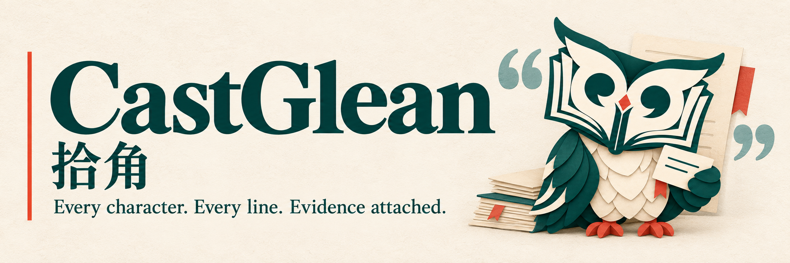
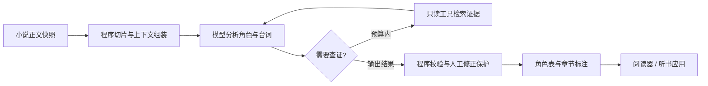

<p align="center">
  
</p>

# CastGlean · 拾角

**从原文拾取线索，让人物与台词有据可循。**

CastGlean 是一个开发中的桌面有声书制作应用。用户围绕小说正文完成角色与朗读分析、选声、生成、试听、修正和导出；模型提出建议，人保留制作决定权。核心能力拆成独立 Rust 包，供桌面应用、辅助 CLI 和其他开发者复用。

*A desktop audiobook production app with reusable Rust analysis packages.*

[桌面产品企划](docs/desktop-studio/README.md) · [当前实施路线](docs/implementation-roadmap.md) · [文档导航](docs/README.md) · [相关先例调研](docs/related-work.md) · [小模型训练规划](docs/training-plan.md) · [数据示例](examples/minimal/README.md) · [品牌](docs/brand.md) · [MIT License](LICENSE)

> **当前可运行的是核心包与 CLI，桌面界面尚未实现。** 已有离线校验、有界模型分析、跨章身份、归属/别名修正、末章重分析、章节恢复与整章/增量交接。独立朗读规划、桌面工程与音频候选恢复仍待开发；协议未冻结，暂未发布可安装的桌面应用。

## 当前开发主线

先做一章的“正文定位 → 生成 → 试听 → 调整 → 比较候选 → 导出与继续”桌面闭环，再增加角色检查、独立演绎规划和连续章节。由具体产品流程暴露缺口，再补齐 CastGlean 核心包或 TaleChime 语音库，并验证对应能力；不等完整基础库路线全部结束才开始做应用。

桌面应用负责工程、任务、选角、候选与导出；分析核心负责原文、身份、归属、朗读意图、校验与人工修正保护；TaleChime 负责语音资源与执行。CLI 是共享核心能力的辅助入口，不与桌面端并列维护另一条产品主线。桌面框架已确定为 Tauri 2，利用 Web 界面与音频组件生态，具体前端和组件待验证；尚未创建桌面工程。详见[技术选型](docs/desktop-studio/technology-choice.md)。

## 已有分析基础

模型分析支持 GLM、[本地 Qwen 服务](docs/local-model.md) 和 [国内 MiniMax](docs/minimax-model.md)。GLM 默认 low 思考和 JSON mode，本地默认关闭思考和 Schema 输出，MiniMax 分离思考与最终文本 JSON；均支持每窗口一次有限校验反馈修复（可关闭）。GLM 还可选择 Schema 或单工具提交，端点约束与样例对照见 [结构化输出验证](docs/structured-output.md)。版本 5 提示词增加证据优先规则；另可显式启用[原文引文模式](docs/quotation-evidence.md)，由程序精确定位并校验引用文字。来源校验不证明归属语义正确。

当前默认/引文提示词版本为 9/10，采用[窗口内短引用](docs/compact-window-references.md)，最终仍保存正式身份、片段 ID、原文摘要和字节范围。[208 次 Qwen/MiniMax/GLM 开发与小说对照](docs/compact-protocol-evaluation.md)已完成：GLM 默认小说组改善，其他后端与引文收益不一致，本地小说仍受输出预算限制。

[连续真实章节验证](docs/continuous-novel-verification.md)已补安全失败窗口与用量诊断、显式目标清单及完整遗漏反馈。修复后的两轮相同冻结三章均完整交付，重复恢复和整书校验通过，首章身份在后两章实际复用。两轮主角称呼候选数分别为 1/2/2、1/1/1，语义正确性未测；完整记录见验证文档，暂不冻结 v1。

提示词变化在本地与线上模型的真实对照见 [归属评测](docs/attribution-comparison.md)；小样本观察不构成真实小说的质量承诺。

[整章消费](docs/chapter-consumption.md)和[增量交接](docs/incremental-delivery.md)已提供可复用的分析消费契约、稳定前缀、宿主背压与取消基础。桌面宿主将按需要使用；已有交接不代表音频候选与桌面工程恢复已实现。

此前的独立 TaleChime 联调原型已退役，源码已迁出当前仓库；结论与失败边界保留在[历史记录](docs/history/talechime-prototype/README.md)。后续由桌面应用直接组织两个基础库的能力，不再维护独立有声书集成 CLI。

## 为什么做

小说里同一个人可能叫“张三”“老张”或“张掌柜”；一句台词也可能没有直接点明说话人。多角色听书需要先识别这些关系，再把稳定的角色身份交给语音后端。

CastGlean 希望把这层分析做成独立、可检查、可修正的工具。角色表由应用保存，模型每次只读取必要上下文；更换模型或 TTS 后端时，角色身份和用户修正能够继续使用。

项目以桌面有声书应用为主要交付，将通用能力保留在独立 Rust 包中。桌面端、辅助 CLI 和其他开发者复用相同校验与工作流；核心不绑定界面、阅读器或具体语音后端。

优先使用确定性制作流程与有界模型分析。工具循环仅在实际问题与评测证明必要时增加，不作为桌面交付前置。

## 计划提供的能力

已实现能力与用法见 [离线格式与校验](docs/data-format.md)：保存规范化正文、校验人工标注，并通过 library 或 CLI 读取结果。Schema 检查结构，程序额外检查正文摘要、UTF-8 范围、完整覆盖、修订与跨章引用；结构正确不代表归属语义正确。

| 能力 | 设计目标 |
| --- | --- |
| 角色与别名 | 稳定角色 ID；重名或同称呼可以对应多个候选人物 |
| 台词归属 | 区分旁白、对话、心理活动和引述文本，保留未知或歧义 |
| 跨章记忆 | 角色事实与证据按章节保存，每次重建相关上下文 |
| 人工修正 | 修正拥有最高优先级，重新分析不静默覆盖 |
| 声音画像 | 可选、带证据的年龄段、性别和声线印象；缺失允许未知 |
| 模型接入 | 已接入 genai/GLM、本地 mistral.rs/Qwen 及国内 MiniMax 服务 |
| 有限工具循环 | 查询角色、阅读前文、检索证据；限制次数与作用域 |
| 持久化与恢复 | 版本化 JSON、缓存失效、执行记录和 checkpoint |

上表描述完整产品目标；单章固定分析、[跨章最小闭环](docs/cross-chapter.md)及[章节级恢复](docs/run-recovery.md)已可用，跨运行缓存、独立发布与工具检索继续按路线图推进。

## 从原文到标注



程序负责原文、ID、范围、校验和提交；模型负责语义判断。模型引用程序分配的片段 ID，不自行计算 UTF-8 字节偏移或改写朗读正文。

固定工作流是首条实现路径。工具循环作为后续可选模式，使用相同评测集对照准确率、未知比例、延迟和成本。

## 输出格式

采用自研 JSON，先满足本项目及使用方的需求。格式尚未冻结，不宣称兼容其他标注标准。

| 产物 | 用途 |
| --- | --- |
| `characters.json` | 角色 ID、姓名、别名、证据、修订和可选声音画像 |
| `<chapter>.annotations.json` | 正文哈希、片段范围、表达类型、角色归属和分析来源 |
| `<chapter>.txt` | 标注对应的不可变 UTF-8 正文快照 |

例如正文 `张三说：“走吧。”` 可以表达为：

| 片段 | 类型 | 归属 | UTF-8 字节范围 |
| --- | --- | --- | --- |
| `张三说：` | `narration` | 叙述功能，不将提到的张三设为旁白说话人 | `[0, 12)` |
| `“走吧。”` | `speech` | `char-001` → 张三 | `[12, 27)` |

查看 [完整示例文件](examples/minimal/README.md)。这些示例由人工构造，不是模型分析结果。

几个核心约定：

- 字节范围从 0 开始、左闭右开，并绑定明确的正文版本。
- 角色身份与旁白/对话功能分开；未知说话人不存成旁白。
- 同一个别名可对应多个角色，不能仅凭名称相似就合并。
- 标注不改变原文；角色事实、归属和声音画像均可附证据。
- 声音画像不包含后端音色 ID，也不根据名字猜测人物属性。

## 与 TaleChime、CLI 和其他使用方的关系

桌面宿主调用 CastGlean 分析包与 TaleChime 语音库，保存选角、实际生成配置、候选及采用关系。具体声音和 TTS 参数不进入角色分析协议；缺少能力时到对应基础库补齐并验证。

CLI 继续作为自动化、诊断与开发者复用入口。其他阅读器（包括 [TRNovel](https://github.com/yexiyue/TRNovel)）可以后续消费核心包，不作为当前首个使用方或交付验收目标。

## 路线图

- [x] 原文快照、草案 JSON/Schema、校验与离线样例。
- [x] 有界角色分析、模型适配及独立评测基础。
- [x] 跨章身份、最小人工修正、末章重分析和章节级恢复。
- [x] 整章/稳定前缀分析交接；原独立语音联调保留历史结论。
- [ ] **P0 — 桌面单章闭环**：正文定位、选声、生成、试听、候选、导出和工程继续。
- [ ] **P1 — 角色检查**：原文依据、归属修正、真实台词选声和同模型多音色。
- [ ] **P2 — 独立演绎规划**：场景/段落意图、人工覆盖、后端映射和有/无规划试听。
- [ ] **P3 — 连续章节**：任务队列、依赖失效、批量变更与可靠恢复。

阶段验收和缺口处理见[当前实施路线](docs/implementation-roadmap.md)。跨运行缓存、任意旧章重分析、完整身份编辑、协议冻结与基础库发布按具体需求推进；可选工具增强和外部阅读器集成均不作为桌面启动前置。

## 开始参与

当前可以克隆仓库阅读企划和示例：

```bash
git clone https://github.com/yexiyue/castglean.git
cd castglean
```

安装 Rust stable 工具链及本地平台链接工具后，可以运行当前骨架：

```bash
cargo run -- --help
cargo run -- --version
cargo run -- validate --characters examples/minimal/characters.json --annotations examples/minimal/chapter.annotations.json --source examples/minimal/chapter.txt
cargo run -p castglean-core --example validate_sample
cargo run -p castglean-core --example analyze_offline
cargo test --workspace --all-targets --locked
```

目录、技术栈和完整检查命令见 [工程说明](docs/engineering.md)，离线入口见 [格式与使用说明](docs/data-format.md)。`analyze` 已实现（见 [模型分析用法](docs/model-analysis.md) 和 [阶段 B 基线](docs/stage-b-baseline.md)）；`inspect`、`correct` 和整书 `validate --book-file` 已实现，见 [跨章用法](docs/cross-chapter.md)；`run`、`resume` 和 `run-inspect` 已实现，见 [运行恢复](docs/run-recovery.md)；`validate` 继续支持显式文件输入，协议仍为草案，首个对外发布前再冻结 v1。

欢迎通过 Issue 讨论中文台词归属、别名冲突、人工修正和格式设计，也欢迎提供允许公开分发的小型测试场景。后续评测将分别记录归属准确率、未知比例和原文完整性，不以 JSON 格式正确代替语义正确。

## 品牌

**Cast + Glean**：故事中的人物，与从文本中拾取线索。中文名“拾角”表示从文字里找回人物身份。

吉祥物“拾拾”是一只纸页猫头鹰，书页轮廓与引号眼睛呼应阅读和台词，证据卡代表可追溯的判断。

<p align="center">
  
</p>

品牌色、使用规范和生成提示词见 [品牌文档](docs/brand.md)。

## 许可证

[MIT](LICENSE)。仓库中的品牌图片由 AI 辅助生成，生成记录随仓库保存；第三方模型和语料遵循各自许可证，本仓库不附带模型权重或完整小说；评测中的精选公有领域片段保留出处及许可说明。
