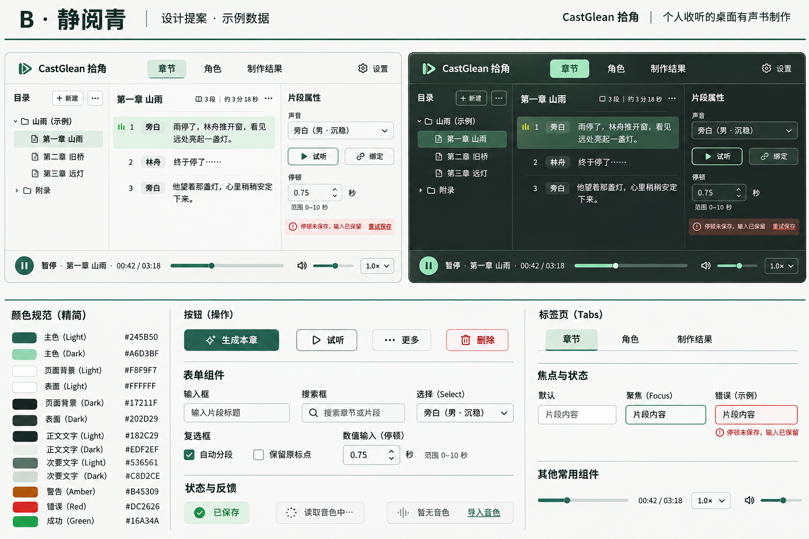

# 静阅青设计系统方案

日期：2026-11-13。状态：用户已选择静阅青方向；本文件是设计与实施方案，尚未修改产品 CSS、组件、lint 或行为规格。产品事实见 [PRODUCT.md](../../PRODUCT.md)，当前实现以根 README、源码和 OpenSpec 为准。

## 已确认方向与图片边界

采用静阅青：浅色以近白阅读面和深青主行动组成，暗色以墨绿工作面和浅青主行动组成；两种主题使用同一套组件、层级和交互语义。色彩、尺寸和状态集中管理，未来更换主题不重写页面。

图片由 image_gen 生成，提示词与用户选择记录保存在[同名 sidecar](../../assets/brand/design-system/quiet-green-concept.png.json)。图片只确认色彩和组件风格方向，不是页面功能清单或真实运行截图。实施时去掉生成器的渐变、材质感和临时 logo，沿用正式品牌资产；不照搬未经规格确认的设置项、全局保存按钮或文字。数值以下面的 token 表为准，不从图片采样。

## 体系与代码边界

推荐组合为 **Tailwind v4 语义 token + shadcn/Base UI 共享组件 + CVA 变体 + Typeset 内容排版 + Biome 静态约束**。调研、工具边界及实验证据见[配套研究](../research/tailwind-design-system-governance.md)。

- 主题值与语义映射仍以 `src/index.css` 为唯一运行时来源，按需要拆成其显式导入的 CSS 文件，不维护手抄的 JSON/TS/CSS 三份色表。
- 优先保持现有 shadcn 名称：`background`、`foreground`、`card`、`popover`、`primary`、`secondary`、`muted`、`accent`、`border`、`input`、`ring` 及对应 foreground。
- 角色颜色、播放、当前选择、错误和运行中分别具有语义，不能因为当前恰好颜色相近就合并。主题主色不承担成功状态的全部含义。
- 页面组合共享组件；外观变化通过 `variant`、`size` 或领域状态参数进入。`className` 主要表达布局，不覆盖按钮的颜色、圆角、字重、内边距和焦点。
- 新组件先查 `src/components/ui/`，再查匹配 Base UI 的 shadcn 组件；已有能力不足才新增。正文、目录虚拟化和音轨不是通用控件的机械替换对象。

## 色彩角色

以下核心色值对应用户选择的方向；完整边框、hover、disabled、焦点和叠色在共享组件样本中补齐后才成为已验证 token。使用 `@theme inline` 映射现有语义名，组件不使用 `green-700` 一类色阶名。

| 语义 | 亮色 | 暗色 | 用法 |
| --- | --- | --- | --- |
| `background` | `#F8F9F7` | `#17211F` | 工作区承托 |
| `card` / `popover` 的基础面 | `#FFFFFF` | `#202D29` | 正文、表单、浮层；必要层级再细分 |
| `foreground` | `#182C29` | `#EDF2EF` | 正文与主要信息 |
| `muted-foreground` | `#536561` | `#C8D2CE` | 次要信息，不隐藏必要状态 |
| `primary` | `#245B50` | `#A6D3BF` | 主要行动与交互色族 |
| `primary-foreground` | `#FFFFFF` | `#132823` | 主行动上的文字、图标 |
| `accent` / `accent-foreground` | 待组件验证 | 待组件验证 | 当前项及悬停承托，和 primary 同色族 |
| `ring` / `input` | 待组件验证 | 待组件验证 | 独立焦点与可识别控件边界 |
| `success` / `warning` / `destructive` / `info` | 独立语义组 | 同名语义组 | 各配弱底、前景与图标/文字，不靠单一颜色判断 |

按 WCAG 相对亮度公式计算：亮色正文/背景 13.89:1、次文字/白表面 6.17:1、主按钮文字/底色 7.81:1；暗色对应 14.56:1、9.24:1、9.36:1。这只验证六组指定纯色组合，不代表透明叠色、焦点、图标、控件边界及完整无障碍已经通过。

换主题时必须同时替换底色、前景、弱底、交互状态和焦点，不能只替换一个 primary 色值后默认整站合格。禁止调用方用 `dark:bg-*` 再维护一套页面颜色。

## 几何、排版与密度

现有 token 名称继续使用。控件/列表项/工作面/浮层的当前圆角为 10/8/12/16px；图中更收敛的圆角作为实施样本比较项，暂不把生成图片的 6/10px 当作已测量的最终标准。最终只改 token 值，不在页面写 `rounded-[7px]` 补丁。

常规交互高度使用现有 `size` 变体，整理为紧凑与常规密度；同排输入、选择器和按钮对齐。布局使用既定间距阶梯，组件内边距归共享组件，不由每个页面重新设定。图标继续使用 Lucide，不替换为生成图中的装饰符号。

排版分三个责任区：

| 区域 | 方案 | 约束 |
| --- | --- | --- |
| 导航、工具栏、按钮、表单 | 共享组件中的命名文字样式与有限 size 变体 | 不用 Typeset 改控件尺寸；数字与时间用等宽数字 |
| 助手 Markdown 与说明文档 | 引入官方 Typeset CSS，分别定义 `typeset-chat`、`typeset-docs` | size、leading、flow 由预设与 token 决定；宽度归容器；嵌入工具卡用 `not-typeset` |
| 小说原文阅读器 | 保留原文渲染与坐标系统，共享命名的正文字号、行高及字体 token | 不把原文作为 Markdown 渲染；不破坏空白、行号、跨块选区和 UTF-8 映射；字号变化后重测虚拟高度与阅读锚点 |

Typeset 先在现有 `MessageResponse` / Streamdown 上做兼容验证；查清已有 utility 与 `.ai-message-response` 规则的优先级后合并，不能在两套样式上继续叠覆盖。流式表格、代码、链接、中英文换行与工具卡分别验收。

## 组件与交互统一

| 范围 | 优先复用 | 统一契约 |
| --- | --- | --- |
| 行动 | Button、CVA 既有 variant/size | 主行动有限；危险动作分离；忙状态说明正在做什么；禁用附近说明缺失条件 |
| 表单 | Field、Input、InputGroup、Select、Checkbox、RadioGroup、Switch | label、description、error 关联；错误保留输入；保存时机明确；选择与立即执行分开 |
| 停顿 | 数字输入与 Slider；缺少数字原语时评估 Base UI Number Field | 秒与 0–10 范围可见；暴露值和步长；拖动有键盘替代；不静默钳制无效输入 |
| 资源集合 | 共享搜索、资源行、菜单与必要的分页/虚拟化 | 名称优先，ID 按需；行打开、试听、绑定互不混淆；控件名称带对象 |
| 弹层 | Dialog、AlertDialog、Popover、Sheet | 确认与影响可见；初始/返回焦点明确；嵌套、Escape、独占快捷键统一；不为每次编辑强制弹窗 |
| 状态 | Alert、Badge、Progress、Skeleton、Empty 的统一组合 | 加载、读取失败、空库、无匹配分别展示；按真实可用动作恢复；不全靠 toast |
| 播放与任务 | 当前宿主状态和唯一播放会话 | 播放、选中、生成位置分开；名称与实际动作一致；导航不遗失控制入口 |
| 可调整工作区 | 现有实现与成熟库进行针对性比较 | 最小正文空间、窄窗面板记忆、焦点返回和键盘 resize 是验收条件，不先增加第二套组件栈 |

组件库提供原语，宿主提供业务事实。菜单能关闭不代表配置入口成功；Field 显示红字不代表保存失败已恢复；Progress 能动不代表任务进度真实。

### 表单专项建议

优先统一 Field 分组、标签、帮助、错误与操作区，复用 InputGroup 处理单位及字段内辅助动作，搜索型选择评估 shadcn/Base UI Combobox，数字输入评估 Base UI Number Field。复杂设置表单建议试点 React Hook Form + Zod 管理编辑、校验与提交；简单即时编辑保留轻量状态。该组合尚未选型或安装，不能用状态/校验库替代视觉改进。现状、备选及草稿/保存契约见[表单调研](../research/form-components-and-state.md)。

## 问题清单转为设计验收

以下对应[当前问题清单](../ui-ux-audit/README.md)，不是已完成修复。行为变化实施前落实到对应 OpenSpec。

| 问题 | 方案要求与检查 |
| --- | --- |
| P1-01 | 阻塞处的配置动作确实打开正确分区，返回章节及焦点；鼠标和键盘都验 |
| P1-02 | 明确切章播放策略，播放条始终指明原目标并保留控制；具体策略实施前定案 |
| P1-03 | 读取重试、连接修复、任务继续和未知提交结果分开，不用泛化“重试”替代 |
| P1-04 | 部分导入展示成功与待处理项，返回真实工程地址，刷新可恢复，不重复导入 |
| P1-05、P1-06 | 能力文案来自同一现状；示例复用真实工作台与隔离适配，不维护第二套过时操作 |
| P2-01、P2-02 | 编码样本标位置与重叠；文件级错误带文件名；每项选择/移除名称可区分 |
| P2-03 | 结构确认显示工程、章节、行号和影响，焦点安全；结构撤销与分析撤销分开 |
| P2-04、P2-09 | 不可用原因与解决入口就近显示，资源准备不自动启动生成 |
| P2-05 | 正文和底部播放器的播放/暂停动作、目标与状态一致 |
| P2-06 | 停顿编辑明确自动提交或显式提交的统一策略；校验、失败、关闭与切换时保留草稿 |
| P2-07 | 资源加载、失败、真实为空、搜索无匹配分别提供信息与下一步 |
| P2-08、P2-14 | 音色名、来源和目标可辨认；“试听配置”与“播放”分开；不渲染海量无差别按钮 |
| P2-10、P2-11 | 音色包错误与目录按钮都带文件/目录用途，避免只报序号或泛称 |
| P2-12 | 完成状态有文字或辅助技术可读状态，不只显示隐藏图标 |
| P2-13 | 帮助从当前键位清单和平台生成，名称与实际作用域一致；尚未实现部分不伪装可用 |
| P2-15 | 停顿边界有独立名称、当前值、范围及键盘说明，保留数字输入 |
| P2-16 | 窄窗入口可发现；目录与属性往返有面板记忆与正确名称，不把所有动作压成无说明图标 |
| P2-17 | 共用组件与状态样式；保留有依据的领域交互；动效不承担业务完成条件 |

## Tailwind 纪律与验收门禁

1. 原始色值只在主题定义和指定图形/资产实现边界；页面使用语义 token。禁止用“绿色”名字表达“已保存”。
2. 共享组件外观在其实现/CVA 变体中定义；调用方不随手覆盖颜色、字重、圆角、内边距和动效。布局容器与叶子控件分开审查。
3. 类名使用完整静态字符串与有限映射，不拼接 `bg-${color}`。条件通过现有 `cn`；它只合并类名，不负责保证设计纪律。
4. 接入 Biome 的原始色板、任意值、外观覆盖及动态类名规则；共享组件实现与调用方分开配置，避免规则反过来阻止设计系统定义自己。
5. 波形、播放游标、虚拟列表位置等运行时尺寸允许领域数值；颜色、圆角、字号不借 inline style 绕过 token。例外要具体到属性、位置、原因和验证，不能整目录关闭。
6. 用实际组件和路由验证亮暗×中英×常规/小窗口、焦点、输入法及错误恢复；组件样本是开发验收工具，不新增用户导航中的展示页面。

## 建议实施顺序与完成标准

1. 在对应 OpenSpec 中补齐设计系统契约和迁移任务；先明确保存/关闭、切章播放与窄窗面板等行为决定。
2. 完整主题 token、排版预设和共享组件样本；先验证对比度、焦点和原语行为，再迁移业务页面。
3. 确认 Biome 规则边界与具体例外，在迁移模块启用 error；避免“规则写了但只是 info”的假门禁。
4. 迁移高频章节流程及 P1 问题，再覆盖资源与设置。每处替换保留来源、人工修改、历史音频和任务恢复语义。
5. 对照上表关闭问题并保存真实验收证据。实现完成后才把实际系统整理为根 `DESIGN.md`，同步品牌/工程文档中的被替代规则。

当前批准的是静阅青方向与可替换主题原则。完整组件样式、Typeset 接法、lint 配置和业务行为仍属方案；本次没有把旧问题标为已修复，也没有开始重设计变更的实施任务。
