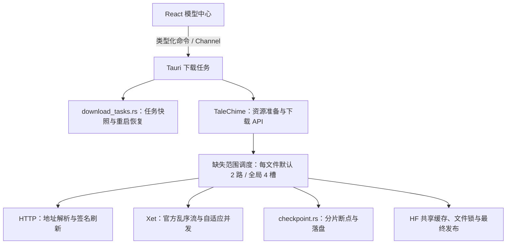

# 模型下载任务、暂停与分片续传

2026-11-05。暂停/任务实现最初配套 TaleChime `3d540e1`；当前传输默认 Auto，消费固定 Git revision 的 hf-hub fork。实现范围为模型资源下载，不加载推理模型，不改变工程选声。

## 职责与模块

前端只发起、暂停、继续、取消并渲染状态，不拼接文件、不保存断点。宿主负责模型任务身份、有序消息、缓存配置隔离、磁盘预检和任务记录。TaleChime 的 `Downloads::with_options` / `DownloadOptions` 负责连接策略；drop future 停止传输，调用方检查 `checkpoint_failed()` 后才能确认暂停已保存。HF 传输内部类型不进入 IPC。

## 用户行为

- 下载中提供“暂停下载”和“取消下载”；暂停后保留字节数、百分比、当前文件，撤回速率与 ETA，并提供“继续下载”。继续直接恢复，不重复弹完整下载确认。
- 暂停先停止并等待原 future 退出，完成断点写入，再确认。写入失败显示磁盘失败，不误报暂停成功。取消停止任务并移除任务记录，保留共享缓存及传输断点。
- 重启后，原下载中和已暂停的记录均显示为已暂停，等待手动继续；不会悄悄联网。Channel 重连快照包含恢复状态，旧任务的迟到消息不能覆盖暂停或重试。
- 缓存目录切换后只加载该目录关联的任务记录，切回可恢复原记录；不复制或删除其他缓存。磁盘事实已就绪时优先展示就绪，旧记录不能覆盖。
- 任务记录为应用配置目录中的 `model-downloads.json`，version 1；记录缓存目录、后端/模型身份与状态，不记录令牌、下载地址或签名 URL。原子替换并同步写入；不覆盖损坏或不支持的记录。

## 传输策略与数据完整性

默认 Auto：文件元数据支持 Xet 时优先使用，否则 HTTP；Xet 服务不可用或网络错误时从有效断点回退 HTTP。取消、内容校验失败、磁盘错误或 Hub 鉴权拒绝不会触发普通网络回退。SDK 提供 Auto / Http / Xet 显式选项，默认每文件并发 2 个缺失范围，允许 1–4。每个模型最多同时准备两个文件；所有客户端共享 4 个范围执行槽，Xet 在范围内自行并发取压缩块。HTTP 的完整文件 200 响应可直接消费；对续传 Range 的忽略则清理已记录前缀并重新读取。

分片记录独立于文件长度：临时文件可能是稀疏文件，不能按长度推断完成。`.incomplete.ranges.json` 记录版本、内容 ETag、总大小、4 MiB 分片大小和各片已同步的连续前缀。Xet 块按真实偏移写入，覆盖计算防止乱序和重复抬高进度；未接齐的离散片段只在内存保留，继续时可重新请求。周期性同步数据并原子保存断点；暂停 drop 时补存有效前缀。没有断点标记的旧临时文件不按长度视为有效数据。

HTTP 检查 206、Content-Range 与响应长度，片段瞬时错误有界重试；连接/读超时为 15/90 秒。Xet 初始化最多 15 秒，取得执行槽后首片段最多 30 秒、后续片段 90 秒。超时不无限重试。排队和最终校验不按整个文件是否增长判定超时。

每文件复用解析后的数据地址，避免每个分片再请求 Hub；签名过期时串行刷新，重新核对 ETag 和总大小。跨 origin 删除凭据，不允许 HTTPS 降级。断点不保存签名地址。文件大小匹配且可用的 64 位 SHA-256 ETag 校验通过后才发布缓存 blob 与引擎布局；暂停、取消、错误或校验失败都不发布半成品。

## 验证与范围

- TaleChime：27 项普通单元、5 项本地 Hub 集成、5 项实际流式分片集成。覆盖跨客户端全局上限、暂停/新客户端恢复、稀疏文件、Range 不支持回退、错误范围、损坏内容、503 重试、过期地址刷新、身份变更拒绝、断点写入失败可见。
- 宿主：38 项普通测试与 specta 导出。覆盖下载中重启恢复为暂停、缓存隔离、损坏记录不覆盖、暂停与继续的任务身份、迟到进度拒绝。
- macOS 隔离调试包 `com.yexiyue.castglean.download-task-qa` 通过本地可控 HTTP 响应验证操作：约 134 MB 暂停 → 退出应用 → 重启仍暂停并显示 134 MB → 手动继续 → 增长到约 200 MB → 再次暂停。该组是状态与恢复验收，响应为测试数据，不是模型可用性证据，不使用用户共享缓存。
- 真实公网对照为同一固定 MOSS Realtime 权重、每次独立缓存、8 MiB 目标、最多 30 秒，顺序 1/2/4/4/2/1；六次均有真实数据。完整模型与推理未验证，Windows 新交互待实机确认。结果见兄弟库 `docs/records/downloads/parallel-download-acceptance-2026-11-05.md`。

两仓相关 fmt、Clippy、rustdoc、前端构建、Lingui 严格编译通过。hf-hub 补丁现已迁至独立 fork，以固定 Git revision 消费；来源、范围和发布限制见 TaleChime 的 `docs/knowledge/hf-hub-fork.md`。原验收未发布 SDK 或推送远端，后续依赖迁移另行记录。

Auto 补充验证：固定 90.9 MB 文件在官方/镜像入口实际选择 Xet，约 12.4 / 14.8 秒完成且哈希正确；真实暂停 23.8 MB 后，新客户端继续并完成校验。屏蔽 Xet 的受控入口成功回退真实 HTTP 下载。MOSS 4.66 GB 权重经应用相同进度桥约 10.19 秒报告 67.1 MB，按预算停止。SDK 本地集成新增默认 Auto 回退覆盖，宿主 38 项测试继续通过；详情见 TaleChime 的 `docs/records/downloads/xet-auto-fallback-2026-11-05.md`。

最终真实 Channel 验证要求当前文件为 `model.safetensors`、累计字节超过 8 MiB 且速率/ETA 为正，避免配置文件提前满足条件。10.48 秒内收到累计 67,095,785 字节、约 13.4 MB/s 和 872 秒 ETA 后停止；这是当时的窗口估算，不是完整模型下载验收或完成时间承诺。使用隔离缓存并已清理。

完成合成响应验收后，已移除我们生成的隔离合成缓存及其一条任务记录。检查窗口时发现验收包设置已切换为官方源与默认共享缓存，另一次真实任务报告约 4.68 GB；已先暂停再更新程序，保留该真实任务记录和缓存，不改动当前用户设置。这一观察不是受控测速，也不证明整模型已完成。
