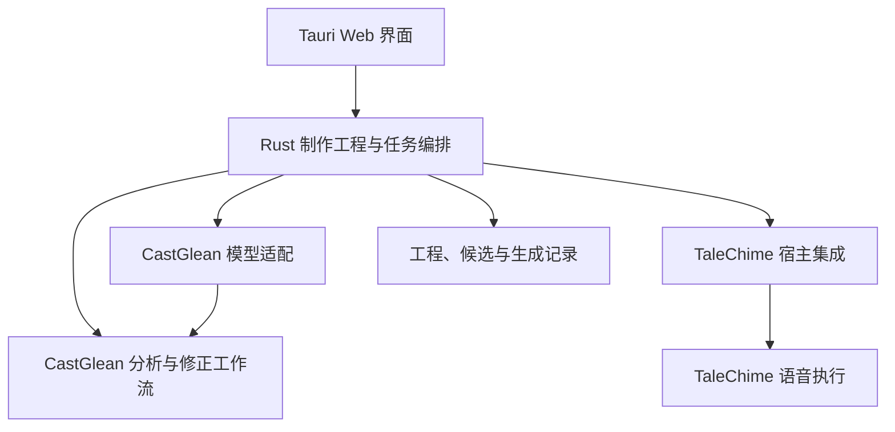

# 执行边界与实施路线

2026-11-11 章节音频增量：第一阶段（已有分析与绑定 → 整章音频）已按 [`chapter-audio-generation`](../../openspec/changes/chapter-audio-generation/proposal.md) 实现。宿主构建带来源映射的合成单元（句读切分，单元不超过 120 字符）、集中报告生成前阻塞，在引擎专用线程顺序合成并逐单元持久化，全部成功后拼接整章；首期限定同一模型的预置音色。自动化门禁通过，真实 Kokoro `1.1-zh` 多音色整章已在宿主层验证；同日按用户真实生成失败补齐执行文本规范化（引擎前端拒绝单元内换行与集合外符号）、失败详情落库（`error_detail`）与同指纹断点续跑并复验。**真实原生窗口系统验收尚未执行**（用户日常应用已提供进度/失败/定位的部分窗口证据），命令层、互斥与界面交互证据不全，见[验收记录](chapter-audio-validation.md)。自动重试、修正后重做、采用与导出仍属下一阶段。

2026-11-10 审查增量：声音绑定与角色中心、选角会话入口及按运行思考档位已完成本轮审查修复；证据冻结、任务互斥和配置传递见[审查决定](../knowledge/decisions/voice-binding-review.md)。macOS 原生公开样例已用配置的 GLM 完成选角与推理/重试验收，并用 VoxCPM Metal 完成设计入库绑定与重启恢复；建议撤回和显式忽略仍缺实现，不能宣告规格全部通过，见[真实验收](voice-binding-acceptance-2026-11-10.md)。

工程助手与分章/章节归属分析专业任务共用子Agent执行设施；上下文隔离、宿主派发、恢复和评测边界见[专业任务决定](../knowledge/decisions/professional-ai-tasks.md)。

2026-11-09增量：章节归属分析正式使用Rig Agent与紧凑工具协议，具备只读预审、阶段恢复、可观测与正式代码评测；思考强度按供应商能力默认最低且前端可调，见[接入与验证](../knowledge/decisions/chapter-agent-production.md)。

日期：2026-10-31。状态：设计建议与验收顺序，不是当前实现承诺；桌面框架已确定采用 Tauri 2，详见[技术选型](technology-choice.md)；本文不冻结数据 Schema。

## 职责与依赖

2026-11-08 交付增量：统一三图标工程外壳、单一章节目录/正文与工程 AI 助手；结构检查和归属分析按任务调用不同能力。切章保留阅读上下文、会话和草稿，每次运行固定自己的目标。宿主上下文与 SQLite v3 迁移保留旧历史，领域校验和人工保护继续独立，见[单一助手决定](../knowledge/decisions/unified-project-assistant.md)与[融合验收](project-assistant-validation.md)。此为当时状态；声音绑定现已完成主链验收，章节音频仍待实现，当前优先级以下方分阶段交付为准。

- 分析核心管理不可变来源、身份、归属、朗读意图、校验和人工修正规则，不依赖 UI、具体音色或 TTS 参数。
- 模型适配处理显式配置、请求和服务能力；同一服务可支持不同分析任务，但不能只换提示词而复用错误的 Schema 或工具提交协议。
- 桌面宿主管理工程、选角、语义到实际参数的映射、任务调度、音频候选与导出。原独立集成包已退役；参考历史经验，按应用需求接入两个基础库，不维护另一套独立集成产品。
- TaleChime 执行资源准备和语音生成，提供实际能力、进度与音频；宿主不能推测缺失事件已经发生。

以桌面应用为主要交付，当前分析在单一 Rust 宿主 crate 内按领域模块组织；独立核心包或其他消费者只在具体需求出现后评估。开发从实际界面流程出发，缺少通用语义时补到对应模块并验证；UI 不复制校验和修正逻辑，核心复用宿主运行时。辅助分章验证引入 graph-flow 作为宿主私有的外层检查点编排；模型调用使用 Rig，确定性逻辑仍由应用模块负责。不增加 HTTP 服务或公共节点 SDK。

## 工程中的概念关系

建议区分来源、角色标注、朗读规划、声音绑定、生成配置、执行尝试、候选音频和采用关系。它们是领域概念，不是已确定的目录布局或 JSON 类型。

每次生成保留实际输入与依赖版本；每个候选绑定不可变来源范围、实际有效配置及执行身份。当前选用哪个候选由独立采用关系表达，不通过覆盖同一个音频文件实现。

正文范围、标注片段、合成单元和音频时间范围不是天然一一对应。宿主保存显式映射，覆盖 TTS 切段、预处理与上下文。没有精确对齐能力时只提供范围级定位。

## 修改与失效

| 修改 | 分析与规划影响 | 音频影响 |
| --- | --- | --- |
| 切换试听位置或显示视图 | 无 | 无 |
| 修改音色或合成参数 | 通常不重跑文本模型 | 相关合成单元产生待生成配置 |
| 修改段落表达 | 更新对应人工覆盖；必要时重算执行映射 | 相关单元与依赖上下文需重新生成 |
| 修改一句归属 | 更新归属修订，检查相关规划依赖 | 受声音或表达变化影响的单元失效 |
| 修改角色身份关系 | 可能影响跨章上下文，须显式计算传播 | 检查所有受影响的绑定与片段 |
| 更换分析模型或提示词 | 产生新建议与差异，不覆盖人工确认 | 采用差异后才确定受影响范围 |
| 更换正文 | 新来源版本，重新验证坐标与引用 | 旧候选保留历史身份，不直接挂到新正文 |

失效表示不再匹配当前制作设置，不等于立即删除旧结果。用户仍可试听旧候选；导出前说明是否使用旧配置音频。无法可靠缩小影响范围时，采用可解释的保守范围。

角色和规划的重新分析先展示新增、变化、冲突与保持不变的结果，用户修正受保护。字段级人工保护与版本合并需要明确契约，不能从现有“整个片段确认保护”推定已经支持。

## 状态与任务

分析执行、语义检查、音频执行和采用关系分别记录。不要用一个“已完成”同时表示模型成功、人工正确、文件已保存与音频已选用。

建议任务状态包括排队、执行、取消中、已取消、失败和成功。成功以任务对应产物安全保存为边界，部分产物另行记录。取消先停止接收新工作并拒绝迟到提交；底层请求无法立即中断时如实展示，不假报资源已经释放。

每个任务绑定来源版本、预期修订、配置指纹和执行尝试；按项目序列化冲突提交。旧任务不能写入新修订。UI 事件丢失或重启后可从权威状态恢复，内存通知不作为唯一完成证据。

任务进度保留实际阶段和度量。合成耗时、资源准备、排队、文件写入和音频时长分别记录；用量缺失不计作零，不将重试成本默认为免费。

## 保存、恢复与导出

当前增量：整书导入与辅助分章的主链已改用本地数据库、不可变来源和通用 AI 会话；工程按本地 id 打开，提交自动保存。旧便携容器及 Recovery 路径已移除，用户旧文件不迁移或删除。此次重构的自动检查已通过，真实桌面回归进行中；证据与平台边界见[存储重构验证记录](../knowledge/lessons/local-storage-windows-validation.md)。章节分析、选角、合成与音频导出不在此次分章变更中。

工程记录持久化来源引用、修订、选角、规划、候选与采用关系。临时音频与正式候选有明确发布边界：文件未完整写入时不能标记可用；候选发布成功后才能用于采用和导出。

恢复时核对文件、来源、修订和配置，辨认完成、部分完成与待重新执行的任务。避免恢复重复发布同一候选；外部模型请求仍可能重复，具体检查点粒度必须说明。

现有分析具有领域阶段/窗口恢复，旧原型的“完整章节提交”边界不再描述当前分析；这些检查点仍不能等同于尚未实现的音频合成单元恢复。新增存储需要中断位置与故障注入验证，不能只验证正常关闭重开。

章节导出使用明确的采用版本集合，检查覆盖、顺序、格式与失效状态。导出任务生成独立文件，避免覆盖仍可恢复的候选。私人文本、音频、凭据与权重继续保存在忽略目录或用户指定目录。

## 分阶段交付

2026-11-10 用户决定：本节替代原“先单人旁白宿主、后补角色”和“先助手短试听切片”的顺序。角色分析及声音绑定已有基础，直接进入整章生成；详细边界见[决定](../knowledge/decisions/chapter-generation-first.md)。第一优先已于 2026-11-11 实现、待原生窗口验收（见文首增量）；其余音频能力仍待实现。

### 第一优先：已有分析与绑定 → 整章音频

输入为当前采用的章节分析、不可变正文及旁白/角色声音绑定。宿主核对覆盖/顺序和资源，冻结有效配置；按模型长度限制组织有来源映射的合成单元，顺序调用 TaleChime，保存各单元音频并按章连续播放。首个交付固定一个已验证模型组合，支持其中多音色，不依赖新 Agent 推理或情绪规划。

最小界面：直接“生成本章”、集中阻塞项、真实阶段/已完成单元、取消、失败位置与播放结果。没有可靠总量不伪造百分比。未知归属、缺声音或资源不兼容必须解决或明确选择回退；不强制逐句确认，不静默改写归属。

验收：真实一章按正文完整且顺序正确生成；可连续听及查看来源/配置，切章不改任务目标；失败不丢已完成片段，重启识别已保存/未完成且不自动再次调用后端；有缺口不报告整章成功。实施前先落实独立章节音频 OpenSpec。

### 紧接补齐：可修正、可采用、可导出的单章闭环

范围：显式重试失败单元，修改归属/音色后按安全合成单元重做，保留旧候选、显式采用、完整性/过期检查与独立 WAV 导出。先提供单元范围定位，不承诺字级对齐或任意选区独立替换。

验收：修正一处错误后能听见对应变化，无关已完成单元不重复执行，旧满意版本可保留；导出采用集合完整且顺序正确；关闭重开后文件与采用关系一致。

### 随后：助手工具卡与交互减负

范围：一个助手调用既有领域工具及专业子 Agent；分歧卡采集决定，生成工具卡显示真实进度、直接播放和生成信息。先复用已经交付的章节生成/产物用例，再补跨步骤目标推进；现有短试听是补充能力，不是优先于整章的交付目标。

验收：直接按钮和对话入口指向同一宿主任务，等待用户可恢复且不占执行资源；不强迫聊天，不重复确认已授权步骤。比较真实任务中的入口发现、阻塞处理、后台切换、播放和改错路径，记录观察后再调整布局。方案见[助手提案](../../openspec/changes/assistant-guided-production/proposal.md)。

### 后续：可靠批量与表达质量

连续章节/整书队列、暂停恢复、角色级变更和依赖失效在单章稳定后推进。发音修正、独立朗读规划及多后端比较分别立规格；issue #3 的契约和评测可以提前准备，完整演绎不成为首章生成前置。

验收：多章声音稳定、失败和中断可解释、无重复发布；结构、归属、跨片段衔接与主观听感分别验证。身份合并/拆分、任意旧章重分析仍按独立语义补齐。

### 后续探索

自由节点、公共插件、插图、配乐、多媒体和其他消费者按明确需求论证，不扩展当前章节交付。工具化保留为能力接入方式，不提前建设通用 Agent/插件平台。

## 待决策项

- 首个章节生成组合已定为同一模型的预置音色（Kokoro `1.1-zh` CPU 已在宿主层验证，Metal 与 g2pW 变体未验）；分发平台、整章播放的原生窗口验收和发布包仍待完成。
- 首个后端/模型与资源准备体验，依据当前设备、实际质量和分发条件决定。
- 工程布局、版本与迁移；候选音频的磁盘预算、清理与删除规则。
- 首版可局部替换的最小安全单元及前后文试听范围。
- 分析何时暂停检查、批量生成初稿的默认行为及导出提示。
- 完整身份编辑与任意旧章重分析的依赖和实施顺序。
- 移动端伴随：带章节标记的导出是否足以覆盖收听场景、何时需要伴侣应用。
- TRNovel 集成：听书能力以何种形态（库、导出或服务）供阅读器使用及启动时机。

这些决策在对应阶段前完成，不扩展为当前文档任务中的实现工作。后续变更持续维护当前路线与状态，按项目要求运行相关测试、fmt、Clippy、rustdoc，并补齐新增界面与中断恢复验证。

## 2026-11-05 音色中心增量

章节 P0 之前已落地独立音色生产接入：基础库无提交候选、七类后端与四类设计适配的真实目录、候选确认入库、原始参考与模型试听、资源任务 v2 和音色名称/删除管理。它们为章节选声准备资产，不等于章节分析、角色绑定持久化或章节导出完成。资源、编译与真实生成分别验收，见[音色中心验证](voice-center-validation.md)。

## 2026-11-05 原生成品准备

Kokoro 普通中文/g2pW、CosyVoice3 与 IndexTTS 已接入固定成品配方，终端用户直接下载/校验。模型中心提供计划、实际下载量、转换需求、保守峰值空间、阶段快照与协作取消；旧下载日志原样保留，新准备日志不会重启自动执行。SDK 8 个 CPU/Metal 合成组合及 Kokoro 桌面波形试听通过；资源就绪、数值对照、人工听感和其他平台仍分层验收。当前工作区结果不替代旧音色中心剩余验收，未发布新 SDK/应用。

## 2026-11-08 章节归属增量

角色/旁白/台词/内心独白归属、不可变原文证据、人工修正及重分析候选已接入真实项目路由和宿主。自动化与 macOS 原生公开样本闭环已通过；原生发现的 Schema/prompt 声明约束和撤回选中状态问题已修复并复验，模型质量/成本及其他平台边界见验收记录。演绎规划、选角和音频制作不属于此增量。实现与模型/原生验证状态见[章节归属验收](chapter-analysis-validation.md)及[规格任务](../../openspec/specs/chapter-attribution-analysis/spec.md)。

## 2026-11-08 单一工程助手增量

分章与归属不再提供两套页面/助手，统一目录、原文、工程级会话和按需检查器。宿主冻结每次任务的上下文；同一 Agent 使用结构工具或受理章节分析，再复用原有归属流水线与人工候选保护。旧会话只读保留，SQLite v3 事务升级。实现和证据边界见[融合验收](project-assistant-validation.md)，不沿用上一轮双模式验收作为新交互的证明。
