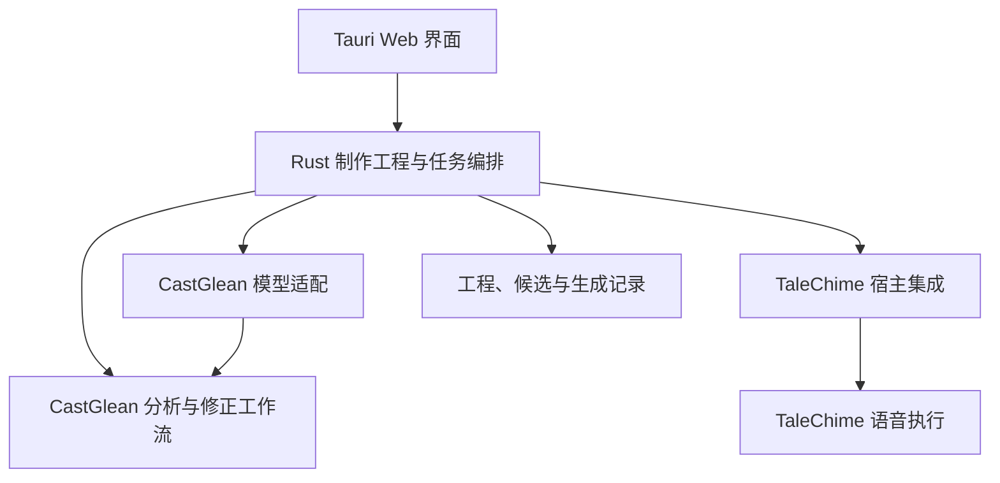

# 执行边界与实施路线

2026-11-10 审查增量：声音绑定与角色中心、选角会话入口及按运行思考档位已完成本轮审查修复；证据冻结、任务互斥和配置传递见[审查决定](../knowledge/decisions/voice-binding-review.md)。macOS 原生公开样例已用配置的 GLM 完成选角与推理/重试验收，并用 VoxCPM Metal 完成设计入库绑定与重启恢复；建议撤回和显式忽略仍缺实现，不能宣告规格全部通过，见[真实验收](voice-binding-acceptance-2026-11-10.md)。

工程助手与分章/章节归属分析专业任务共用子Agent执行设施；上下文隔离、宿主派发、恢复和评测边界见[专业任务决定](../knowledge/decisions/professional-ai-tasks.md)。

2026-11-09增量：章节归属分析正式使用Rig Agent与紧凑工具协议，具备只读预审、阶段恢复、可观测与正式代码评测；思考强度按供应商能力默认最低且前端可调，见[接入与验证](../knowledge/decisions/chapter-agent-production.md)。

日期：2026-10-31。状态：设计建议与验收顺序，不是当前实现承诺；桌面框架已确定采用 Tauri 2，详见[技术选型](technology-choice.md)；本文不冻结数据 Schema。

## 职责与依赖

2026-11-08 交付增量：统一三图标工程外壳、单一章节目录/正文与工程 AI 助手；结构检查和归属分析按任务调用不同能力。切章保留阅读上下文、会话和草稿，每次运行固定自己的目标。宿主上下文与 SQLite v3 迁移保留旧历史，领域校验和人工保护继续独立，见[单一助手决定](../knowledge/decisions/unified-project-assistant.md)与[融合验收](project-assistant-validation.md)。音色绑定和章节音频制作仍属于后续阶段。

- 分析核心管理不可变来源、身份、归属、朗读意图、校验和人工修正规则，不依赖 UI、具体音色或 TTS 参数。
- 模型适配处理显式配置、请求和服务能力；同一服务可支持不同分析任务，但不能只换提示词而复用错误的 Schema 或工具提交协议。
- 桌面宿主管理工程、选角、语义到实际参数的映射、任务调度、音频候选与导出。原独立集成包已退役；参考历史经验，按应用需求接入两个基础库，不维护另一套独立集成产品。
- TaleChime 执行资源准备和语音生成，提供实际能力、进度与音频；宿主不能推测缺失事件已经发生。

以桌面应用为主要交付，当前分析在单一 Rust 宿主 crate 内按领域模块组织；独立核心包或其他消费者只在具体需求出现后评估。开发从实际界面流程出发，缺少通用语义时补到对应模块并验证；UI 不复制校验和修正逻辑，核心复用宿主运行时。辅助分章验证引入 graph-flow 作为宿主私有的外层检查点编排；模型调用使用 Rig，确定性逻辑仍由应用模块负责。不增加 HTTP 服务或公共节点 SDK。

## 工程中的概念关系

建议区分来源、角色标注、朗读规划、声音绑定、生成配置、执行尝试、候选音频和采用关系。它们是领域概念，不是已确定的目录布局或 JSON 类型。

每次生成保留实际输入与依赖版本；每个候选绑定不可变来源范围、实际有效配置及执行身份。当前选用哪个候选由独立采用关系表达，不通过覆盖同一个音频文件实现。

正文范围、标注片段、合成单元和音频时间范围不是天然一一对应。宿主保存显式映射，覆盖 TTS 切段、预处理与上下文。没有精确对齐能力时只提供范围级定位。

## 修改与失效

| 修改 | 分析与规划影响 | 音频影响 |
| --- | --- | --- |
| 切换试听位置或显示视图 | 无 | 无 |
| 修改音色或合成参数 | 通常不重跑文本模型 | 相关合成单元产生待生成配置 |
| 修改段落表达 | 更新对应人工覆盖；必要时重算执行映射 | 相关单元与依赖上下文需重新生成 |
| 修改一句归属 | 更新归属修订，检查相关规划依赖 | 受声音或表达变化影响的单元失效 |
| 修改角色身份关系 | 可能影响跨章上下文，须显式计算传播 | 检查所有受影响的绑定与片段 |
| 更换分析模型或提示词 | 产生新建议与差异，不覆盖人工确认 | 采用差异后才确定受影响范围 |
| 更换正文 | 新来源版本，重新验证坐标与引用 | 旧候选保留历史身份，不直接挂到新正文 |

失效表示不再匹配当前制作设置，不等于立即删除旧结果。用户仍可试听旧候选；导出前说明是否使用旧配置音频。无法可靠缩小影响范围时，采用可解释的保守范围。

角色和规划的重新分析先展示新增、变化、冲突与保持不变的结果，用户修正受保护。字段级人工保护与版本合并需要明确契约，不能从现有“整个片段确认保护”推定已经支持。

## 状态与任务

分析执行、语义检查、音频执行和采用关系分别记录。不要用一个“已完成”同时表示模型成功、人工正确、文件已保存与音频已选用。

建议任务状态包括排队、执行、取消中、已取消、失败和成功。成功以任务对应产物安全保存为边界，部分产物另行记录。取消先停止接收新工作并拒绝迟到提交；底层请求无法立即中断时如实展示，不假报资源已经释放。

每个任务绑定来源版本、预期修订、配置指纹和执行尝试；按项目序列化冲突提交。旧任务不能写入新修订。UI 事件丢失或重启后可从权威状态恢复，内存通知不作为唯一完成证据。

任务进度保留实际阶段和度量。合成耗时、资源准备、排队、文件写入和音频时长分别记录；用量缺失不计作零，不将重试成本默认为免费。

## 保存、恢复与导出

当前增量：整书导入与辅助分章的主链已改用本地数据库、不可变来源和通用 AI 会话；工程按本地 id 打开，提交自动保存。旧便携容器及 Recovery 路径已移除，用户旧文件不迁移或删除。此次重构的自动检查已通过，真实桌面回归进行中；证据与平台边界见[存储重构验证记录](../knowledge/lessons/local-storage-windows-validation.md)。章节分析、选角、合成与音频导出不在此次分章变更中。

工程记录持久化来源引用、修订、选角、规划、候选与采用关系。临时音频与正式候选有明确发布边界：文件未完整写入时不能标记可用；候选发布成功后才能用于采用和导出。

恢复时核对文件、来源、修订和配置，辨认完成、部分完成与待重新执行的任务。避免恢复重复发布同一候选；外部模型请求仍可能重复，具体检查点粒度必须说明。

现有 CastGlean 恢复以完整章节提交为界，不提供窗口检查点；旧联调原型的历史实现也不能等同于制作工程的片段候选恢复。新增存储需要中断位置与故障注入验证，不能只验证正常关闭重开。

章节导出使用明确的采用版本集合，检查覆盖、顺序、格式与失效状态。导出任务生成独立文件，避免覆盖仍可恢复的候选。私人文本、音频、凭据与权重继续保存在忽略目录或用户指定目录。

## 分阶段交付

### P0：一章制作闭环

范围：本地章节、一个验证过的后端/模型组合、单人旁白、正文定位、片段级试听、设置修改、候选采用、WAV 导出、生成详情与工程继续。

验收：无需命令行完成一章；实际重做范围清楚；失败不丢旧候选；关闭重开后采用关系与文件一致。先验证最小宿主，不以所有语义能力和后端都就绪作为启动条件。

### P1：角色与人工修正

范围：线上有界角色分析、正文角色视图、原文依据、未知/歧义、归属修正、角色列表、真实台词选声、同模型多音色与待检查列表。

验收：修正一处错误归属后能听见预期声音；重分析保护人工结果；播放回退不改变语义身份；结构和归属质量分别评价。

### P2：独立朗读规划与试听验证

范围：按 issue #3 设计任务契约、版本、样例与评测；场景概览、段落意图、演绎视图、人工覆盖、模型能力映射和有/无规划候选比较。

验收：无人物表也能规划；自然/未知/未分析分开；跨段连贯；计划与实际执行一致；同一音色、正文和可比配置做盲听，记录收益、失败、token、时延与费用。

issue #3 的契约和评测准备可以提前开展，但不要求其完整实现成为 P0 的前置。必要的角色/规划组合在闭环中验证，不先发展成通用 agent。

### P3：连续章节与可靠批量制作

范围：整书任务队列、暂停/恢复、角色级声音变更、依赖失效、重分析差异，以及经验证的后端切换比较。任意旧章重跑、身份合并/拆分与撤销按独立变更补齐。

验收：多个章节身份和声音稳定；中断、重复恢复、冲突和过期结果均有测试；变更不使无关候选丢失；跨章语义与听感独立验收。

### 后续探索

有明确需求再论证批量模板、开放工作流、自定义节点、插图与多媒体。内部步骤可组合不等于承诺公共插件兼容性；不提前冻结扩展协议。

## 待决策项

- Tauri 2 的前端框架、音频组件、目标平台及首个可分发安装包范围；框架已确定，具体组件与分发仍需验收。
- 首个后端/模型与资源准备体验，依据当前设备、实际质量和分发条件决定。
- 工程布局、版本与迁移；候选音频的磁盘预算、清理与删除规则。
- 首版可局部替换的最小安全单元及前后文试听范围。
- 分析何时暂停检查、批量生成初稿的默认行为及导出提示。
- 完整身份编辑与任意旧章重分析的依赖和实施顺序。
- 移动端伴随：带章节标记的导出是否足以覆盖收听场景、何时需要伴侣应用。
- TRNovel 集成：听书能力以何种形态（库、导出或服务）供阅读器使用及启动时机。

这些决策在对应阶段前完成，不扩展为当前文档任务中的实现工作。后续变更持续维护当前路线与状态，按项目要求运行相关测试、fmt、Clippy、rustdoc，并补齐新增界面与中断恢复验证。

## 2026-11-05 音色中心增量

章节 P0 之前已落地独立音色生产接入：基础库无提交候选、七类后端与四类设计适配的真实目录、候选确认入库、原始参考与模型试听、资源任务 v2 和音色名称/删除管理。它们为章节选声准备资产，不等于章节分析、角色绑定持久化或章节导出完成。资源、编译与真实生成分别验收，见[音色中心验证](voice-center-validation.md)。

## 2026-11-05 原生成品准备

Kokoro 普通中文/g2pW、CosyVoice3 与 IndexTTS 已接入固定成品配方，终端用户直接下载/校验。模型中心提供计划、实际下载量、转换需求、保守峰值空间、阶段快照与协作取消；旧下载日志原样保留，新准备日志不会重启自动执行。SDK 8 个 CPU/Metal 合成组合及 Kokoro 桌面波形试听通过；资源就绪、数值对照、人工听感和其他平台仍分层验收。当前工作区结果不替代旧音色中心剩余验收，未发布新 SDK/应用。

## 2026-11-08 章节归属增量

角色/旁白/台词/内心独白归属、不可变原文证据、人工修正及重分析候选已接入真实项目路由和宿主。自动化与 macOS 原生公开样本闭环已通过；原生发现的 Schema/prompt 声明约束和撤回选中状态问题已修复并复验，模型质量/成本及其他平台边界见验收记录。演绎规划、选角和音频制作不属于此增量。实现与模型/原生验证状态见[章节归属验收](chapter-analysis-validation.md)及[规格任务](../../openspec/specs/chapter-attribution-analysis/spec.md)。

## 2026-11-08 单一工程助手增量

分章与归属不再提供两套页面/助手，统一目录、原文、工程级会话和按需检查器。宿主冻结每次任务的上下文；同一 Agent 使用结构工具或受理章节分析，再复用原有归属流水线与人工候选保护。旧会话只读保留，SQLite v3 事务升级。实现和证据边界见[融合验收](project-assistant-validation.md)，不沿用上一轮双模式验收作为新交互的证明。
