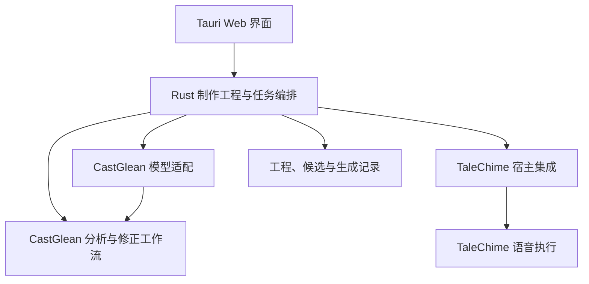

# 执行边界与实施路线

2026-11-24 单章实测已走通局部重做、同音色重录、试听、采用、重启和导出。macOS 窗口实测使用 Kokoro CPU 与独立短篇工程，主观听感留待人工评价。见[章节音频验收](chapter-audio-validation.md#2026-11-24-局部重做与版本采用的原生复验)。

2026-11-23 路线图调整：单章收尾后先通过 GitHub Actions 发首个桌面安装包。「音频制作」页与多章批量生成同批交付，迷你播放器接续多章成品收听。见[分阶段交付](#分阶段交付)。

2026-11-19 章节音频工作台增量接入单音色与多角色两条流程、常驻播放栏和可折叠的胶囊片段轨道。两种流程各自持久化生成任务和编排，共用同一宿主执行与播放链路。[实施任务](../../openspec/changes/refine-chapter-audio-workbench/tasks.md)

2026-11-17 助手交互重写已实现：现有入口共用任务区段、身份归组、折叠过程、任务内整组文字回答与单一输入模式；领域审阅器继续拥有采用等决定。目标步骤和音频卡不纳入本轮，见 [实施记录](../../openspec/changes/archive/2026-11-19-redesign-agent-workspace/implementation.md)，中英亮暗/小窗口自动化与 macOS 隔离公开工程的真实模型、停止、重开回答及审阅往返已验；其他平台、屏幕阅读器与真实 IME 候选窗未验，见[验证记录](../../openspec/changes/archive/2026-11-19-redesign-agent-workspace/validation.md)。

2026-11-17：桌面 agent 前后端已重写为 AG-UI + assistant-ui，保留 Rust 领域与 Rig 执行；旧 agent 协议/AI SDK 链路移除，SQLite v9 保留领域数据并隔离旧任务。专业调用独立消息/归因，必要问题持久挂起并通过新 run 回答。自动化与真实模型/原生桌面未验边界见[验证记录](../../openspec/changes/rewrite-agent-ag-ui/validation.md)。

章节交互简化（2026-11-13）：已接当前章右侧角色归属与声音设置，AI 校验结果直接可用，下拉修改立即保存，失败可重试并沿用宿主撤销；音色搜索/模型筛选、共享资源订阅、停顿失焦或回车保存和底部单一主要播放器已接入。导入改为先选 TXT、文件名预填名称、同屏编码预览后提交。原文、稳定身份、人工保护及历史音频保持；来源范围变化的重分析仍保留独立候选。自动化和原生验证边界见 `openspec/changes/archive/2026-11-19-simplify-chapter-workflow/validation.md`。

2026-11-22 手动归属：框选原文后从浮条打开归属对话框，可在未配置 AI 时复用或新建工程角色。未标注区间进入多角色生成前检查。后发分析基于当前归属修订更新，覆盖人工归属时在结果卡提示，可从章节标题菜单撤回。见[手动归属变更](../../openspec/changes/add-manual-speaker-attribution/design.md)。

2026-11-22 正文交互增量：旧角色列由原稿内的归属标记和片段浮条替代。分章与合并从行号或选区起始行发起，章节标题菜单承载章节级操作。详见[规格](../../openspec/changes/refine-chapter-audio-workbench/specs/chapter-production-workspace/spec.md)。

2026-11-13 工作台增量：按用户确认的 Fish 式制作交互实施 `chapter-audio-workbench`：未分析紧凑阅读，有效分析后角色列分段；底部全章音频占位、真实单元进度与播放、独立停顿编排和冻结版本 WAV 导出。此增量接续下述第一阶段，并覆盖第二阶段中的停顿与导出；声音/归属修改后的局部重做及候选采用仍未交付。实现和自动化验证已完成，中文原生样本已完成导入、分析、整章生成与停顿 WAV 导出；完整原生矩阵与人工听感仍待验，详见[任务](../../openspec/changes/chapter-audio-workbench/tasks.md)及[验证](chapter-audio-validation.md)。

2026-11-11 章节音频增量：第一阶段（已有分析与绑定 → 整章音频）已按 [`chapter-audio-generation`](../../openspec/changes/chapter-audio-generation/proposal.md) 实现。宿主构建带来源映射的合成单元（句读切分，以 120 字符为目标且不截断不可分表达式）、集中报告生成前阻塞，在引擎专用线程顺序合成并逐单元持久化，全部成功后拼接整章；首期限定同一模型的预置音色。自动化门禁通过，真实 Kokoro `1.1-zh` 多音色整章已在宿主层验证；同日按用户真实生成失败补齐 Kokoro 文本规范化（现由后端执行）、失败详情落库（`error_detail`）与同指纹断点续跑并复验；schema v7 要求文本语义版本一致，旧任务保留但语义未知时不混合续跑。**真实原生窗口系统验收尚未执行**（用户日常应用已提供进度/失败/定位的部分窗口证据），命令层、互斥与界面交互证据不全，见[验收记录](chapter-audio-validation.md)。自动重试、修正后重做、采用与导出仍属下一阶段。

2026-11-10 审查增量：声音绑定与角色中心、选角会话入口及按运行思考档位已完成本轮审查修复；证据冻结、任务互斥和配置传递见[审查决定](../knowledge/decisions/voice-binding-review.md)。macOS 原生公开样例已用配置的 GLM 完成选角与推理/重试验收，并用 VoxCPM Metal 完成设计入库绑定与重启恢复；建议撤回和显式忽略仍缺实现，不能宣告规格全部通过，见[真实验收](voice-binding-acceptance-2026-11-10.md)。

工程助手与分章/章节归属分析专业任务共用子Agent执行设施；上下文隔离、宿主派发、恢复和评测边界见[专业任务决定](../knowledge/decisions/professional-ai-tasks.md)。

2026-11-09增量：章节归属分析正式使用Rig Agent与紧凑工具协议，具备只读预审、可观测与正式代码评测。2026-11-18 将恢复边界收敛到完整窗口；思考强度按供应商能力默认最低且前端可调，见[接入与验证](../knowledge/decisions/chapter-agent-production.md)。

日期：2026-10-31。状态：设计建议与验收顺序，不是当前实现承诺；桌面框架已确定采用 Tauri 2，详见[技术选型](technology-choice.md)；本文不冻结数据 Schema。

## 职责与依赖

2026-11-08 交付增量：统一三图标工程外壳、单一章节目录/正文与工程 AI 助手；结构检查和归属分析按任务调用不同能力。切章保留阅读上下文、会话和草稿，每次运行固定自己的目标。宿主上下文与 SQLite v3 迁移保留旧历史，领域校验和人工保护继续独立，见[单一助手决定](../knowledge/decisions/unified-project-assistant.md)与[融合验收](project-assistant-validation.md)。此为当时状态；声音绑定现已完成主链验收，章节音频仍待实现，当前优先级以下方分阶段交付为准。

- 分析核心管理不可变来源、身份、归属、朗读意图、校验和人工修正规则，不依赖 UI、具体音色或 TTS 参数。
- 模型适配处理显式配置、请求和服务能力；同一服务可支持不同分析任务，但不能只换提示词而复用错误的 Schema 或工具提交协议。
- 桌面宿主管理工程、选角、语义到实际参数的映射、任务调度、音频候选与导出。原独立集成包已退役；参考历史经验，按应用需求接入两个基础库，不维护另一套独立集成产品。
- TaleChime 执行资源准备和语音生成，提供实际能力、进度与音频；宿主不能推测缺失事件已经发生。

以桌面应用为主要交付，当前分析在单一 Rust 宿主 crate 内按领域模块组织；独立核心包或其他消费者只在具体需求出现后评估。开发从实际界面流程出发，缺少通用语义时补到对应模块并验证；UI 不复制校验和修正逻辑，核心复用宿主运行时。分章诊断的外层阶段及检查点由宿主状态机管理；模型调用使用 Rig，确定性逻辑仍由应用模块负责。不增加 HTTP 服务或公共节点 SDK。

## 工程中的概念关系

建议区分来源、角色标注、朗读规划、声音绑定、生成配置、执行尝试、候选音频和采用关系。它们是领域概念，不是已确定的目录布局或 JSON 类型。

每次生成保留实际输入与依赖版本；每个候选绑定不可变来源范围、实际有效配置及执行身份。当前选用哪个候选由独立采用关系表达，不通过覆盖同一个音频文件实现。

正文范围、标注片段、合成单元和音频时间范围不是天然一一对应。宿主保存显式映射，覆盖 TTS 切段、预处理与上下文。没有精确对齐能力时只提供范围级定位。

## 修改与失效

| 修改 | 分析与规划影响 | 音频影响 |
| --- | --- | --- |
| 切换试听位置或显示视图 | 无 | 无 |
| 修改音色或合成参数 | 通常不重跑文本模型 | 相关合成单元产生待生成配置 |
| 修改段落表达 | 更新对应人工覆盖；必要时重算执行映射 | 相关单元与依赖上下文需重新生成 |
| 修改一句归属 | 更新归属修订，检查相关规划依赖 | 受声音或表达变化影响的单元失效 |
| 修改角色身份关系 | 可能影响跨章上下文，须显式计算传播 | 检查所有受影响的绑定与片段 |
| 更换分析模型或提示词 | 产生新建议与差异，不覆盖人工确认 | 采用差异后才确定受影响范围 |
| 更换正文 | 新来源版本，重新验证坐标与引用 | 旧候选保留历史身份，不直接挂到新正文 |

失效表示不再匹配当前制作设置，不等于立即删除旧结果。用户仍可试听旧候选；导出前说明是否使用旧配置音频。无法可靠缩小影响范围时，采用可解释的保守范围。

角色和规划的重新分析先展示新增、变化、冲突与保持不变的结果，用户修正受保护。字段级人工保护与版本合并需要明确契约，不能从现有“整个片段确认保护”推定已经支持。

## 状态与任务

分析执行、语义检查、音频执行和采用关系分别记录。不要用一个“已完成”同时表示模型成功、人工正确、文件已保存与音频已选用。

建议任务状态包括排队、执行、取消中、已取消、失败和成功。成功以任务对应产物安全保存为边界，部分产物另行记录。取消先停止接收新工作并拒绝迟到提交；底层请求无法立即中断时如实展示，不假报资源已经释放。

每个任务绑定来源版本、预期修订、配置指纹和执行尝试；按项目序列化冲突提交。旧任务不能写入新修订。UI 事件丢失或重启后可从权威状态恢复，内存通知不作为唯一完成证据。

任务进度保留实际阶段和度量。合成耗时、资源准备、排队、文件写入和音频时长分别记录；用量缺失不计作零，不将重试成本默认为免费。

## 保存、恢复与导出

当前增量：整书导入与辅助分章的主链已改用本地数据库、不可变来源和通用 AI 会话；工程按本地 id 打开，提交自动保存。旧便携容器及 Recovery 路径已移除，用户旧文件不迁移或删除。此次重构的自动检查已通过，真实桌面回归进行中；证据与平台边界见[存储重构验证记录](../knowledge/lessons/local-storage-windows-validation.md)。章节分析、选角、合成与音频导出不在此次分章变更中。

工程记录持久化来源引用、修订、选角、规划、候选与采用关系。临时音频与正式候选有明确发布边界：文件未完整写入时不能标记可用；候选发布成功后才能用于采用和导出。

恢复时核对文件、来源、修订和配置，辨认完成、部分完成与待重新执行的任务。避免恢复重复发布同一候选；外部模型请求仍可能重复，具体检查点粒度必须说明。

现有分析具有领域阶段/窗口恢复，旧原型的“完整章节提交”边界不再描述当前分析；这些检查点仍不能等同于尚未实现的音频合成单元恢复。新增存储需要中断位置与故障注入验证，不能只验证正常关闭重开。

章节导出使用明确的采用版本集合，检查覆盖、顺序、格式与失效状态。导出任务生成独立文件，避免覆盖仍可恢复的候选。私人文本、音频、凭据与权重继续保存在忽略目录或用户指定目录。

## 分阶段交付

整章生成、停顿编辑和单章 WAV 导出已实现。2026-11-24 已在 macOS Apple Silicon 调试窗口用 Kokoro `1.1-zh-g2pw` CPU 验证单章主链；更广的中断、资源互斥和原生测试矩阵仍由各自的 OpenSpec 任务跟踪。以下按 2026-11-23 路线安排后续交付。见[章节音频验收](chapter-audio-validation.md#2026-11-24-局部重做与版本采用的原生复验)。

### 第一优先：已有分析与绑定 → 整章音频

输入为当前采用的章节分析、不可变正文及旁白/角色声音绑定。宿主核对覆盖/顺序和资源，冻结有效配置；按模型长度限制组织有来源映射的合成单元，顺序调用 TaleChime，保存各单元音频并按章连续播放。首个交付固定一个已验证模型组合，支持其中多音色，不依赖新 Agent 推理或情绪规划。

最小界面：直接“生成本章”、集中阻塞项、真实阶段/已完成单元、取消、失败位置与播放结果。没有可靠总量不伪造百分比。未知归属、缺声音或资源不兼容必须解决或明确选择回退；不强制逐句确认，不静默改写归属。

验收：真实一章按正文完整且顺序正确生成；可连续听及查看来源/配置，切章不改任务目标；失败不丢已完成片段，重启识别已保存/未完成且不自动再次调用后端；有缺口不报告整章成功。实施前先落实独立章节音频 OpenSpec。

### 紧接补齐：可修正、可采用、可导出的单章闭环

2026-11-23 已按 `add-chapter-audio-redo-and-adoption` 实现：修改归属或音色后按当前计划派生新任务，只合成输入变化的单元，其余沿用已落盘音频；同输入重录的结果先待采用；版本可查看、重新采用或放弃，派生版本继承可精确锚定的停顿，导出只接受当前采用版本。宿主测试与浏览器回归通过。2026-11-24 macOS 原生已验 5 段中仅重做改动的一段、同段新旧试听、重录采用和放弃、重启保留采用与停顿、系统保存对话框导出 WAV。人工听感、VoiceOver、完整原生中英亮暗矩阵、其他模型与平台仍待验。[任务与验证](../../openspec/changes/add-chapter-audio-redo-and-adoption/tasks.md)

范围：显式重试失败单元，修改归属/音色后按安全合成单元重做，保留旧候选、显式采用、完整性/过期检查与独立 WAV 导出。先提供单元范围定位，不承诺字级对齐或任意选区独立替换。

验收：修正一处错误后能听见对应变化，无关已完成单元不重复执行，旧满意版本可保留；导出采用集合完整且顺序正确；关闭重开后文件与采用关系一致。

### 下一阶段：GitHub Actions 发首个桌面安装包

首发拟交付 Apple Silicon 签名公证 DMG（CPU 与 Metal）和 Windows x64 签名 NSIS 安装包（CPU 通用版与 CUDA 版）。CastGlean 已接入 `windows-cuda` 构建特性，首发须验证 Windows 原生链接、CUDA 运行库、兼容驱动和 NVIDIA 真机合成。GitHub Actions 固定 CastGlean 与 TaleChime 构建输入，GitHub Release 草稿汇总安装包、发布说明、校验和及签名更新资产，验收后公开。Tauri Updater 复用稳定 Release 的静态清单，用户确认后安装升级。见[桌面分发 OpenSpec](../../openspec/changes/release-desktop-app/proposal.md)。

交付门槛包括三个发行目标的真机跨版本升级，以及对稳定草稿中的最终安装包进行干净安装、首次启动、导入公开样章、生成、播放、局部重做和 WAV 导出。发布后核对匿名下载和稳定更新源，下一稳定版补正式渠道的跨版本记录。现有单章调试窗口验收已通过。Windows 原生构建、Release 草稿与晋级流程及应用内更新已接线，首轮候选已配置独立更新签名，macOS 使用 ad-hoc、Windows 跳过 Authenticode。三目标装包及候选跨版本升级待实测，稳定平台签名仍待配置。见[验收任务](../../openspec/changes/release-desktop-app/tasks.md)。

### 音频制作页与多章批量生成

「音频制作」页按正文目录顺序列出章节。首版可选连续范围或多选章节，以单音色或多角色方式提交一批任务。提交前按章检查，明确显示可入队项、已有产物和阻塞原因。用户确认入队范围后，宿主复用单章生成与恢复机制，按顺序执行。单章失败保留已完成片段并记录失败原因，其余队列项继续按各自状态推进。

页面用同一份宿主状态显示章节的排队、生成进度、阻塞、失败和可播放产物，提供暂停队列、恢复、重试、试听和返回原章。重启后读回队列与已完成结果，按确认后的恢复动作继续；重新提交前识别正在运行或已有可用产物的章节。正文或绑定在排队期间变化时，宿主须重新校验，具体冻结与失效规则在实施前写入独立 OpenSpec。

首版验收：选一批包含可生成章、缺音色章和已有成品章的章节，提交前可核对具体范围；中断重开后能恢复队列，已完成章无重复生成，失败章可重试，产物可从同页试听并回到原章。单章 WAV 出口复用现有流程。整书一键提交与批量导出列为本阶段后续增量；导出范围、文件命名、冲突及部分失败规则另定。

### 桌面迷你播放器

接续多章制作交付，复用章节顺序、可播放成品状态和同一个播放会话。首版支持可拖动、可选置顶、上一章、播放或暂停、下一章和返回工作台。以 macOS 真机验证隐藏主窗口后继续播放、两处控制同步和相邻章节缺成品的反馈。[GitHub Issue #4](https://github.com/yexiyue/castglean/issues/4)

### 随后：助手驱动制作与卡片交互

单章工作台根据当前章的制作方式、宿主检查与运行状态给出一个制作主操作，跨章和助手任务另有返回入口。阻塞清单使用居中弹窗，音色在清单内确认，定位归属后可从底栏返回清单。对话内章节生成 Task Card 已接入，复用宿主运行和全局试听。完整制作目标、对话内发起生成和通用领域决定继续由助手提案跟踪。[单章变更](../../openspec/changes/archive/2026-11-23-add-chapter-workflow-status/proposal.md) · [组件调研](../research/assistant-ui-workflow-components.md)

范围：一个助手调用既有领域工具及专业子 Agent；分歧卡采集决定，生成工具卡显示真实进度、直接播放和生成信息。先复用已经交付的章节生成/产物用例，再补跨步骤目标推进；现有短试听是补充能力，不是优先于整章的交付目标。

验收：直接按钮和对话入口指向同一宿主任务，等待用户可恢复且不占执行资源；不强迫聊天，不重复确认已授权步骤。比较真实任务中的入口发现、阻塞处理、后台切换、播放和改错路径，记录观察后再调整布局。方案见[助手提案](../../openspec/changes/assistant-guided-production/proposal.md)。

### 后续：表达质量与编辑扩展

角色级批量变更、发音修正、独立朗读规划及多后端比较分别立规格；issue #3 的契约和评测可以提前准备，完整演绎不成为首章生成前置。

验收分别覆盖结构、归属、跨片段衔接与主观听感。身份合并/拆分、任意旧章重分析仍按独立语义补齐。

### 后续探索

自由节点、公共插件、插图、配乐、多媒体和其他消费者按明确需求论证，不扩展当前章节交付。工具化保留为能力接入方式，不提前建设通用 Agent/插件平台。

## 待决策项

- 首个章节生成组合使用同一模型的预置音色。Kokoro `1.1-zh` CPU 已通过宿主层验证，`1.1-zh-g2pw` CPU 已通过 macOS 单章原生复验。Metal、其他平台和分发安装包仍需各自验收。
- 首个后端/模型与资源准备体验，依据当前设备、实际质量和分发条件决定。
- 工程布局、版本与迁移；候选音频的磁盘预算、清理与删除规则。
- 首版可局部替换的最小安全单元及前后文试听范围。
- 分析何时暂停检查、批量生成初稿的默认行为及导出提示。
- 完整身份编辑与任意旧章重分析的依赖和实施顺序。
- 移动端伴随：带章节标记的导出是否足以覆盖收听场景、何时需要伴侣应用。
- TRNovel 集成：听书能力以何种形态（库、导出或服务）供阅读器使用及启动时机。

这些决策在对应阶段前完成，不扩展为当前文档任务中的实现工作。后续变更持续维护当前路线与状态，按项目要求运行相关测试、fmt、Clippy、rustdoc，并补齐新增界面与中断恢复验证。

## 2026-11-05 音色中心增量

章节 P0 之前已落地独立音色生产接入：基础库无提交候选、七类后端与四类设计适配的真实目录、候选确认入库、原始参考与模型试听、资源任务 v2 和音色名称/删除管理。它们为章节选声准备资产，不等于章节分析、角色绑定持久化或章节导出完成。资源、编译与真实生成分别验收，见[音色中心验证](voice-center-validation.md)。

## 2026-11-05 原生成品准备

各模型的固定成品直接从共享 Hub 缓存盘点和加载，模型中心提供下载量、空间预估、进度、暂停与取消；旧任务日志原样保留，不自动重启任务。应用数据和应用缓存目录可独立设置并在重启后生效，设备校准记录可单独清理。共享模型缓存移除与原生桌面验收仍待完成；资源就绪不代表人工听感或其他平台已验收。当前工作区结果未发布新 SDK/应用，见[存储决定](../knowledge/decisions/hub-cache-separation.md)。

## 2026-11-08 章节归属增量

角色/旁白/台词/内心独白归属、不可变原文证据、人工修正及重分析候选已接入真实项目路由和宿主。自动化与 macOS 原生公开样本闭环已通过；原生发现的 Schema/prompt 声明约束和撤回选中状态问题已修复并复验，模型质量/成本及其他平台边界见验收记录。演绎规划、选角和音频制作不属于此增量。实现与模型/原生验证状态见[章节归属验收](chapter-analysis-validation.md)及[规格任务](../../openspec/specs/chapter-attribution-analysis/spec.md)。

## 2026-11-08 单一工程助手增量

分章与归属不再提供两套页面/助手，统一目录、原文、工程级会话和按需检查器。宿主冻结每次任务的上下文；同一 Agent 使用结构工具或受理章节分析，再复用原有归属流水线与人工候选保护。旧会话只读保留，SQLite v3 事务升级。实现和证据边界见[融合验收](project-assistant-validation.md)，不沿用上一轮双模式验收作为新交互的证明。
