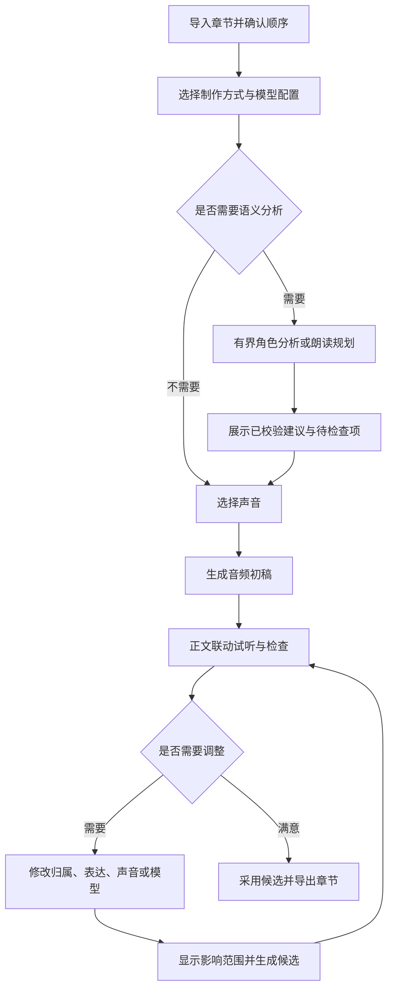

# 交互设计

日期：2026-10-31。状态：建议交互契约；界面文案示例不代表现有字段或已实现功能。

## 应用与工程层级

2026-11-03 交互决定：一个工程对应一本小说的一套制作方案。同一本小说制作其他版本时新建工程，不再引入“制作版本”实体。工程拥有章节、稳定角色身份、标注与朗读规划、声音绑定、音频候选和采用关系；音色资源与应用偏好跨工程共享。

应用外壳常驻顶部工程标签栏；每个标签对应一个工程，章节和正文视图不占工程标签。工程首页与工程内部使用不同布局：

- 首页与共享资源页：应用级导航采用带文字的固定侧栏，常规宽度 240px，小窗口收窄；新建、打开、最近工程、音色中心和模型中心直接可见，底部提供快速上手和设置。不放无工程上下文的“章节制作”入口。用户工程采用列表展示，示例另列，不伪装为最近打开的真实工程。
- 工程内部：固定窄导航栏只显示章节制作、工程角色和制作结果；第二栏按工程模块展示章节等对象，正文与上下文检查是主要制作区。
- 完整应用设置不再占用独立页面：顶栏齿轮或侧栏设置打开同一浮层，保留当前页面上下文。浮层内是双栏布局，左侧为可搜索的分类导航（通用、服务连接、存储位置、语言、快捷键、关于），右侧用标题和分隔线组织设置项。“关于”复用品牌标志与吉祥物，展示应用版本，不再提供独立的隐私与许可分区。主题与语言即时作用于会话，存储设置显式保存；未接入的制作偏好禁用，不展示假成功。
- 浮层状态就是地址栏状态，只有这一处真相：地址栏用 `?settings=<分区>` 标记当前分区（直接打开该地址即可进入对应分区，如 `/models?settings=storage`），浮层的开合与分区都从路由状态读取，不再单独维护会话副本。由此得到三个结果：关闭浮层清掉该参数，浏览器后退同样关闭浮层；应用内导航保留该参数，浮层可以跨页面保持打开且链接可分享；任何页面（含引导页）都能用同一个参数把用户送到指定分区。未知分区回落到“通用”而不是空白面板。
- `/start` 按导入章节、准备声音模型、确认存储位置提供三个入口，导入与阅读原文不依赖模型。存储位置需在开始下载前确认。浏览器明确说明哪些能力需要桌面应用，不呈现虚构目录状态。
- 顶栏模型状态直接链接模型中心，显示已就绪数量、下载进度、未准备或读取失败；浏览器显示“浏览器预览”。模型中心的资源以列表展示，详情保留准备、暂停、继续、取消及验证入口。浏览或准备模型不会设置应用全局的当前模型。

当前前端实现工程标签的打开、切换、关闭，并在会话内分别保留正文视图、章节选择、选中片段、阅读位置与检查面板开合状态。关闭标签不删除工程，仍可从当前会话的首页重新进入；这些临时状态不写入 `.castglean`。尚未实现应用重启后恢复打开标签或最近文件索引。角色与制作结果页展示真实空状态，不把章节示例当作已持久化角色表或正式音频。

首页和共享资源页使用紧凑标题行，操作与内容对齐；采用现有主题、克制圆角和细分隔线，不增加装饰渐变、玻璃背景或悬浮面板。右侧检查面板可通过工具区按钮展开/收起，收起后释放正文宽度。

空白与异常反馈使用统一状态组件，区分首次使用/无内容、搜索无匹配、服务未就绪、正在加载和操作失败。首页没有用户工程时展示新建/打开入口，示例仍标为示例；工程、音色与设置搜索支持清除筛选。角色/制作结果为空时提供章节制作或服务连接入口。404 与路由失败提供返回首页/重试，避免暴露默认技术错误页；源语言随外壳打包，启动不等待语言请求。打开/保存失败使用可恢复的对话框，不挤占固定高度工具栏；批量文件问题逐项展示，意外失败恢复可操作状态，不清空已有草稿。参考录音解码失败可更换或移除。模型服务未接入属于不可用状态，不展示假重连、假生成或虚构任务失败。状态组件以真实页面的空目录、无匹配与失败场景为验收对照，不表示该页实际发生故障。

小窗口下，状态文案和操作按钮允许换行；文件名等连续长文本在错误提示内折行，不撑宽内容区。对话框最多占视口高度减去上下留白，内容过长时内部滚动，键盘仍可到达关闭、重试与确认操作。全页错误在内容超高时从顶部滚动，不因居中而丢失开头。前端已检查 1024×640、800×600，以及 800×400 下的英文对话框和放大文字；Tauri 原生窗口下限仍为 1024×680。

后台任务、资源调度与实际播放器随宿主工作流接入；当前标签与空状态不代表多工程合成、任务恢复或真实播放已实现。未来关闭标签不能隐式取消宿主任务。窗口原生控制仍由 Tauri/系统提供，应用内顶部栏不模拟操作系统关闭按钮。

## 主工作区

| 区域 | 内容与职责 |
| --- | --- |
| 顶部桌面栏 | 首页入口、已打开工程标签、新建；右侧为模型状态芯片与设置入口；跨页面保持 |
| 工程窄导航 | 当前小说的章节制作、工程角色、制作结果 |
| 章节二级列表 | 当前工程的章节顺序、生成与待检查状态 |
| 工程工具栏 | 仅保留正文视图与保存、生成、检查面板开合等操作；工程标签和章节高亮已表达位置，不再重复标题 |
| 左侧正文主体 | 连续原文、选区、角色/演绎/音频标记；保持阅读位置 |
| 右侧上下文面板 | 当前范围的检查、设置、试听、候选与生成详情 |
| 底部播放器 | 制作区保留播放器布局；实际全局播放需绑定工程与来源，避免不同工程同时发声 |

正文是不可变来源。更换或修订正文必须建立新来源版本并检查标注与音频失效，不能在界面直接改字后继续套用旧坐标。发音替代、朗读指令与实际送入 TTS 的文本另存并保持可追溯映射。

正文上的单击负责定位并打开详情；显式播放按钮负责试听。悬停显示轻量操作，拖选用于指定范围。播放时反向高亮到已知范围；只有片段级映射时不伪装成逐字对齐。

## 制作流程

分析后可暂停检查，也可继续生成初稿。用户选择“生成”代表允许执行该范围的任务，不代表人工确认所有语义标注。导出时说明未检查项及旧版本使用情况，让用户选择处理或按明确状态导出。

## 同一正文的三个视图

| 视图 | 正文标记 | 右侧主要内容 |
| --- | --- | --- |
| 角色 | 旁白、对白、心理活动、说话人和歧义 | 归属候选、证据、角色与声音入口 |
| 演绎 | 场景边界、重要表达变化、停顿建议 | 场景走向、段落读法、修改与试听 |
| 音频 | 未生成、任务中、可用、设置已变更、失败 | 当前音频、生成配置、候选和任务详情 |

角色、演绎、音频仅在正文上方的标签中切换，不放入一级业务导航。工程级角色列表用于整理身份、别名与声音绑定，区别于检查当前正文归属的角色视图。

切换视图保留章、选区和播放位置。不要把所有模型标签同时铺满正文；状态不能只靠颜色区分。

## 角色、台词和选声

将三种操作分开：改一句话的说话人；整理一个角色的身份与别名；为角色绑定声音。名字不等于稳定身份，声音也不等于身份。

片段检查卡示例：

> 说话人：张掌柜；来源：模型建议；人工状态：未检查。原文依据可跳转。可改为其他角色、保留未知，或确认当前归属。

角色列表展示名称、别名、出现章节、台词数量、代表性台词、声音绑定和人工状态。选择角色后可以定位其台词，使用书中的真实句子试听候选声音。画像缺失允许未知，不根据姓名推断性别或声线。

同称呼对应多人时展示候选及依据，不自动选择第一个。暂用旁白声音不改变 unknown / ambiguous 语义状态。归属修正只作用于明确选中的范围，不自动改写所有同名文本。

完整身份合并、拆分、撤销需要独立的核心契约。首版不提供表面成功而实际只改显示名的操作。角色级声音替换则由宿主计算受影响台词，先展示范围再加入生成队列。

## 模型中心

2026-11-04 设计预览：`/models` 是模型资源管理的唯一主入口，与音色中心并列。设置浮层的“服务连接”分区只预览分析与语音服务的地址和凭据配置，不再重复模型选择、下载或安装管理。

2026-11-04 已接入宿主：模型中心展示当前构建实际编译的本地模型（目录即构建事实，不显示虚构条目），状态为离线盘点结果——未下载、部分就绪、已就绪、下载中与失败（类型化原因），应用重启后状态回归磁盘事实。下载经共享 Hugging Face 缓存（默认 `~/.cache/huggingface/hub`，与其他 Hub 工具复用同一份权重，存储位置可在设置浮层的“存储位置”分区更改），下载前确认展示待下载体积并在磁盘空间不足时拦截；下载中可取消，已就绪文件绝不重下。已就绪模型提供"验证可用性"冒烟（加载成功即释放，不常驻）。本地转换型模型（Kokoro 等）无下载入口，如实显示需本地转换。下载源支持镜像端点与访问凭据配置。仍待接入：模型的更新与移除、云端服务分类、引用检查。

模型资源跨工程共享，浏览或准备模型不会设置应用全局的当前模型，也不会替换角色声音。真实工程模型选择、能力核对和资源调度由宿主提供。

## 音色中心

2026-11-04 批量搬运接入：我的音色已读取真实宿主库，支持系统多包选择、完整校验、逐项勾选、冲突决定、多个音色单包导出，以及后台取消和可查询结果。音色包不需要“连接音色服务”或先下载模型。下文的创建、重命名、删除、绑定和试听仍属于各自的预览/后续接入范围，不得作用于真实资产。

导入先检查全部输入，有损坏包时不提交；可移除问题文件重新检查。预览区分已存在、信息差异、身份冲突、同名和可能重复；展示包内及本地参考信息。默认保留本地声音和元数据；冲突项只能跳过或作为新音色导入。一次可从多个包只选部分音色；列表的全选明确限定当前搜索结果，导出前展示实际选中数量。详情单音色导出与多选导出共用流程，预置示例不能导出。

任务阶段、数量/字节与逐项结果来自宿主快照和事件，切页可重新查询；取消不撤销已完成项，重启只恢复正式音色事实，不宣称恢复旧任务。浏览器显示明确不可用提示，不伪造本机导入成功。真实资产不显示虚构性别、标签、固定模型归属或未经验证的兼容性。

音色中心是独立于主工作区的界面，负责声音的创建、试音与库管理；角色绑定声音的入口在角色视图，创建与绑定分开。声音资源与合成能力由 TaleChime 提供，界面只呈现可验证的状态。

2026-11-04 能力分层：音色库分为“预置音色”和“我的音色”，可按兼容模型筛选。预置声音由模型提供，不出现自定义资产的重命名、删除或导出操作；我的音色使用真实资产列表，未接入的重命名和删除入口保持禁用。创建页先选示例模型，仅允许其支持的文字设计或参考录音；仅支持预置声音时展示浏览入口，不展示克隆表单。切换模型不清空会话草稿。示例角色更换根据既有绑定对应的示例模型过滤候选，提交时再次核对；这不代替真实工程的宿主能力验证。

创建界面预览：音色库提供“创建音色”和“导入音色包”两个入口。`/voices/new` 左侧以文字设计/参考录音标签切换输入，右侧集中试听与显式保存；描述、名称、试听文案、录音原文与文件仅保存在当前会话草稿中。参考 WAV 支持本地格式初检、播放、移除与替换，不代表已创建音色；`.voice` 导入已由宿主提供多包校验、选择与冲突处理；生成和创建候选的保存仍未接入，不与资产包搬运混淆。

真实接入时，宿主须提供候选暂存，让“生成→试听比较→明确保存”成立。TaleChime 当前设计接口生成成功即入库，不能直接等同于界面的“保存到音色库”；引擎就绪状态、模型兼容性与资源下载也需由宿主提供。

自定义音色详情预览：侧栏内编辑显示名称，保留稳定音色 ID；名称不可为空，取消或 Escape 放弃编辑。导出对话框展示 `.voice` 文件名与资源可用性，示例不生成伪造音色包。删除需二次确认，默认聚焦取消，移除示例后提供撤销；会话内路由切换保留预览修改，刷新恢复初始示例。工程引用未接入时显示未知状态，不宣称没有引用。真实删除前的引用、任务与候选依赖检查仍由宿主实现，这些预览操作不修改工程或本地文件。

引用位置预览：详情的“使用此音色”按工程分组，区分人物角色与旁白等朗读职能。示例引用与示例工程角色页共用稳定绑定 ID，点击定位并聚焦对应行，返回时恢复音色详情；重命名不改变绑定，预览移除后在工程侧显示资源已移除。未用于示例的音色显示“暂无示例引用”，不等同于真实库中未被使用。真实工程的全局引用完整性与删除影响范围仍由宿主提供，示例夹具不写入工程文件。

更换声音预览：在工程角色行打开同一个两步弹窗，先直接选择候选音色，再查看原/新音色、当前工程内的作用范围以及音频保留策略。当前音色不作为替换候选，已从预览移除的音色不可选；返回选择、取消或 Escape 不提交。确认仅更新该稳定绑定的会话覆盖，保留角色身份和正文归属，更新反向引用并允许撤销；刷新后恢复示例基线。受影响章节/片段数量尚未接入，明确显示“待宿主计算”，不编造规模。旧音频与采用结果保留，新音色只用于后续生成，本次不自动生成或采用候选。真实接入须由宿主重新核对绑定修订、可用资源、模型能力与影响范围后提交，不能把界面预览当作已保存工程。

- **克隆**：先支持导入样本音频，录音界面后置。入库前检查样本质量与一致性，展示时长与可用性提示；只克隆有权使用的声音，样本不默认随工程分享（沿用生成详情的隐私规则）。克隆结果用固定句与书中真实台词试听后命名入库。
- **设计**：两条入口。文字描述直接生成（如「中年男声，低沉沙哑，语速慢」）；或从角色画像生成——分析层提供带证据的 `voice_profile`（性别、年龄段、印象），作为设计提示词的初始值，画像缺失的字段保持未知，不凭姓名推断声线。设计可迭代调整，每次调整产生新候选，旧候选保留可回退。
- **试音**：选一段书中真实台词，对多个候选音色批量生成短试听，比较后绑定。试听结果不进正式音频库，重做便宜。
- **库管理**：模型无关的自定义音色跨书复用并保留来源；预置声音属于模型目录。使用自定义资产时校验所选模型与录音限制，不跨模型沿用模型本地的 voice ID（沿用音频候选的既有原则）。

克隆与设计的可用性取决于当前后端的实际能力；不支持的操作显式禁用并说明，不伪装成「生成中」。设置中分别呈现文本分析模型与语音合成模型。

## 发音与读音管理

中文人名与多音字读音是高频修正点。发音替代不修改正文：替代文本、作用范围（章节、角色、片段）与实际送入 TTS 的文本保持可追溯映射，正文页显示有替代标记的位置。

读音修正保护人工结果：重新分析不静默覆盖已确认的读音；导出的音频记录实际使用的读音表。具体词典格式与后端能力映射（SSML、拼音标注、逐字替换）随 TaleChime 接入验证，界面按实际支持开放，不承诺全部后端一致。

## 朗读规划与演绎检查

规划分为场景与段落两层：场景层解释表达如何推进，段落层给出具体朗读意图。默认只突出有意义的变化，以克制、连贯为原则，不要求每句有情绪标签。

例如场景建议为“开头平静，争执后加快，结尾收住”，段落建议为“压低表达，语速略慢，末句留停顿”。这是示例意图，维度、枚举与执行映射需由独立朗读规划契约确定。

区分事件情绪、人物态度和叙述者表达。正文写人物愤怒，不代表旁白必须愤怒。模型建议与原文明示事实分别呈现，可展开查看原文依据，不展示模型内部思考作为可信证据。

用户可接受、调整、移除建议，或明确指定自然读法。“未分析”“无法判断”“建议自然”分别显示。移除建议不自动变成自然结论。人工确认和覆盖保护精确到字段与范围。

计划与执行并排可查：若模型不支持某种表达，显示不支持或实际采用的回退方式，不能把未执行的建议标成已经生效。试听至少支持当前采用版、新候选和前后文连续试听。

## 音频调整与候选

右侧默认展示角色、声音、后端、模型和支持的常用设置。更深的采样参数、量化、设备等按需展开。修改设置不自动发起昂贵任务；点击生成后执行，旧音频继续保留。

当前采用版本与下一次生成设置必须分开：模型 A 生成的音频在选择器切到 B 后仍标注来自 A，并显示“设置已修改，尚未生成”。新候选成功也不自动等于用户选用或人工检查通过。

每个候选可以试听、比较、采用、恢复和查看详情。失败不覆盖已有文件。后端切换时核对兼容音色、参考音频与参数，说明哪些设置需要重新选择；不能跨模型沿用同名 voice ID。

修改前展示实际重做范围。一个选区可能需要扩展到完整句子、段落或现有合成单元；若无法安全替换，明确提示更大的重生成范围。上下文变化的影响也应由实际依赖计算。

## 待检查列表

列表收集未知归属、多候选、缺少声音绑定、规划与模型能力不匹配、人工冲突、生成失败及用户主动标记。可按章和类型筛选，点击定位正文；逐项处理后保持工作位置。

不以未校准的置信度百分比制造准确感。优先显示可验证的问题、候选和原文依据。无法判断时允许保留未知并采用显式播放回退。

## 分析与生成进度

任务面板分别展示准备资源、角色分析、朗读规划、语音合成、保存与导出。显示当前章节/窗口、已完成数量、已知用量、耗时和有限修复状态；无可靠总量的阶段展示阶段与等待时间。

流式文本不是已采用结果。正文可以逐步显示经过校验的分析前缀；需要全章概览的规划在确定前标为草稿。保存完成、输入接收完成、生成完成、播放完成和人工检查完成分别表达。

支持取消、重试和恢复，说明已保存范围与可能重复的请求。运行期间用户仍可查看已保存结果；对同一内容的冲突修改需要串行或修订校验，迟到结果不覆盖更新状态。

## 生成详情

| 类别 | 记录与展示 |
| --- | --- |
| 来源 | 正文版本与范围、归属修订、人工修正、实际执行文本及映射 |
| 分析 | 厂商与实际模型、提示词/任务版本、规划版本、证据与实际采用建议 |
| 语音 | 后端与模型版本、音色 ID、参考音频版本、实际 style 与有效参数 |
| 执行 | 执行身份、尝试、时间、设备、错误；排队/准备/合成/写入耗时 |
| 结果 | 音频时长、格式、采样率、文件位置、当前采用关系 |
| 用量 | 厂商报告的 token、可获得的费用与估算依据；缺失为未记录 |

可复制脱敏生成记录，跳转安全日志。凭据不得进入记录；私人正文不默认进入日志或调试导出。参考音频不默认随工程分享。种子和配置有助于排查，但不承诺不同设备、版本与厂商下逐位复现。
