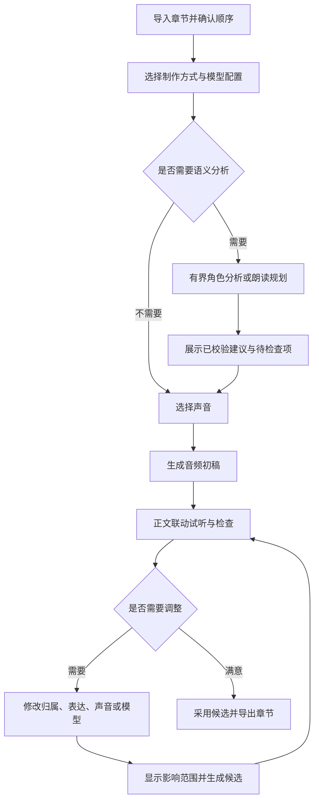

# 交互设计

日期：2026-10-31。状态：建议交互契约；界面文案示例不代表现有字段或已实现功能。

## 主工作区

| 区域 | 内容与职责 |
| --- | --- |
| 最左侧可折叠导航 | 章节顺序、生成与待检查状态；角色列表入口 |
| 左侧正文主体 | 连续原文、选区、角色/演绎/音频标记；保持阅读位置 |
| 右侧上下文面板 | 当前范围的检查、设置、试听、候选与生成详情 |
| 底部播放器 | 播放控制、时间位置、简洁音轨；可展开任务队列 |

正文是不可变来源。更换或修订正文必须建立新来源版本并检查标注与音频失效，不能在界面直接改字后继续套用旧坐标。发音替代、朗读指令与实际送入 TTS 的文本另存并保持可追溯映射。

正文上的单击负责定位并打开详情；显式播放按钮负责试听。悬停显示轻量操作，拖选用于指定范围。播放时反向高亮到已知范围；只有片段级映射时不伪装成逐字对齐。

## 制作流程

分析后可暂停检查，也可继续生成初稿。用户选择“生成”代表允许执行该范围的任务，不代表人工确认所有语义标注。导出时说明未检查项及旧版本使用情况，让用户选择处理或按明确状态导出。

## 同一正文的三个视图

| 视图 | 正文标记 | 右侧主要内容 |
| --- | --- | --- |
| 角色 | 旁白、对白、心理活动、说话人和歧义 | 归属候选、证据、角色与声音入口 |
| 演绎 | 场景边界、重要表达变化、停顿建议 | 场景走向、段落读法、修改与试听 |
| 音频 | 未生成、任务中、可用、设置已变更、失败 | 当前音频、生成配置、候选和任务详情 |

切换视图保留章、选区和播放位置。不要把所有模型标签同时铺满正文；状态不能只靠颜色区分。

## 角色、台词和选声

将三种操作分开：改一句话的说话人；整理一个角色的身份与别名；为角色绑定声音。名字不等于稳定身份，声音也不等于身份。

片段检查卡示例：

> 说话人：张掌柜；来源：模型建议；人工状态：未检查。原文依据可跳转。可改为其他角色、保留未知，或确认当前归属。

角色列表展示名称、别名、出现章节、台词数量、代表性台词、声音绑定和人工状态。选择角色后可以定位其台词，使用书中的真实句子试听候选声音。画像缺失允许未知，不根据姓名推断性别或声线。

同称呼对应多人时展示候选及依据，不自动选择第一个。暂用旁白声音不改变 unknown / ambiguous 语义状态。归属修正只作用于明确选中的范围，不自动改写所有同名文本。

完整身份合并、拆分、撤销需要独立的核心契约。首版不提供表面成功而实际只改显示名的操作。角色级声音替换则由宿主计算受影响台词，先展示范围再加入生成队列。

## 朗读规划与演绎检查

规划分为场景与段落两层：场景层解释表达如何推进，段落层给出具体朗读意图。默认只突出有意义的变化，以克制、连贯为原则，不要求每句有情绪标签。

例如场景建议为“开头平静，争执后加快，结尾收住”，段落建议为“压低表达，语速略慢，末句留停顿”。这是示例意图，维度、枚举与执行映射需由独立朗读规划契约确定。

区分事件情绪、人物态度和叙述者表达。正文写人物愤怒，不代表旁白必须愤怒。模型建议与原文明示事实分别呈现，可展开查看原文依据，不展示模型内部思考作为可信证据。

用户可接受、调整、移除建议，或明确指定自然读法。“未分析”“无法判断”“建议自然”分别显示。移除建议不自动变成自然结论。人工确认和覆盖保护精确到字段与范围。

计划与执行并排可查：若模型不支持某种表达，显示不支持或实际采用的回退方式，不能把未执行的建议标成已经生效。试听至少支持当前采用版、新候选和前后文连续试听。

## 音频调整与候选

右侧默认展示角色、声音、后端、模型和支持的常用设置。更深的采样参数、量化、设备等按需展开。修改设置不自动发起昂贵任务；点击生成后执行，旧音频继续保留。

当前采用版本与下一次生成设置必须分开：模型 A 生成的音频在选择器切到 B 后仍标注来自 A，并显示“设置已修改，尚未生成”。新候选成功也不自动等于用户选用或人工检查通过。

每个候选可以试听、比较、采用、恢复和查看详情。失败不覆盖已有文件。后端切换时核对兼容音色、参考音频与参数，说明哪些设置需要重新选择；不能跨模型沿用同名 voice ID。

修改前展示实际重做范围。一个选区可能需要扩展到完整句子、段落或现有合成单元；若无法安全替换，明确提示更大的重生成范围。上下文变化的影响也应由实际依赖计算。

## 待检查列表

列表收集未知归属、多候选、缺少声音绑定、规划与模型能力不匹配、人工冲突、生成失败及用户主动标记。可按章和类型筛选，点击定位正文；逐项处理后保持工作位置。

不以未校准的置信度百分比制造准确感。优先显示可验证的问题、候选和原文依据。无法判断时允许保留未知并采用显式播放回退。

## 分析与生成进度

任务面板分别展示准备资源、角色分析、朗读规划、语音合成、保存与导出。显示当前章节/窗口、已完成数量、已知用量、耗时和有限修复状态；无可靠总量的阶段展示阶段与等待时间。

流式文本不是已采用结果。正文可以逐步显示经过校验的分析前缀；需要全章概览的规划在确定前标为草稿。保存完成、输入接收完成、生成完成、播放完成和人工检查完成分别表达。

支持取消、重试和恢复，说明已保存范围与可能重复的请求。运行期间用户仍可查看已保存结果；对同一内容的冲突修改需要串行或修订校验，迟到结果不覆盖更新状态。

## 生成详情

| 类别 | 记录与展示 |
| --- | --- |
| 来源 | 正文版本与范围、归属修订、人工修正、实际执行文本及映射 |
| 分析 | 厂商与实际模型、提示词/任务版本、规划版本、证据与实际采用建议 |
| 语音 | 后端与模型版本、音色 ID、参考音频版本、实际 style 与有效参数 |
| 执行 | 执行身份、尝试、时间、设备、错误；排队/准备/合成/写入耗时 |
| 结果 | 音频时长、格式、采样率、文件位置、当前采用关系 |
| 用量 | 厂商报告的 token、可获得的费用与估算依据；缺失为未记录 |

可复制脱敏生成记录，跳转安全日志。凭据不得进入记录；私人正文不默认进入日志或调试导出。参考音频不默认随工程分享。种子和配置有助于排查，但不承诺不同设备、版本与厂商下逐位复现。
