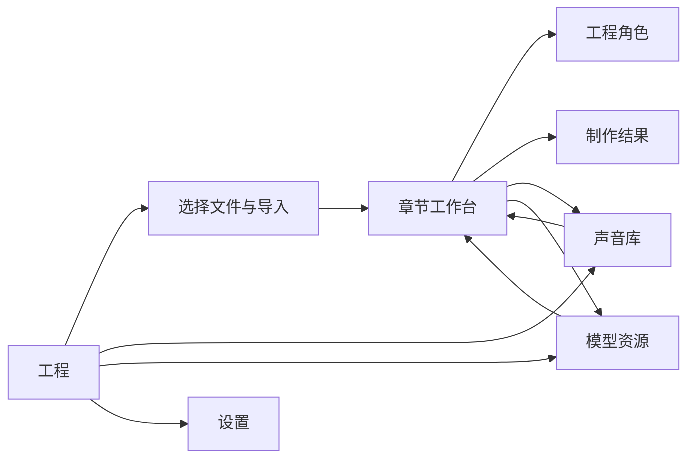

# 制作体验设计规范（候选）

日期：2026-11-13。状态：设计中，尚未在产品实现或完成原生验收。执行项和行为契约见 [重设计变更](../../openspec/changes/redesign-production-experience/)。

2026-11-13 后续决定：用户已选择[静阅青设计系统方向](design-system-proposal.md)，并要求通过语义 token、共享组件和 Tailwind 约束保持一致。下文视觉数值仍为早期候选，后续以静阅青方案及实际组件验证收敛，不把本页候选表当作已批准或已实现 token。

## 产品任务和设计判断

个人制作者从一本本地小说出发，检查章节与说话人，给角色选声音，生成、试听、调整停顿并导出。一次工作可能跨多个会话，后台任务、播放和人工修改都有独立生命周期。界面必须回答：当前工程和章节是什么、还有什么阻碍、正在处理什么、哪些音频可听、操作结果是否保存。

原则：正文与声音是工作材料；任务状态靠近对应对象；直接操作可见，助手提供可选帮助；每次切换保留上下文；真实状态由宿主提供。来源文件、人工修改和历史音频不能因界面重组而改变。

## 当前基线与问题

以下是源码与已有验收材料的观察，不是假定的用户研究结论。此前浏览器截图使用合成 IPC；[原生记录](chapter-audio-validation.md)包含真实导入、分析、绑定、生成、失败、续跑及导出样本，但并非完整原生矩阵。后续已通过 Tauri MCP 取得桌面截图和只读交互证据，详见[组件审计](component-interaction-audit.md)。

| 路径 | 现状与设计问题 | 依据 |
| --- | --- | --- |
| 首页与导入 | 应用资源和工程入口常驻；先选文件、编码预览后提交。模型并非导入前提。需把文件选择、识别结果和导入失败恢复组织成单一可返回流程。 | `src/components/library-sidebar.tsx`、`src/routes/new.tsx` |
| 章节与分析 | 真实工作台并列目录、正文、助手和底部音轨；分析按钮、检查、更多工具在顶栏并列。截图中的图标密度使动作含义与章状态不够直接。 | `src/components/projects/imported-workspace.tsx`；`src-tauri/target/workbench-acceptance/audio-track/zh-light-1440.png`（忽略文件） |
| 归属与绑定 | 点击片段可在右侧就地改归属、筛选和试听声音；人工保护与重试已实现。面板同时充当助手与属性，需要明确返回关系及保存状态。 | `openspec/changes/simplify-chapter-workflow/validation.md` |
| 生成与恢复 | 主操作在正文顶栏，实际进度/失败另在底部状态条，片段和导出位于音轨；入口、原因与结果跨区域分散。失败后已有音频可用，不能混为整章完成。 | `src/components/projects/chapter-audio-bar.tsx`、`chapter-audio-track.tsx` |
| 示例 | 原示例与真实工程使用不同组件；2026-11-14 已改为真实工作台与隔离只读数据。 | [验证记录](../../openspec/changes/unify-forms-theme-and-interactions/validation.md) |
| 窄窗口 | 既有 1024px 截图中目录收起、主要动作变图标，助手和音轨继续占面积。需提供可发现的面板入口和受保护的正文空间。 | `src-tauri/target/workbench-acceptance/audio-track/zh-dark-1024.png`（忽略文件） |
| 资源与设置 | 模型中心区分合成与设计、实际准备状态，音色中心区分预置与个人音色；当前工程内发现相关资源需要跨页面。 | `src/components/models/model-center.tsx`、`src/components/voices/voice-library.tsx` |
| 制作结果 | 原结果页对能力的说明与章节页不一致，示例也有过时操作；现已分别修正。通用错误区域的“重试读取”不能代表重试原操作，仍需处理。 | `src/components/projects/project-workspace.tsx`、`src/components/projects/imported-workspace.tsx` |

## 信息架构

应用级：工程、声音、模型、设置。新建是工程列表的动作，不与资源目的地混淆。工程级：章节、角色、制作结果；返回工程列表始终可达。每个目的地用明确文字表示；窄窗使用带名称的菜单。示例有持续可见的示例标记，独立适配器不触碰真实工程。

跨页面的资源准备应带明确返回路径和原工程上下文；完成下载不自动启动生成。音色选择必须说明预置声音所属模型与本地声音来源，不把不可用项当作可绑定结果。

## 端到端流程

| 阶段 | 用户动作及反馈 | 失败与返回 |
| --- | --- | --- |
| 打开 | 工程列表显示名称和最近访问；选择工程直接回到此前位置。无工程时可选文件或打开独立示例。 | 读取失败与空列表分开；可重试，不能以示例填充。 |
| 导入 | 先选择本地 TXT；展示文件名、编码、预览、分章方式与工程名，再导入；追加来源在当前工程明确标识。 | 无效编码可改选；部分失败逐项列明已完成和待处理，保留可恢复输入。 |
| 找章节 | 目录展示章节名称和真实状态；可搜索、选择、折叠；正文记住阅读位置。 | 目录为空提供导入入口；搜索无结果可清除；来源不可读提供重试。 |
| 分析 | 当前章显示“分析本章”；分析中显示目标和进度，用户仍可阅读。AI 结果通过宿主校验后可直接编辑；结构变化候选按现有规则审阅。 | 模型未配置直达连接设置并返回；失败给出重试，不伪造分析结果。 |
| 检查与选声 | 正文显示片段说话人，点击片段打开属性；可改归属、试听和绑定声音，保存状态就近显示。角色中心管理跨章身份及画像。 | 未知归属、缺声可定位到对象；保存失败保留输入与原身份重试；人工保护不被自动覆盖。 |
| 生成 | 章节制作状态区显示可生成或具体阻碍；用户明确发起，资源不足则显示准备入口。 | 后台执行显示目标、阶段、真实进度和取消；跨章可回到任务；失败定位单元，保留已完成音频并提供可用恢复动作。 |
| 试听与停顿 | 唯一播放器显示播放对象、位置、范围与状态；正文选中、生成位置和播放位置分开。轨道可定位片段；停顿有数字和键盘替代操作。 | 缺口停止连续播放；用户手动浏览不被自动跟随抢走；旧版本标识清楚。 |
| 导出 | 已具备有效完整编排时提供 WAV 导出，展示目标与实际结果。 | 导出失败可重试且不报告成功；冻结版本变化时保留历史并说明如何继续。 |

## 页面与区域

### 工程列表与导入

使用可扫描列表，首要操作为「新建工程」（2026-11-14 起各入口统一此名称）；示例与工程分区。导入页将文件、编码预览、章节方式和提交结果放在同一连续流程，不以模型设置阻挡阅读。返回不丢未完成选择；真实文件权限与桌面不可用状态明确区分。

### 章节工作台

桌面窗口自上而下为工程上下文、章标题与任务操作、正文工作区、可收放音频区。左侧目录可收放；正文有稳定的阅读宽度，片段角色列与原文可区分。右侧一个上下文区域在“片段属性”和“助手”之间切换，显示返回入口，不混淆两者。助手关闭时仍能操作分析、绑定、生成和播放。

章任务状态与主动作放在同一位置：未分析→分析；缺声→查看缺失项；可生成→生成；运行中→查看进度/取消；失败→定位/继续；完成→播放/导出。此映射是显示优先级，不替代宿主准入、也不禁止阅读或其他合法操作。重新分析、重生成必须明确表示对现有结果的影响。

### 角色、声音和模型

角色列表按实际身份展示绑定状态，详情提供名称、别名、声音、画像及可用建议，批量/合并动作须明确影响。声音库用来源和可用性筛选，试听和绑定是分开的动作。模型中心以用途、设备与真实资源状态组织；下载前展示体积、位置和可用空间，失败/暂停/取消保持真实状态。

### 设置、引导与结果

设置按外观与语言、服务连接、存储与诊断分组；草稿、保存与失败状态清晰。引导提供导入、服务与声音准备的直达路径，不声明尚不存在的功能。制作结果只展示真正可用的任务与产物；当前未实现的结果管理显示明确状态，不编造采用记录。

## 视觉系统

产品气质为安静、清晰的音频制作工具，不模仿录音设备的装饰。使用现有 Geist Variable 与系统中文回退；数值、时间使用等宽数字。深浅主题共用几何，颜色使用语义变量。以下色值为设计候选，只有通过实际组件与主题验证后才可作为产品 token。

| 角色 | 亮色 | 暗色 | 用途 |
| --- | --- | --- | --- |
| 工作背景 | `#f8f9f7` | `#192321` | 主背景 |
| 正文 | `#182c29` | `#edf2ef` | 主要文字 |
| 次文字 | `#536561` | `#c8d2ce` | 辅助信息，不能承载唯一状态 |
| 主行动 | `#245b50` / 白字 | `#a6d3bf` / `#132823` | 主要操作、选中和焦点 |
| 选中承托 | `#e3eee9` | `#243831` | 当前对象，不代替文字状态 |

计算的 WCAG 对比度：亮色正文/背景 13.89:1、次文字/背景 5.85:1、主行动 7.81:1；暗色正文/背景 14.23:1、次文字/背景 10.41:1、主行动 9.36:1。选中文字分别为 6.58:1 和 7.53:1。边线、焦点、危险色及实际叠色仍需单独测量，不能据此宣称完整无障碍通过。

字号：辅助 12px、界面 14px、正文阅读 16–18px、区域标题 16–20px；文本随系统缩放可重排。间距采用 4/8/12/16/24/32px；常规控件视觉高度 32–36px，密集桌面使用时确保独立可点击区域，窄屏触控目标按平台扩展。控件圆角 6px，列表选中 6px，浮层 10px；窗口贴边区域直角。样式不得用嵌套卡片制造层级。

布局断点按实际可用宽度决定：宽窗同时显示目录、正文、上下文；约 1024px 优先正文与一个辅助面板；更窄时目录和检查器由有名称的按钮打开，避免遮挡主操作。面板收起不能丢焦点、草稿或滚动位置。不能简单隐藏关键入口；不能出现整页横向滚动。

组件状态包括默认、悬停、焦点、按下、禁用以及适用的加载、错误和成功。焦点立即可见；禁用原因可发现；错误靠近对象并提供恢复；状态不只靠颜色。弹层关闭后焦点返回触发处；拖动提供键盘和单指替代。减少动态效果设置下取消非必要动画。长任务使用真实阶段，未知比例不显示伪进度。

### 组件与状态规范

组件选型必须先检查 `src/components/ui/` 和现有依赖，再核对官方组件与维护状态；通用按钮、复选框、滑块、菜单、弹层、表单和提示优先复用项目内 shadcn/Base UI 组件。shadcn 是纳入仓库维护的源码组件，仍需检查其无障碍、版本和行为，不能仅凭目录名称认定合格。缺少合适能力时比较成熟方案，记录用途、许可、依赖成本、平台支持与真实窗口验证；确需自定义时说明组件库不满足的具体交互，并统一键盘、焦点、状态和主题。

本轮源码盘点发现，`split-proposal.tsx` 的原生复选框可评估迁至共享 `Checkbox`，`chapter-audio-track.tsx` 的缩放 range 可评估迁至共享 `Slider`；模型行、音色行、诊断历史的可点击行需要与现有 Button/列表原语比较。阅读器行号、虚拟目录、音轨片段及原生窗口控件承载选择、虚拟定位、拖放或系统命中测试，不能机械替换；应逐项验证语义及性能后决定。原生控件出现次数不是缺陷数量。

动效优先使用现有组件内置状态过渡；需要布局过渡、共享元素或可中断的复杂交互时，优先评估 [Motion for React](https://motion.dev/docs/react)，通过 `MotionConfig` 尊重系统减少动态效果，并评估 `LazyMotion` 的包体收益与所需功能。焦点和操作反馈立即可见，动画不能决定任务、保存或卸载的正确性；虚拟列表、正文选区、播放跟随和面板收放须在 Tauri 系统 WebView 实测。Motion 是候选，尚未安装或验证；不得为了简单颜色变化引入多套动效体系。

| 对象 | 标准行为 | 特殊状态和键盘 |
| --- | --- | --- |
| 主要按钮 | 当前上下文最多一个高强调动作；动作名称说明对象，如“生成本章”。 | 提交中保留名称并说明进行中；不可用时说明原因；焦点环与背景对比至少 3:1。 |
| 导航与标签 | 名称始终可通过文字或可访问名称获得，当前页面用文字和选中态表示。 | Tab 顺序随视觉顺序；收起的面板不参与焦点遍历。 |
| 表单 | 标签位于输入之前；单位、范围和持久帮助紧邻字段。 | 失败保留草稿，错误关联字段；多项失败聚焦错误摘要，清晰区分重试提交与重试读取。 |
| 列表和搜索 | 行首为身份，次行放必要状态；操作与所作用的对象相邻。 | 搜索支持清除和 Escape；无匹配与真实空集合区分；长列表保持虚拟化与稳定焦点。 |
| 片段 | 角色和正文可同时扫描；选中态、播放态与生成位置分别表达。 | 正文复制/选区必须保持真实来源；角色、播放和停顿控件不污染复制文字。 |
| 播放与进度 | 播放器只有一个时间权威，标签区分章节、片段和固定播放范围；任务进度由宿主提供。 | 未知时长不画真实时间刻度；状态变化可被读屏感知；暂停与失败不等于完成。 |
| 弹窗与侧面板 | 破坏性操作先确认；轻量属性可就地或在侧面板处理。 | 弹窗约束焦点并支持 Escape；关闭后返回触发点；未保存更改不得悄悄丢弃。 |
| 通知与错误 | 与具体任务或字段关联，说明发生了什么、保留了什么、如何恢复。 | 状态提示不抢焦点；未知结果重试复用原命令身份；不同任务不共享模糊的“重试”语义。 |

### 操作优先级与时态

章状态不能作为单个覆盖值：例如正在生成第二章时，第一章仍可显示历史失败和可播放片段。章内至少分别保留分析、角色声音、生成、播放器和导出状态；顶部优先呈现当前章最需要处理的动作，其余真实状态可展开。另章后台运行须指出目标并提供返回，但不改变当前章选中。只有用户显式启动任务，不能在面板切换、设置完成或恢复连接时自动生成。

当声音或分析变化时，界面将现有音频标为旧版本并继续提供合法的历史试听；生成新版本与继续旧任务的条件由宿主裁定。失败、取消、中断和未知结果是不同状态：前两者不等同于成功，中断不自动续跑，未知提交结果重试必须沿用原请求身份。停顿编辑与 WAV 导出保持同一冻结编排，保存失败保留草稿。

### 页面状态清单

| 页面 | 必须覆盖 |
| --- | --- |
| 工程 | 初始空、真实工程、示例、加载、读取失败、搜索无结果 |
| 导入 | 待选择、预览、编码错误、多文件部分完成、提交中、成功、重试/取消 |
| 章节 | 无章节、未分析、分析中/失败、未知归属、缺声、可生成、生成中/失败/中断、旧音频、完成 |
| 角色与声音 | 无角色、未绑定、可试听、资源不可用、保存失败、冲突恢复、候选建议与人工保护 |
| 模型 | 未下载、部分就绪、准备中、暂停、失败、完成、设备不支持、磁盘不足 |
| 结果 | 无产物、当前章完整音频、历史音频、导出中/失败/完成；仅显示已实际提供的能力 |
| 设置与助手 | 草稿、提交中、失败、配置缺失、会话目标、后台运行、停止中、返回保留草稿 |

### 键盘与上下文

导航按视觉顺序以 Tab 进入；目录行、正文片段、音轨单元均是具名控件，Enter/Space 执行对应的选择或播放。搜索可 Escape 清除；面板开启后焦点进入面板标题或首项，关闭时回到触发按钮，触发按钮不存在时回到章节标题。弹窗打开后背景不可交互，焦点限定于弹窗；Escape 依次关闭最上层弹窗、辅助面板、导航，不连带取消正在运行的任务。平台和输入法快捷键优先，应用快捷键不能覆盖文本输入、系统和辅助技术操作。

工程持有共享角色及声音绑定；章节持有分析、当前选段、阅读位置、生成与编排；工程会话持有助手草稿与消息位置；播放器单独保存播放章节、范围、位置与暂停状态。切章不得改变播放器目标。切主题、面板、弹窗和资源页往返保留已提交的权威状态与未提交草稿；失败输入及其重试身份按所属对象保留。阅读位置与目录/检查器滚动分别保存；跨章结果返回目标章而非当前可见章。焦点不可被底部轨道或浮层遮挡。

## 验证

在真实桌面逐步验证每一目的地，以及未分析、缺声、生成中、失败、完成、空、读取失败和窄窗；以隔离可控工程验证整章路线和返回路径。分别验证中英文、亮暗、键盘、1024×680 与应用支持的窗口尺寸；通过真实宿主验证导入、分析、声音绑定、生成失败与恢复、试听与导出。自动化、原生操作、真实模型与人工听感分别记录，不能互相替代。
