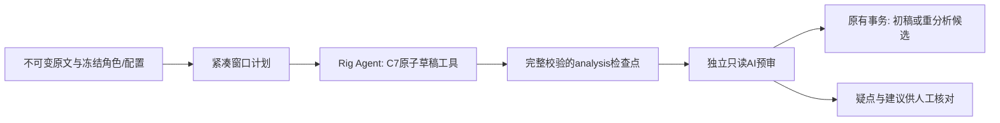

# 正式章节分析采用 Rig Agent + C7

2026-11-09，已实现。正式实现位于 Rust 宿主；实验 ECS/JSON 继续保留用于历史对照，未成为产品依赖。此决定替代旧“生产未迁移”的阶段结论，原实验结果仍按各自冻结版本解释。

用户选择当前 Rig Agent + C7，并明确修正为“按供应商能力默认最低思考档位，用户可改”，不固定 low。模型条目的 `reasoning` 缺省 `lowest`，已知能力由 Rig 0.46 精确模型目录解析，少量明确的 GLM 网关别名单独声明。未知能力不猜测、不发送思考参数。前端仅展示宿主提供的选项，支持供应商默认；只改思考强度可以在执行时保存，旧租约不变，新任务使用新修订。端点、凭据和模型替换的忙碌保护不变。GLM 强制思考和 low/high/max 定义见[官方模型说明](https://huggingface.co/zai-org/GLM-5.3-Flash/blob/main/README.md)；服务商实际执行强度不能由请求值或 reasoning_tokens=0 独立证明。

## 执行和恢复

源片是整数索引与原样文字，模型不计算字节。优先一批声明新人物并提交连续 runs，错误返回明确定位，再有限修复；纯聊天不算完成。工具只处理内存草稿，无工程写权限；原有 publisher 仍负责来源、租约、人工保护、全章校验、候选和幂等回执。

新窗口格式5保存实现/提示词/源/角色/配置身份、analysis与review完成边界。先持久化全计划，再开始付费调用。预审失败可在明确重试时复用已验证分析；不恢复在途模型请求/工具循环，不复用旧格式4固定JSON窗口。新人物核心ID仅在源/ref内稳定，应用UUID另按原分析窗口隔离，重分析不会碰撞已有候选，也不按名称合并。只读重叠从源重建，不重复写入检查点。

C7定位证据明确是宿主来源标记，不等于模型语义论证。详细解释可通过现有讨论路径请求。AI预审只存建议，不应用标注；界面按原目标章节展示建议类型/人物并定位原文，不因切章错用当前章。

每个独立Agent最多32工具尝试、3次失败校验；40轮防止不调用工具的空转。不设置累计token或整章墙钟配额；显式输出上限保留，HTTP后台单请求600秒、连接15秒和64MiB传输保护仍适用。已知上下文按紧凑协议保守估计，未知不再虚构8k。容量估计不是实际tokenizer保证，服务商仍可能拒绝超窗。

## 可观测与评测

模型请求规范输入、工具schema的摘要/大小/数量，真实工具尝试、主机反馈码、阶段开始/最近观测时间、实际用量和耗时写入既有消息与版本化窗口。工具参数/结果仅保存摘要，不复制read_source正文。未知用量不记零；缓存token是输入的子集，不重复相加。阶段运行时查询增量耗时，中断只保留已观察下界并标明不完整。401/408/429分别保留配置不可用/超时/未知供应商失败类别，不冒充工具失败。

[run_production_agent.py](../../../scripts/ai_eval/run_production_agent.py) 通过显式忽略的 Rust 测试入口直接运行正式C7核心、提示词、工具和原生Agent，不写工程。运行前预检源摘要、角色字段/重复ID，冻结二进制/驱动/输入/连接配置，结果保留失败与未知成本；程序身份变化即停止。输出只能放Git忽略目录。模型收到源、角色及别名，不收到gold。

公开AI标注可做字节标签回归；私人章节没有gold，语义质量标记unmeasured。正式评测入口验证每窗核心/运行时；窗口/数据库恢复与发布由自动化覆盖，不将无写入入口称为真实桌面端到端验收。后续修改提示词或工具应重跑固定公开集，并对真实章节做独立AI抽查，人工语义准确率另验。

## 本次验证

- 宿主264项库测试通过，6项外部条件测试按原配置忽略；新增核心27项、真实Agent HTTP错误分类、分析完成后预审失败的恢复、应用候选隔离、配置冻结/实际三协议wire映射等回归。
- TypeScript绑定由Specta导出；前端构建、45项Node测试、119项Python评测测试通过。Clippy/rustfmt/rustdoc、OpenSpec严格验证通过。
- 合成IPC浏览器覆盖中英×亮暗×1360/1024宽度：模型思考选项保存、未知能力禁发、只读预审定位；原章节分析矩阵8组也通过。不是原生桌面厂商接受测试。
- 子agent最终审阅发现错误归因/计时两项P2，修复后复核无新增P1/P2。新增真实HTTP401/408/429回归防止仅修helper未接执行分支。

真实模型为当前连接 `zcode/GLM-5.3-Flash`，配置为自动最低，解析请求low，无显式输出/累计token配额。两例均直接运行正式核心/原生运行时，身份门禁通过，没有工程写入：

| 样本 | 分析/预审请求 | 宿主阶段耗时 | 累计输入/输出token | 结果 |
| --- | --- | --- | --- | --- |
| 复用公开 holdout-tide-post | 1 / 1 | 14.30秒 | 2894 / 321 | 286/286字节标签一致；AI标注非人工真值 |
| 授权《吞噬星空》第2章，3088字符 | 1 / 1 | 79.07秒 | 11370 / 4265 | 完成；4新人物候选、88片段、1预审疑点；无gold |

这是接入冒烟，不是新一轮JSON/Agent/ECS统计对照，不能据此宣称耗时或语义质量总体改善。上轮多章稳定性见[原记录](../../desktop-studio/chapter-multi-stability-validation.md)。耗时包含主机/框架/工具开销，不等于纯模型推理。

冻结评测二进制SHA256为 `dd2858777e38590fbb75a38711fe5fa5b68578047c47f4acb860ff86f7796b49`；配置摘要 `0766f70b15e09fb8847001ef4ddd1c230df07ae0d9a604aa21674420f853089e`。后续仅补齐查询/UI显示，正式核心/运行时未改；评测原始数据保留在忽略的 `src-tauri/target/production-agent-v1/`，不提交私人文本或日志。

未验：发布包、原生桌面真实交互与跨平台、人工语义准确率。未合并、推送或发布。
