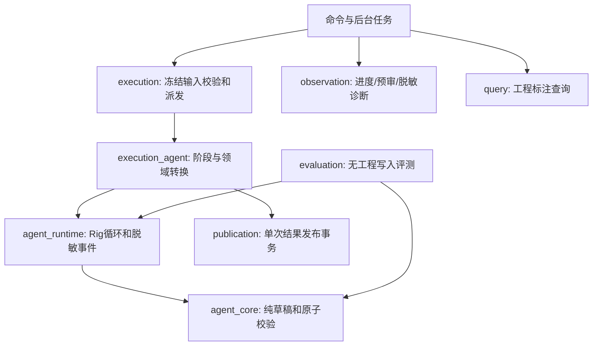

# 正式实现的架构收敛

2026-11-09，已实现；本次清理获授权不保留旧兼容。用户工程、不可变来源、人工修正、凭据与忽略目录中的私人实验产物不删除，Git提交历史不重写。

只维护Rig Agent驱动的章节归属分析。移除旧JSON流水线、ECS原型、原生completion中继、专用比较/抽查脚本和配套测试；保留唯一正式代码评测入口与公开用例。旧输入和旧窗口不迁移、不专用读取、不继续执行；需要时显式创建新任务。

发布不依赖模型运行时；观察不驱动执行；纯工具没有数据库写权限；前端不重做源校验。移除旧publication观察参数及无用lint豁免；进度计数复用已读取窗口，不再重复发计数SQL。旧锚点坐标转换被删除，唯一窗口规划继续覆盖UTF-8来源并隔离只读上下文。

四项设计基础为抽象、封装、模块化、信息隐藏；简化检查采用KISS/YAGNI/DRY/SOLID，避免只有一条实现仍保留泛化执行层。删除归档文档与已完成变更记录，现行要求由OpenSpec主规格负责；未完成的音色/引擎/视觉验收继续保留。

正式评测先验证全部输入和gold，再调用模型；评分拒绝重叠、缺口、非法UTF-8和身份，不按姓名匹配。失败仍在分母，未知用量不补零，无gold语义质量为unmeasured。只保留一个入口，见[契约](../../desktop-studio/ai-evaluation-contract.md)。

验证：262项Rust库测试、2项集成测试、45项Node测试、6项Python评测测试通过；6项库测试及2项原生应用测试按原有外部条件忽略。Specta导出、前端生产构建、Clippy全目标-D warnings、rustfmt、rustdoc-D warnings与26项OpenSpec严格校验通过；文档相对链接无缺失。Vite仍提示大chunk和中文catalog的静态/动态导入重叠，本轮没有修改前端打包策略。两套公开集共16例通过预检；独立子agent两轮只读审阅未发现P1/P2。本轮未重新进行付费模型调用或原生桌面验收；既往证据只说明当时冻结实现，不能证明本次重构后的真实服务商质量。
