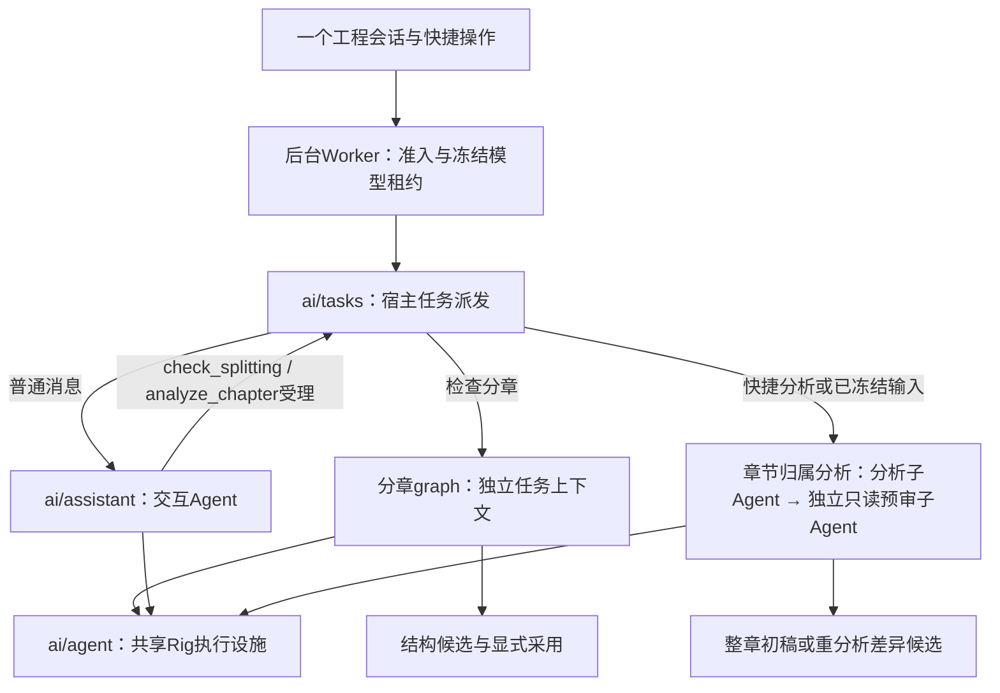

# 工程助手、专业任务与独立子Agent

2026-11-09。用户已确认此方案；实现与验证范围见文末。不新增框架、数据库或第二套会话。本文细化[单一工程助手](unified-project-assistant.md)和[分章Agent规范化](normalize-splitting-agent.md)的执行边界；不替代人工采用和章节归属分析结果契约。

## 运行结构

“专业任务”是有输入、状态与结果的宿主用例；“子Agent”是内部独立的模型执行上下文，不要求额外线程、独立模型或一个主模型调度循环。每次执行重新装配Rig Agent，所有角色共用已冻结模型及供应商能力设置；默认最低支持思考档，前端可改，未新增固定low。

`ai/agent`统一工具串行、正文遥测关闭、显式输出上限、错误分类、流式文本输出与取消处理。交互/分章保留既有执行策略，章节归属分析/预审保留40轮与核心32工具/3次失败校验，不新增累计token限额。请求/工具审计、领域完成判定和事务仍由各域hook拥有，公共执行完成不是候选已采用或人工已确认。

`ai/assistant`拥有统一交互提示词与模型上下文；`ai/assistant/tools`拥有工程工具DTO、Schema、权限和适配。分章域保留纯目录提案、graph检查点、候选发布/人工采用；工具只调用领域用例。Worker不再重复编排章节归属分析：`ai/tasks`统一选择已冻结分析、分章/交互graph以及工具受理后的章节归属分析继续执行。显式分析快捷操作不经过交互模型，任务结束不强制追加模型总结。

## 上下文与恢复

普通工程对话保留完整合法会话投影；主助手只提供只读工具和`check_splitting`/`analyze_chapter`委派工具，低层规则、边界和提交候选仅分章子Agent可调用。显式分章任务只加载自己的触发消息及同触发身份各次尝试的合法事实。自然语言委派使用持久化的独立instruction，保留用户约束，隔离父Agent正文、委派工具及委派前的局部读取。筛选按session与trigger身份，不按“某条消息之后”截取，避免重试旧任务时混入后来其他任务。完整工具调用/结果配对继续经过公共projection，未知或未完成工具不重放，私人内容不新增日志副本。工程UI保留原会话历史。

章节归属分析仍只接收原文窗口、身份和必要只读上下文，预审新建独立草稿与工具集。一个run只受理一种专业任务；章节归属分析已冻结时拒绝随后分章委派，分章已受理时拒绝再分析，不返回无法执行的accepted。分章委派意图与accepted工具事实在同一事务保存；受理后失败的显式重试直接进入专业任务，不重新委派。工具受理返回accepted后，同一run和助手消息继续streaming，宿主完成分析与发布后才结束，不伪造任务完成。检查点继续由分章graph及章节归属分析窗口各自维护，不声称公共子Agent提供在途工具循环恢复。工具事实按run、独立Agent执行身份与供应商call ID绑定；同Agent克隆共享准入状态，不同子Agent可以复用供应商ID而不碰撞。重复队列投递由run租约拦截，完成回调与候选发布保留原幂等边界，不把新执行身份当作恢复在途调用。跨run若模型主动重新提出相同业务动作仍是新调用，不能声称历史事实提供跨run业务去重。当前诊断协议为`chapter-attribution/1`，工具核心协议为`chapter-attribution-tools/1`，窗口使用`attribution-window-`前缀；不再用实验编号作为产品名或执行身份。共享执行器及调用身份桥源码已进入章节归属分析实现摘要，变更后旧完成阶段不能无校验复用。

## 可观测与评测

保留会话请求/工具台账、稳定消息及失败事实，章节归属分析阶段trace继续保存输入/工具摘要、耗时、真实用量及未知值，预审仍只读。正式无工程写入评测依旧直接运行生产核心与`agent_runtime`，现在也经过同一`ai/agent`。公开AI标注与私人无gold样本的质量边界不变；没有额外退役路线或一次性脚本。

## 验证状态

已实现并验证：282项Rust库测试通过、6项既有外部条件测试忽略；2项集成测试通过、2项真实资源测试忽略。44项Node测试、6项Python评测测试、16个公开用例预检通过；前端构建、Specta导出、全目标Clippy -D warnings、rustfmt、rustdoc -D warnings和29项OpenSpec严格校验通过。前端仅新增委派工具的现有翻译标签，构建保留既有大chunk和静态/动态导入提示。

新增真实Rig HTTP/SSE及SQLite回归覆盖历史隔离、普通对话记忆、同任务跨尝试配对、快捷直达、自然语言分章委派、失败后直接进入专业任务、父子及分析/预审复用供应商call ID、单助手消息、候选待采用和重复队列投递。实现与独立审查中修复两项P2：独立Agent工具ID碰撞，以及已受理归属分析后又受理但不执行分章。后者在受理事务内拒绝第二个任务并保留失败事实；针对性回归与独立复核均通过，最终无未关闭P1/P2。

本轮没有付费模型质量/耗时对照、原生桌面或真实进程崩溃故障注入；本地协议夹具和既有恢复测试不能替代这些验收。历史实测仍绑定旧实现摘要，不能宣称本轮语义质量或速度改善。
