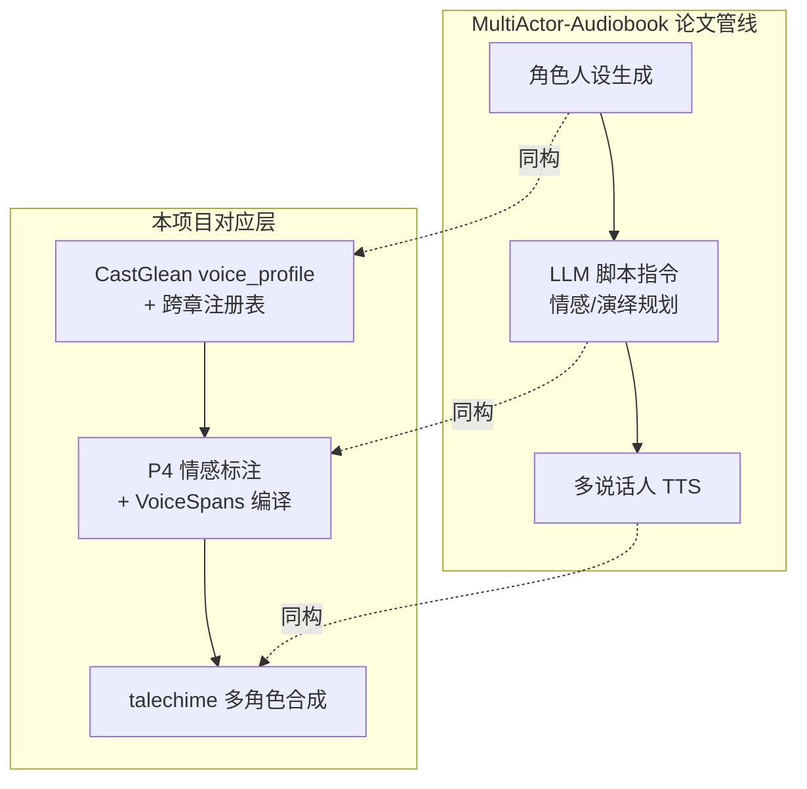

# 相关先例调研：小说角色分析与多角色听书

> **状态：外部调研快照，2026-10-14 检索。** 本文记录小说→角色/情感分析→多角色听书这条链路的开源与学术先例，用于校准 [小模型训练规划](training-plan.md) 与项目定位。外部项目状态会变化，引用数字以各自原文为准；本项目未引入其中任何依赖。

## 结论概览

1. **小模型做文学 NLP 有成熟先例**：BookNLP 一系（英文）五年前就用 BERT 小模型做角色聚类与引语归属，路线本身被反复验证。
2. **小说转有声书的工程壳成熟、语义层空白**：最流行的开源项目解决格式转换、分块、多引擎合成与打包，但"谁在说话、以什么情绪说话"靠手工标签或干脆没有。
3. **学术界 2025-2026 出现与本项目同构的 LLM 规划方案**：角色人设 + LLM 情感/演绎指令 + 多说话人合成，但全部走免训练大模型智能体路线，无证据协议、不可人工修正。
4. **"证据可溯 + 小模型本地化 + 人工修正"的组合在开源界是空白**：这是本项目的差异化定位，不是风险信号。

## 调研问题

- 是否有人用微调小模型做小说角色/归属分析？（对应训练规划 P1/P2 与挂起项）
- 是否有完整的开源"小说→多角色有声书"流水线可参考或对比？（对应 TRNovel 集成与 talechime 生态位）
- 情感标注、声音画像有没有可借鉴的数据集与标注方法论？（对应 P3/P4）

## 一、文学 NLP 小模型路线：BookNLP 一系

**[BookNLP](https://github.com/booknlp/booknlp)**（UC Berkeley，David Bamman）是该领域的基础设施：整本书的角色聚类（"Tom"、"Tom Sawyer"、"Mr. Sawyer" → 同一角色 ID）、指代消解、引语说话人归属，Python 开源。其说话人归属是 BERT 上下文打分模型——即"encoder 微调做文学任务"的直接先例。

归属组件的改进线：

| 工作 | 内容 | 与本项目关系 |
| --- | --- | --- |
| [Improving Automatic Quotation Attribution in Literary Novels](https://arxiv.org/html/2307.03734)（arXiv 2307.03734，2023） | ModernBookNLP 分支，重写 BookNLP 的 BERT 归属组件，结构化对话上约 72% | 归属打分器架构参考 |
| [Fictional Character Graphs](https://aclanthology.org/2024.findings-emnlp.744.pdf)（EMNLP 2024 Findings） | 角色图谱改进代词指代与隐式引语归属 | 对应评测集 pronoun/continuation 题型的解法参考 |
| [booknlp-plus-speaker-attribution](https://huggingface.co/bodyanats/booknlp-plus-speaker-attribution)（HF） | 5 折留出训练的增强归属模型 | 训练/评测切分方式参考 |

> **命名注意**：project-plan.md 已引的 [ModernBookNLP](https://arxiv.org/abs/2608.02359)（149M 微调编码器，PDNC 94.5）与上表 arXiv 2307.03734 的 ModernBookNLP 同名不同物，前者为 2026 年工作。引用时以 arXiv 编号区分。

**可借鉴与不可抄**：BookNLP 的流水线源码（聚类、候选评分、指代链接）是 P2 与挂起项的架构教科书；其"聚类靠相似度、归属靠打分、无证据链、错误静默传播"的弱点正是本项目证据协议（引用片段 ID、人工修正保护、unknown 不强制归属）的设计动机。中文化的证据版实现（UTF-8 字节范围、修订保护）未见先例。

## 二、小说转有声书开源项目：工程壳成熟，语义层空白

**[ebook2audiobook](https://github.com/DrewThomasson/ebook2audiobook)**（Apache-2.0，Drew Thomasson）是最流行的开源实现，配套 [VoxNovel](https://github.com/DrewThomasson/VoxNovel)（每角色选声音）与 E2A-SML（自动插标签的辅助仓库）：

- 流水线：电子书解析（epub/mobi/pdf/txt）→ 分章分句 → 多引擎 TTS（XTTSv2、Bark、Fairseq、VITS、YourTTS、Tortoise 等，路线图含 Kokoro/F5-TTS 等）→ 声音克隆 → 章节组装（m4b/mp3 等）→ 可选 MusicGen 间奏与 Audiobookshelf 上传。
- **角色与情感**：无自动角色检测、无说话人分离；换声靠手工嵌入 SML 标签（`[voice:...]...[/voice]`）；情感控制为零，只有预设风格声音与生成参数。

**启示**：开源世界把"格式→分块→合成→打包"的壳做满了，语义层（归属、情感、画像）要么手工要么缺失——这正是 CastGlean + talechime 的差异化所在。同时它印证 talechime 的生态位：它支持的每个引擎都只是可替换的合成后端。

## 三、学术前沿（2025-2026）：LLM 规划情感多角色有声书

| 工作 | 路线 | 与本项目架构的对应 |
| --- | --- | --- |
| [MultiActor-Audiobook](https://arxiv.org/html/2505.13082v1)（Interspeech 2025） | 多模态角色人设生成（面孔+声音）+ LLM 脚本指令（情感/演绎规划）→ 零样本多角色有声书 | 人设 ↔ `voice_profile`；脚本指令 ↔ P4 情感标注 + 合成端 VoiceSpans 胶水 |
| Dopamine Audiobook（arXiv 2504，2025.04） | 免训练 MLLM 智能体做情感化拟人有声书 | "大 LLM 全包"档位；见 [Awesome 列表](https://github.com/01Zhangbw/Awesome-Expressive-speech-synthesis) |
| [可控多说话人有声书智能体框架](https://arxiv.org/html/2609.33362v1)（arXiv 2609.33362，2026.09） | 智能体化可控多说话人生成 | 方向正处于活跃前沿 |
| [SpeechCraft 数据集](https://dl.acm.org/doi/10.1145/3664647.3681674)（ACM MM 2024，双语） | 多专家标注系统产出细粒度表达性语音，用个性化自然语言风格描述替代粗粒度标签 | P4 标签体系与 P3 impressions 的方法论参考——验证自由文本语义标签优于枚举字段 |

**关键区别**：学术方案均为免训练/零样本大模型智能体——即本项目规划中"大 LLM 全包"档位，成本高、不可纠错、证据不可溯。架构形状的趋同验证了分层设计的方向；"小模型 + 证据 + 修正 + 本地化"组合仍无公开实现。

## 四、中文数据与工具资源

| 资源 | 内容 | 用途 |
| --- | --- | --- |
| [MagicHub](https://magichub.com/cn/)（MagicData 开源） | 情感语音数据集；RAMC 180h 中文对话（含说话人标注） | 声音侧参考；P4 情感口径对照 |
| Emilia | 大规模中文有声书语料（ChatTTS 系训练数据） | 有声书语料形态参考 |
| AISHELL-3 | 多说话人中文语音 | 合法声音来源（talechime 侧已有记录） |
| [Dia](https://developer.volcengine.com/articles/7541273627522826283) | `[S1]`/`[S2]` 多角色对话 TTS 标签格式 | 多角色数据格式参考 |
| JY-QuotePlus / CSI / PDNC | 归属种子语料（license 约束见 project-plan.md 与 training-plan.md） | P0 已列入导入计划 |

**自家协同点**：talechime 的 readback 已在解码时捕获 `<|情感/事件/语言|>` 标签存入 `ReadbackEvidence`（talechime `docs/readback.md`）。P4 情感分类器上线后，可将其作为真实回读数据的情感标签来源（读侧标签反哺生成侧训练）。

## 五、定位对比与行动建议

| 项目 | 路线 | 语义层 | 与本项目关系 |
| --- | --- | --- | --- |
| BookNLP 一系 | 小模型流水线 | 有（英文，无证据协议） | 路线验证 + 源码教科书 |
| ebook2audiobook / VoxNovel | 工程 TTS 壳 | 无（手工 SML 标签） | 差异化反证；talechime 为同类合成后端 |
| MultiActor / Dopamine / 智能体框架 | 大 LLM 智能体 | 有（不可纠错、不本地） | 架构形状验证；成本与证据是本项目差异 |
| CastGlean + talechime | 小模型 + 证据 + 修正 + 本地 | 核心 | 组合空白区 |

按优先级的借鉴动作：

1. **读 BookNLP 源码**：归属打分器与角色聚类的实现、候选生成与指代链接策略（P2 与挂起项的架构参考）。
2. **P4 标签设计精读 SpeechCraft 方法论**：细粒度自然语言风格描述如何定义、标注与质检（与 P3 impressions 的自由文本设计互证）。
3. **MultiActor-Audiobook 论文留作架构对照**：其"LLM 脚本指令"环节的输入输出设计可与 P4 + VoiceSpans 编译互相校准。
4. Ebook2audiobook 系持续观察：作为工程壳与引擎生态的对照物，不引入依赖。

## 参考链接

- BookNLP：<https://github.com/booknlp/booknlp>
- Improving Automatic Quotation Attribution in Literary Novels：<https://arxiv.org/html/2307.03734>
- Fictional Character Graphs（EMNLP 2024 Findings）：<https://aclanthology.org/2024.findings-emnlp.744.pdf>
- booknlp-plus-speaker-attribution：<https://huggingface.co/bodyanats/booknlp-plus-speaker-attribution>
- ebook2audiobook：<https://github.com/DrewThomasson/ebook2audiobook>
- VoxNovel：<https://github.com/DrewThomasson/VoxNovel>
- MultiActor-Audiobook（Interspeech 2025）：<https://arxiv.org/html/2505.13082v1>
- 可控多说话人有声书智能体框架：<https://arxiv.org/html/2609.33362v1>
- SpeechCraft（ACM MM 2024）：<https://dl.acm.org/doi/10.1145/3664647.3681674>
- Awesome-Expressive-speech-synthesis：<https://github.com/01Zhangbw/Awesome-Expressive-speech-synthesis>
- MagicHub：<https://magichub.com/cn/>
