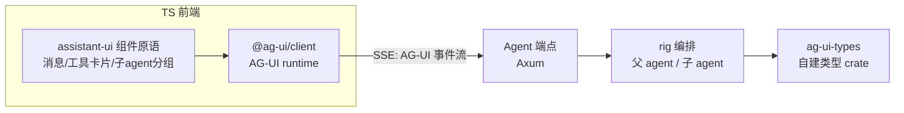

# AG-UI 协议调研与 agent 线接入方案

调研日期：2026-11-17（crate 元数据、热度数据均为当日实测）。

**状态：已拍板（2026-11-17），未实现。** 适用范围：**agent 线**（Stitchwork/rig 后端 + TS 前端的产品线）。CastGlean 桌面应用**维持现状**（ai-sdk 客户端 + 自定义 `ChatTransport`），不迁移——那个结论见 [tanstack-ai-vs-ai-sdk.md](tanstack-ai-vs-ai-sdk.md)，本文不推翻它。影响功能范围的部分后续落实到对应 OpenSpec 再动代码。

来源：[AG-UI GitHub](https://github.com/ag-ui-protocol/ag-ui)、[官方文档](https://docs.ag-ui.com/introduction)、[Subagents 概念](https://docs.ag-ui.com/concepts/subagents)、[integrations](https://docs.ag-ui.com/integrations)、[assistant-ui AG-UI runtime](https://www.assistant-ui.com/docs/runtimes/ag-ui/overview)、[AI SDK 7 发布](https://vercel.com/blog/ai-sdk-7)、[ai-sdk Subagents 文档](https://ai-sdk.dev/docs/agents/subagents)。

## 结论（TL;DR）

1. **agent 线切换到 AG-UI 协议 + assistant-ui 前端**。核心动因：任务本身是子 agent，需要协议级的子 agent 归因/挂起语义，而 ai-sdk 的 UI 协议层没有这个能力（且 v7 明确禁止 subagent × HITL 组合）。
2. **Rust 侧零外部依赖，类型自持**：自建 `ag-ui-types` crate，vendor 官方 `ag-ui-core`（MIT）+ 对照 1.0 schema 补齐 SUBAGENT_*/Activity 等变体；用官方 `spec/harness/` fixtures 对拍验证。
3. **`rig-ai-sdk` 废弃**（实现的是 v4 时代 Data Stream Protocol，`ai` 已到 7.x，落后三个大版本）。

## AG-UI 是什么

CopilotKit 2025-05 开源的**事件驱动开放协议**，标准化「agent 后端 ↔ 前端」对接。1.0 规范已冻结：JSON Schema 为权威源（`https://ag-ui.com/spec/1.0/schema.json`），TS/Python/.NET SDK 由 schema 生成并双向兼容 0.x，仓库自带 generator 与一致性 harness。

**核心模型**：agent = 一个 HTTP 端点，收 `RunAgentInput`（消息历史 + 前端工具 + 共享 state + context），流式返回 **31 种类型化事件**（8 家族：run/step 生命周期〔唯一必需〕、文本消息、工具调用、状态同步 `STATE_SNAPSHOT`/`STATE_DELTA`(JSON Patch)、reasoning、subagent、passthrough `RAW`/`CUSTOM`）。传输无关：官方绑定 HTTP+SSE 与 HTTP+Protobuf，其他传输自适配。

**事件顺序是硬约束**（客户端按 schema 严格校验，不宽容）：`RUN_STARTED` 首条 / `RUN_FINISHED`|`RUN_ERROR` 末条 / `TEXT_MESSAGE_START→CONTENT*→END` / `TOOL_CALL START→ARGS*→END→RESULT`。

**生态位**：MCP=agent↔工具，A2A=agent↔agent，AG-UI=agent↔人，三者互补。已被 Google/Microsoft/Amazon/Oracle 采用，官方集成 LangGraph、CrewAI、MS Agent Framework、Google ADK、Mastra、Pydantic AI 等；前端一等框架仅 CopilotKit 在列，另有 Slack/Teams/终端客户端。

### 子 agent 语义（我们场景的核心，1.0 新增）

**子 agent 不是嵌套流，是同一股事件流 + 归因标签**：

- `SUBAGENT_STARTED`（`subagentRunId` + `name`）/ `SUBAGENT_FINISHED`（`outcome`: success | suspended{interruptIds}）/ `SUBAGENT_ERROR`
- 其余事件（文本/工具/reasoning/step）带可选 `subagentRunId`，无标签 = 父 agent
- 支持嵌套（`parentSubagentRunId` + `parentToolCallId`，agents-as-tools 模式）与并发交错
- 挂起语义：suspended 子 agent 显示"等待中"，resume 复用同一 id 视为延续
- 前端渲染模式：按 `subagentRunId` 建折叠组，子 agent 输出可嵌进派生它的工具卡片
- **限制**：state 是 run 级，**没有 per-subagent state**（并发子 agent 上报进度须划 state 命名空间或走 CUSTOM 事件）；子 agent 事件是 opt-in（老客户端会炸未知事件，我们自己前后端都控，无此顾虑）
- 边界澄清：AG-UI **不承担 agent 间通信**——父→子调用在后端内部编排（rig 里就是函数调用），`SUBAGENT_*` 只是把过程镜像给 UI 的观测事件；跨服务 agent 互通是 A2A 的地盘

## 与 ai-sdk 对比：为什么切

**能力重合面**（这些不是迁移理由）：聊天流、工具卡片、生成式 UI、HITL（ai-sdk v5+ 的 `needsApproval` + `addToolResult` 回填 + 自动续跑与 AG-UI 的 TOOL_CALL 中断→回带→resume 语义同构）、客户端工具——两边平手。

**三点真实差异**：

| 差异 | ai-sdk（7.0.173，2026-06-25 发布 7.0） | AG-UI 1.0 |
|---|---|---|
| 子 agent UI 归因 | ❌ UI message stream 无任何命名 subagent 事件；子 agent 只是"输出为嵌套 UIMessage 的普通 tool part"，前端手动查 `part.preliminary === true`；无归因树/并发分组 | ✅ 协议事件 + `subagentRunId` 归因 + suspended 语义 |
| **子 agent × HITL** | ❌ 官方明文 "All tools must execute automatically"——子 agent 工具不能用 approval 流，"子 agent 产出→人审→生效"进不去 | ✅ suspended outcome + interruptIds |
| 协议所有权 | 流协议跟 Vercel SDK 版本走（16 个月 5→6→7 三个大版本，v4 Data Stream Protocol → v5 UI Message Stream 有迁移史）；跨语言实现自己维护 | 冻结 spec + schema 生成 SDK + 多框架官方集成；实现一次，升级是加法 |

共享 state：ai-sdk 无协议原语（须借 data parts 绕），AG-UI 有——仅当需要"agent 改前端状态"才有意义，请求-响应式审阅用不上。

**我们核心场景（任务=子 agent + 要显示 + 要审）恰好全部落在 ai-sdk 协议空白区**，这是切换的充分理由；能力平手的部分不构成留驻理由。

**热度数据（2026-11-17）**：vercel/ai 28.0k 星、`ai` 45.8M 周下载 vs ag-ui 19.1k + CopilotKit 38.7k 星、`@ag-ui/core` 6.3M 周下载（约为 ai 的 14%，对 2025-05 发布的协议属异常高）；两仓库均 24h 内有推送。ai-sdk 绝对体量更大但含大量教程流量；AG-UI 非小盘项目。互操作性现状：ai-sdk 侧无官方一等互通（Dojo 支持 [issue #933](https://github.com/ag-ui-protocol/ag-ui/issues/933) open；TanStack 对比页提到的 `@ag-ui/vercel-ai-sdk` 桥方向为 Vercel 生态接 AG-UI agent）。

## 前端选型：assistant-ui

真正支持 AG-UI 的 UI 库只有三个：

| 库 | AG-UI 支持方式 | 形态 | 判定 |
|---|---|---|---|
| [assistant-ui](https://www.assistant-ui.com/docs/runtimes/ag-ui/overview) | 独立 AG-UI runtime（双向事件/生成式 UI/HITL） | shadcn/ui+Tailwind 组件原语，复制进仓库逐块重组（同 shadcn 模式）；tool UI=`makeAssistantToolUI` | **首选**：与我们 shadcn/自持代码栈同构 |
| [CopilotKit](https://www.copilotkit.ai/ag-ui) | 协议作者参考客户端，官方唯一在列前端（React/Angular/Vue/RN） | 容器：`CopilotChat`/`Sidebar`/`Popup` 整块交付 + `useCoAgent` 状态绑定 + `useCopilotAction` 生成式 UI/HITL | 替补：HITL 审批流/状态绑定自写太重时上；SUBAGENT_* 渲染跟进最快 |
| [OpenUI](https://mastra.ai/integrations/agentic-ui/openui)（`@openuidev/react-ui`） | AG-UI 原生：`<AgentInterface />` + `agUIAdapter()` | 生成式 UI 优先（OpenUI Lang + cards/forms/tables/charts 组件库） | 不作基座（范式不同），组件库思路可抄 |

选型原则：**前端库只选一个**——容器与原语是同一事件流的两个消费者，混用会有两套消息累积器/渲染管线打架。子 agent 分组 UI 各家都无现成组件（协议只给事件），这部分工作量是选型常数，自己写。

坑与注意：

- assistant-ui 是多 runtime 架构，**须显式走它的 AG-UI runtime**；Mastra 的 assistant-ui 集成页走的是 ai-sdk 传输（`@mastra/ai-sdk` + `useChatRuntime`），勿照抄
- Vercel AI Elements / ai-sdk 生态**不支持** AG-UI（绑定 UIMessage 形状）
- 将来若上 CopilotKit 容器，自定义 agent 需补实现 `connect()`（`AbstractAgent` 默认 throw `ConnectNotImplementedError`）
- headless 数据层是 `@ag-ui/client`：`HttpAgent`（默认实现）、`AbstractAgent`（自定义传输扩展点，子类实现 `run()` 把事件喂进 `events$`）、`AgentSubscriber`、`use()` 中间件、zod 严格校验。HTTP+SSE 只是默认姿势——Tauri IPC/WebSocket/in-process 都可以走 `AbstractAgent` 子类接入

## Rust 侧：types-only，自建 `ag-ui-types`

**结论：零外部 crate 依赖。** 我们只需要类型（后端发事件），不需要 runtime。

crates.io 全景（2026-11-17 实测，全部否决）：

| crate | 状态 | 否决理由 |
|---|---|---|
| `ag-ui-core` 0.1.0（24k 下载） | 2025-08 发布，无仓库链接，从未更新 | pre-1.0 陈货，高下载是旧教程引流 |
| `ag-ui` 0.5.0-alpha.3（KimSoungRyoul） | 非官方关联，2026-09 更新 | 单维护者 + alpha，1.0 覆盖存疑 |
| `agui-sdk` 0.9.1（MattJackson） | 声称 AG-UI 1.0 + SSE/protobuf | 2026-11-11 才创建（5 天），96 下载 |
| `agui-protocol` 0.8.2 / `ag-ui-protocol` 0.1.0 | 单维护者小 crate | 下载量/维护不足以承载核心数据模型依赖 |

**决定性事实：官方 repo `sdks/community/rust/crates/ag-ui-core` 的 `Event<StateT>` 枚举只有 24 个变体，缺 1.0 的 `SUBAGENT_STARTED/FINISHED/ERROR` 与 Activity**——恰好缺我们最需要的。serde 形状本身正确，可直接沿用：

```rust
#[serde(tag = "type", rename_all = "SCREAMING_SNAKE_CASE")]
pub enum Event<S> { /* 24 + 我们补齐的变体 */ }
// 字段名 #[serde(rename_all = "camelCase")]
```

实施路径（二选一）：

1. **vendor + 补齐（推荐）**：拷官方 `ag-ui-core` 进自己 workspace（MIT），对照 schema 补 SUBAGENT_*/Activity 等变体（24→31），半天量级
2. **typify 生成**：从 `spec/1.0/schema.json` 整个生成，手工审计事件枚举 serde 形状（typify 对内部 tag 枚举的展开需调整）

无论哪种：产物为自有 `ag-ui-types` crate（事件 + `RunAgentInput` + Message/Tool/Context），rig 映射层只对它写；用官方 `spec/harness/` fixtures 做序列化对拍；等官方一等 Rust SDK 补齐 1.0 再机械替换。

## 新方案架构



渐进三步（非大爆炸，spec 已冻结故第一步不会白费）：

1. **后端事件模型对齐**：rig 编排输出按 AG-UI 形状/命名组织（含 `SUBAGENT_*`），内部传输照旧；前端 `AbstractAgent` 子类桥接（该步不碰 HTTP）
2. **前端薄 adapter**：AG-UI 事件 → assistant-ui 渲染
3. **切正式协议**：需要独立部署/多前端时，Axum SSE + 事件编码，前端换 `HttpAgent`

后端义务按功能分层：聊天流 = 最小（但事件顺序是硬约束）；共享 state = 须真读请求 state 并合法 JSON Patch 回发；前端工具/HITL = 须识别 `RunAgentInput.tools`、调 `TOOL_CALL_*` 后结束 run 等前端回带结果或走中断/resume。**协议语义主战场在后端**，前端基本是现成的。

## `rig-ai-sdk` 废弃处置

实现的是 v4 时代 Data Stream Protocol，`ai` 已 7.x，协议落后三个大版本：

1. README 顶部标 DEPRECATED，指向本方案
2. 发最后版本 0.1.5，description 改为 "DEPRECATED: ..."（crates.io description 只能靠发新版更新）
3. **不 yank**——不破坏既有依赖者

## 边界与风险

- **无 per-subagent state**：并发子 agent 进度上报须划 state 命名空间或走 CUSTOM 事件，影响后端数据结构，宜早定
- **并发交错是客户端责任**：多个子流按 `subagentRunId` 追踪/分组的渲染逻辑自己写
- **官方 Rust SDK 落后 1.0**（24 变体）——所以才走自持路线；关注 `sdks/rust` 是否升一等
- **assistant-ui 的 AG-UI runtime 相对新**，子 agent 分组等场景可能要绕其原语自组
- **A2UI / MCP Apps 载荷集成仍在演进**，不押产品在它上面
- ai-sdk 侧 reversible：CastGlean 桌面不动，agent 线切换失败可回退（协议形状对齐的产出对两条线都有价值）

## 参考

- 协议：[GitHub](https://github.com/ag-ui-protocol/ag-ui) · [文档](https://docs.ag-ui.com/introduction) · [Events](https://docs.ag-ui.com/concepts/events) · [Subagents](https://docs.ag-ui.com/concepts/subagents) · [Tools](https://docs.ag-ui.com/concepts/tools) · [integrations](https://docs.ag-ui.com/integrations)
- Rust SDK：[官方 community Rust](https://github.com/ag-ui-protocol/ag-ui/tree/main/sdks/community/rust/crates/ag-ui-client)（[ag-ui-core](https://github.com/ag-ui-protocol/ag-ui/tree/main/sdks/community/rust/crates/ag-ui-core)）· crates.io：`ag-ui` / `agui-sdk` / `agui-protocol` / `ag-ui-core`（均已否决，理由见上）
- 前端：[assistant-ui AG-UI runtime](https://www.assistant-ui.com/docs/runtimes/ag-ui/overview) · [CopilotKit AG-UI](https://docs.copilotkit.ai/agentic-protocols/ag-ui) · [OpenUI × Mastra](https://mastra.ai/integrations/agentic-ui/openui)
- 对照：[AI SDK 7](https://vercel.com/blog/ai-sdk-7) · [ai-sdk Subagents](https://ai-sdk.dev/docs/agents/subagents) · [ai-sdk Tool Approvals](https://ai-sdk.dev/docs/agents/tool-approvals) · [@ag-ui/client](https://github.com/ag-ui-protocol/ag-ui/tree/main/sdks/typescript/packages/client)
- 相关内部文档：[tanstack-ai-vs-ai-sdk.md](tanstack-ai-vs-ai-sdk.md)（CastGlean 桌面侧结论，不受本文影响）
