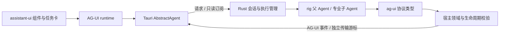

# AG-UI 协议调研与桌面 agent 重写方案

调研与复核日期：2026-11-17。

**状态：桌面 agent 前后端已切换，自动化与现场验收进度见 OpenSpec validation。** 本文现行结论覆盖 **CastGlean 桌面工程助手、分章、章节归属分析/只读预审和选角专业任务的前后端**。用户明确允许不兼容旧 agent 实现；工程正文、人工修正、声音资产和领域结果不删除。原“只改独立 agent 线、桌面维持 AI SDK”的结论已被本决定替代；[TanStack 对比](tanstack-ai-vs-ai-sdk.md)仅保留历史背景。

实施契约见 [OpenSpec 重写方案](../../openspec/changes/rewrite-agent-ag-ui/proposal.md)、[设计](../../openspec/changes/rewrite-agent-ag-ui/design.md)和[任务](../../openspec/changes/rewrite-agent-ag-ui/tasks.md)。独立 Stitchwork 产品、发布/废弃外部 `rig-ai-sdk` 包不属于本次仓库改动。

## 已确认的方向

1. 桌面 agent 前后端统一采用 AG-UI；前端使用 assistant-ui 的 AG-UI runtime。
2. 替换旧 `StreamEvent`、`ChatTransport`、AI SDK 消息转换和会话 UI 接线，不维护双栈与旧 agent 兼容 adapter。
3. 桌面继续使用 Tauri Channel，由 `AbstractAgent` 实现 IPC 传输；不为换协议新增 Axum/SSE 服务。以后有独立服务需求时再评估 HTTP。
4. Rust 类型先实跑 typify；原样生成失败后，按用户补充要求验证 `ag-ui = 0.5.0-alpha.3`。**当前设计优先复用该 crate 的协议类型，不自建整套协议类型库**，按用户最终决定，不增加通用 schema 拦截，不修正库的命名差异；宿主保证实际输出合法。
5. 新 agent 使用独立记录版本，不续跑或转换旧 agent 任务。无兼容要求不代表可以清空数据库或删改用户工程。

## 协议解决什么

AG-UI 标准化 agent 与交互端之间的请求、事件、消息、工具、共享状态和中断；不负责模型调用、任务队列、领域提交、授权或 agent 间编排。父子 agent 继续在 Rust 宿主内部调用，AG-UI 负责把可展示事实交给前端。

本次固定的 [1.0 官方 schema](https://github.com/ag-ui-protocol/ag-ui/blob/79530a25f3476d0abb93cb00761906fda757a2d5/spec/1.0/schema.json)有 98 个定义、31 类事件，使用 JSON Schema Draft 2020-12。数据形状与流行为分别验证：serde 成功、枚举齐全或 fixtures 能解码，都不能证明生命周期顺序、JSON Patch 应用和恢复语义正确。

- 文本、工具调用、reasoning、Activity、run/step 生命周期使用标准事件。
- 专业调用用 `SUBAGENT_STARTED/FINISHED/ERROR` 与 `subagentRunId` 归因；关联发起工具和嵌套父任务，不按任务名称合并。
- 子 agent 挂起使用 suspended outcome；运行以 interrupt outcome 结束，后续通过 `resume` 回答。能关联的继续复用子 agent 调用身份；新运行仍有新 `runId`。
- state 为运行级共享文档，归因不创建私有 state；进度放在宿主定义的任务命名空间。
- 领域计算完成、候选待采用、人工采用是不同事实。已经完成且无需模型继续的候选，不为等待采用伪造挂起。
- 版本容错与消费者行为按所采用规范实现，不能把 schema 的封闭对象规则直接当作所有接收端的版本兼容策略。

参考：[官方概念](https://docs.ag-ui.com/introduction) · [Subagents](https://docs.ag-ui.com/concepts/subagents) · [Events](https://docs.ag-ui.com/concepts/events)。本次不再用下载量、星数、其他框架的功能缺口作为实施前提。

## 前端：assistant-ui AG-UI runtime

使用 `@assistant-ui/react-ag-ui` 和 `@ag-ui/client`，组件沿用项目的 shadcn/Base UI、主题 token 与共享 Markdown 渲染。官方当前已经说明支持将子 agent 渲染为发起工具下的嵌套会话，因此旧文“各家均无现成子 agent 组件，必须全写”不成立；实际可复用范围在接线时验证。

`useAgUiRuntime` 接受 `AbstractAgent`，HTTP 只是默认选项。Tauri 子类直接交付 AG-UI 事件，不再先产生 AI SDK chunks。宿主历史/状态是权威；runtime 的消息重建是可丢弃显示状态，不另立一套持久化权威。

必须专项验证：runtime teardown/abort、显式停止和只读 reconnect 的关系。现有产品保证“卸载只解除订阅，后台继续”，不能因库默认清理路径而隐式取消宿主任务；前端注册的任意工具也不能获得工程写入权限。

来源：[runtime 概览](https://www.assistant-ui.com/docs/runtimes/ag-ui/overview) · [runtime options](https://www.assistant-ui.com/docs/runtimes/ag-ui/runtime-options)。

## Rust 类型实测

可复现实验源码与结果说明见 [spike](spikes/ag-ui-typify/README.md)。以下是独立编译和 JSON 测试，**不是应用集成或完整流一致性验收**。

固定输入：

- 官方仓库 commit：`79530a25f3476d0abb93cb00761906fda757a2d5`。
- `spec/1.0/schema.json` SHA-256：`4b5c93226838a0e72d88e6c5df20633c686c49fcb75d9be2815c6cbf9e48e71a`。
- 官方 fixtures：219 个文档（135 合法、84 非法），先由独立 Draft 2020-12 validator 核验标签；另把其中 153 个事件文档送入 Event 联合类型，总计 372 次探针。

### typify 0.10.1

原样生成在 `not: {type: "null"}` 处 panic，退出 101。它不是“稍改 serde tag 就能直接使用”的已验证方案。

为定位差异做了两种**不等价于原 schema** 的诊断投影：

| 路径 | 生成/编译 | 372 次探针的合法输入拒绝 | 非法输入被接受 | 合法输入往返后不再满足原 schema |
| --- | --- | --- | --- | --- |
| 原 schema | 生成 panic | 未运行 | 未运行 | 未运行 |
| 仅移除 12 处 `not:null` | 通过 | 0 | 76 | 10 |
| 再把 `const` 转单值 enum、展平对象继承与封闭规则 | 通过 | 0 | 33 | 0 |

仅移除 not 的输出会丢掉 `interruptIds`、interrupt 的 `interrupts`、JSON Patch move/copy 的 `from` 和文件来源 `provider`，不能投入应用。结构投影修复了这些已覆盖问题，但仍不能靠 serde 拒绝全部 null、数值界限、空 interrupts 等非法值；需要独立原 schema 验证器。8 次 JSON 变化是默认字段补齐或 remove 操作忽略额外 value，不能直接当作 8 次业务语义丢失。

结论：保留实验，不将此生成流水线引入应用；在存在可复用 crate 时，不为 typify 再维护一整套 schema 降级规则。

### ag-ui 0.5.0-alpha.3（KimSoungRyoul）

实测使用精确版本、关闭默认特性；仅在实验中开启 `schemars` 导出类型表面。来源：[仓库](https://github.com/KimSoungRyoul/ag-ui-rust) · [发布包](https://crates.io/crates/ag-ui/0.5.0-alpha.3)。

- 31 类官方事件均存在，额外支持 5 个退役 `THINKING_*`；本项目新生产端不发退役事件。
- 对比 Event 联合、7 类 Message 联合和 RunAgentInput 的字段名，官方事件和消息字段在本次表面对照中无缺失；包含 Activity、子 agent 归因、suspended outcome、interrupt/resume 和结构化工具结果。
- 372 次探针中，233 次合法输入均能解码，往返结果均满足原官方 schema；139 次非法输入中仍有 34 次被 serde 接受，说明类型库不能代替协议验证器。
- **不是全部 98 个定义的完全等价实现**：`MultiAgentCapabilities.sub_agents` 编码为 `subAgents`，规范字段是 `subagents`；合法 capabilities 往返会静默丢失该字段。本次按用户决定直接使用，不做局部修正；当前主链不发送 capabilities，不能据此宣称全类型完全等价。
- 其他非法接受案例含 unknown property、rawEvent null、timestamp 超安全整数范围、空 interrupts、部分 JSON Patch 约束等。部分属于消费者容错选择；本项目生成端仍须验证自己的输出，不能把宽松 serde 当规范判定。
- 默认特性关闭后不需要该库的 HTTP/client/server/runtime；本项目只复用类型，宿主运行时、任务调度、授权与恢复仍由应用拥有。

结论：**采用该 crate 的现成协议类型作为重写基座**，锁定版本，直接复用，不增加通用 schema 验证或命名修复；不 vendor 全套、自建全套或为“零依赖”重复造轮子。后续若升级，重跑同一对照；本次不将 alpha 标签或作者数量单独作为否决理由。

## 目标架构与职责

宿主负责：受理幂等、冻结工程/章节/模型配置、权威历史、有效租约、领域校验、检查点、原子候选发布、用量未知值、显式取消和人工决定。前端发送的完整协议 messages/state/context 不会因符合 schema 就获得权威，不能伪造工具成功或改写执行目标。

恢复交付使用独立传输游标与权威快照，不能把任意事件尾部当新运行喂给客户端。断开订阅和显式取消分离；不能因前端重连重发计费请求。

旧实现可以删除，领域的确定性用例和验证仍可复用。旧记录按版本隔离且停止领取，不转换旧 agent 历史、不建立双栈。正式数据库升级需验证保留工程数据与领域外键；备份/回滚不得简单用旧程序打开新增版本的库。

## 下一步与验收边界

1. 已接入精确 `ag-ui = 0.5.0-alpha.3`（关闭默认特性），实际输出使用标准运行、消息/状态快照和子任务生命周期事件。
2. 已切换 Tauri `agent_*` IPC 与 assistant-ui AG-UI runtime，删除 AI SDK transport/stream 与依赖；SQLite v9 保留领域数据，将旧 agent 记录隔离为协议版本 0。
3. 实际验收与未验边界持续记录在 [validation](../../openspec/changes/rewrite-agent-ag-ui/validation.md)，不把类型实验当成全协议 conformance。
4. 更新正式评测身份并分别记录自动化、真实模型和原生桌面证据；亮暗、小窗口、中英文仍须实际验收。

本次已完成调研、类型实验与重写规格；未执行应用前后端切换、真实模型任务或原生桌面验收。

## 2026-11-17 工作区交互实施

协议切换之后，现有两个助手入口已接入 [redesign-agent-workspace](../openspec/changes/archive/2026-11-19-redesign-agent-workspace/implementation.md) 的共享任务流、固定目标、折叠过程、任务内整组文字回答和领域审阅往返。普通讨论仍是消息，不给每个工具建立任务卡；输入在等待回答时收起并保留草稿。不保留旧逐题表单、重复停止/重试或双版开关。

本轮新增 `AgentPage.runs` 只读运行历史，以及工具-only 根问题恢复所需的标准工具生命周期；都从现有权威记录派生，无新目标步骤表或兼容协议。真实捕获帧、自动化与原生限制分别见[验证记录](../openspec/changes/archive/2026-11-19-redesign-agent-workspace/validation.md)。目标步骤推进、领域决定及音频卡继续留在 `assistant-guided-production`，不能由本轮 UI 完成状态代领。

## 2026-11-17 UI 层全面 assistant-ui 化（已实现）

按 `rebuild-agent-ui-on-assistant-ui` 完成消息层重写：自建任务树聚合（`task-index.ts`）删除，子代理消息由 `@assistant-ui/react-ag-ui` conversions 原生嵌套进 `ToolCallMessagePart.messages`（零聚合）；消息流改为 r.assistant-ui.com registry 生成件（Base UI flavor，文案 i18n 化）+ 三个委派工具卡；会话切换内嵌 ThreadList。shadcn AI Elements 消息件（message/bubble/message-scroller）随之退役。输入栏因 draft 持久化与引用拼装语义保留宿主实现（Thread composer 槽留空）。架构决策与 vendored 约定见 [decisions/agent-ui-on-assistant-ui](../knowledge/decisions/agent-ui-on-assistant-ui.md)。
