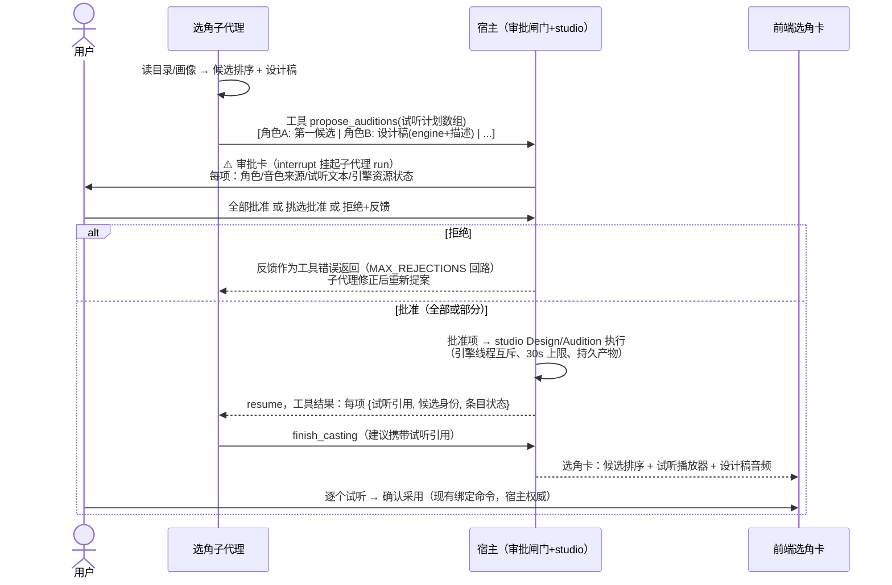

# 选角试听预览与审批闸门：调研与方案

调研与复核日期：2026-11-18。

**状态：已实现（[add-casting-preview-approval](../../openspec/changes/add-casting-preview-approval/tasks.md) 8/8 任务完成，2026-11-18；剩桌面真窗口验收与归档）。** 审批恢复、候选保存与确认绑定以该 change 为准。 本文覆盖选角子代理的试听预览工具、审批交互与确认采用链路；不改变现有绑定采用命令的宿主权威语义。协议层的挂起/resume 语义遵循 [AG-UI 协议调研](ag-ui-adoption.md)既有结论：子 agent 挂起使用 suspended outcome，运行以 interrupt outcome 结束，通过 `resume` 回答。

## 目标与已拍板决策

用户目标：

1. 选角建议时，按排位第一的候选音色生成试听音频；
2. 目录无合适音色时，音色设计草稿（design）能产出实际音频供试听；
3. 上述两个动作都必须先经用户审批，不能由子代理静默执行；
4. 设计稿与目录中已有音色一起呈现，用户先试听，再确认采用。

已拍板：**子代理在审批处挂起等待**——试听计划提交后触发 interrupt 挂起整个子代理 run，用户批准后宿主代跑合成，`resume` 后子代理携带试听结果继续收尾，`finish_casting` 发布的建议自带试听引用。备选方案「先 finish 后补试听」已否决：试听文本由子代理依据冻结证据选取，在会话上下文内审批体验连贯；interrupt 本就是 run 的合法终态，「受理≠完成」哲学未被破坏。

## 现状积木盘点（能力均已存在，缺编排）

| 积木 | 位置 | 现状 |
| --- | --- | --- |
| 选角草稿产出 | `voice_binding/suggest/draft.rs` | `finish_casting` 每目标已支持 `profile` 画像 + `voice_candidates`（仅目录真实音色的排序与理由）+ 可选 `design {engine, prompt}` 设计稿 |
| 设计引擎 | `engine/designs.rs` | 独立设计引擎已注册（描述→音色），带 `text_max_chars` / `description_max_chars` / `forbid_parentheses` 等输入约束 |
| 试听合成 | `voices/studio` | `StudioRequest::Design`（描述→候选音色+音频，`saved_id` 标记入库）与 `StudioRequest::Audition`（Preset/Library/Candidate 三种音色源）已存在；≤30 秒/16 MiB PCM 上限、受控媒体、会话缓存回收 |
| 中断机制 | `ai/interrupts.rs` | `ag_ui::Interrupt` 已带 `responseSchema`（现仅用 `type: string`）与 `subagentRunId`；「提问→落库→run 挂起→回答→resume」链路已由 `request_input` 走通 |
| 前端呈现 | `components/assistant-ui/tools/` | 工具卡识别 `requires-action` 自动展开；子代理嵌套消息可渲染；审批组 `AgentQuestionGroup` 已支持审批卡渲染 |
| 选角证据 | 冻结输入 | `CastingEvidence { kind, excerpt }` 已携带角色台词摘录——试听文本的天然默认来源 |

**缺口（已在 add-casting-preview-approval 补齐）**：选角子代理现注册 `propose_auditions`（批量 ≤32 条、试听文本 ≤500 字）与 `finish_casting`；审批走 `interrupts::persist` 持久中断，`auditions::resume` 四态恢复（Waiting/Published/Approved/Rejected），试听资产由 `recover_assets` 挂启动恢复、`mark_published` 标记发布。

## 主流 HITL 方案调研

### 审批机制的四个流派

| 流派 | 代表 | 核心机制 | 适配度 |
| --- | --- | --- | --- |
| 协议内中断 | AG-UI [Interrupts](https://docs.ag-ui.com/concepts/interrupts)、LangGraph [`interrupt()`](https://docs.langchain.com/oss/python/langgraph/interrupts) | agent 停在敏感操作前→状态持久化→人决定→`resume` 续跑，不重放已完成步骤 | ★★★★★ 已有同构实现，零新增协议 |
| 工具审批中间件 | [LangChain HITL Middleware](https://docs.langchain.com/oss/python/langchain/human-in-the-loop) | 按工具声明式配置审批策略，三态：approve / reject / **edit**（改参数再放行） | 「修改后批准」的三态值得吸收进审批卡 |
| MCP elicitation | [MCP elicitation](https://thenewstack.io/how-elicitation-in-mcp-brings-human-in-the-loop-to-ai-tools)、[Glama 解析](https://glama.ai/blog/2025-09-03-elicitation-in-mcp-bridging-the-human-ai-gap) | 工具执行中途 server→client 请求结构化输入，客户端转交用户 | 思路相同；本仓为自持宿主，无需跨进程协议 |
| 前端 human tool | [assistant-ui Tool UI](https://www.assistant-ui.com/docs/tools/tool-ui)（human tool + `addResult`）、CopilotKit `renderAndWait` | 工具在前端执行，审批卡 resolve 结果 | 不适合：合成是宿主重活，前端只是控制面 |

共同的 UX 原则（MCP 官方 guidance 与社区共识）：

1. 敏感/昂贵操作**执行前**审批，不做事后追认；
2. 审批卡**可解释**：做什么、用什么资源、影响什么（社区明确批评「末尾一个 Approve 按钮」的反模式，见[讨论](https://www.reddit.com/r/LangChain/comments/1svamiv/stop_building_humanintheloop_just_by_putting_an)）；
3. 审批三态：批准 / 拒绝带反馈 / 修改参数后批准。

### 生成式媒体的「试听→确认」模式

| 产品 | 模式 | 可借鉴点 |
| --- | --- | --- |
| [ElevenLabs Voice Design](https://elevenlabs.io/docs/eleven-creative/voices/voice-design) | 描述→一次生成多个候选→逐个试听（预览文本可自定义）→命名入库 | 设计候选是**临时的**，确认后才入库；已知坑：预览与正式生成音色不一致 |
| [Midjourney Draft Mode](https://docs.midjourney.com/hc/en-us/articles/28954697373069-Draft-Mode) | 低成本预览→满意再花 credits 出正式稿 | 「廉价预览 / 昂贵提交」分离 |
| Midjourney U1–U4 | 一次出四候选网格选择 | **批量呈现**候选优于逐个生成 |

通用模式：**廉价预览 → 人工选择 → 确认才入库**。试听音频是临时产物，设计音色确认后才成为库资产——与 studio 现有 `CandidateView.saved_id` 机制吻合。

## 设计决策（已拍板）

1. **审批载体：泛化现有 interrupt，不新增协议。** `Interrupt.responseSchema` 本就是结构化字段，`resume` 的 `ResumeEntry` payload 接受任意 JSON（`ai/protocol.rs` 的 resume 解析已支持对象 payload）。做法：`request_input` 泛化为多态中断（`reason: "human_input"` 之外增加 `"approval"`），前端 `AgentQuestionGroup` 按类型渲染审批卡而非自由文本框。与 AG-UI 官方 [Interrupt→ResumeEntry](https://learn.microsoft.com/en-us/agent-framework/integrations/by-component/ui/ag-ui/human-in-the-loop) 用法一致。
2. **计划级批量审批。** 一次选角涉及 N 个角色，逐工具审批体验不成立；子代理一次提交整个试听计划（数组），审批卡列出全部条目，支持「全部批准 / 挑选批准 / 拒绝带反馈」。借鉴 Midjourney 批量网格逻辑。
3. **审批卡可解释 + 拒绝可修。** 每项展示：角色 → 音色来源（目录第一候选或设计稿描述原文）→ 将合成的试听文本（默认取该角色台词证据 `excerpt`，用户可改）→ 引擎与资源状态（模型未下载时显示 `missing_bytes`，审批价值之一是避免批准后才触发下载）。拒绝反馈进入子代理既有 `MAX_REJECTIONS` 修复回路，子代理修正计划后可再次提案。
4. **确认采用不加新工具。** 采用绑定是宿主命令 + 选角结果卡的既有路径；agent 不代用户确认。要做的是把试听音频挂进结果卡：每个候选/设计稿旁渲染播放器，试听完点确认。
5. **入库使用实际试听的候选。** 宿主在建议可审阅期间保留音频和可直接入库的设计候选，支持跨重启恢复。seed 可记录为生成参数。确认采用时保存原候选，入库成功而绑定失败时保留资产供重新确认绑定。
6. **子代理等待。** 见「目标与已拍板决策」。

## 推荐时序

## 调研时的实现差距

以下为调研时识别的差距，均已在 add-casting-preview-approval 落地（条数上限 32、试听文本上限 500 字；多态审批中断；跨重启资产识别用持久回执）。保留原文备查：

- 选角子代理接入 interrupt：`interrupts.rs` 泛型层已支持 `subagentRunId`，需为选角子代理开放中断链路并定义挂起后的 resume 语义（对齐 AG-UI suspended outcome 结论）。
- `propose_auditions` 工具的参数 schema 与一次计划的条数上限；合成意图与 `finish_casting` 建议的关联方式（试听引用如何挂到建议条目）。
- `responseSchema` 多态形状与 `AgentQuestionGroup` 审批卡渲染；挑选批准时的部分接受语义。
- 试听文本的选取与上限（默认 `CastingEvidence.excerpt`，超长截断规则）。
- studio 任务的发起身份与预算归属：现 studio 任务是用户会话身份，子代理发起的试听记账到哪个预算、与试听互斥/引擎线程的协调。
- 设计候选的入库和重试需要持久回执。现有 Studio `saved_id` 是进程内状态，独立 OpenSpec 要求跨重启识别已保存资产。
- 引擎资源未就绪的审批卡展示与资源下载触发边界。

## 关联方向（仅会话讨论，未拍板）

同日会话还讨论了「帮我做一章音频」的生产目标链（归属分析→人工审阅采用→绑定确认→`chapter_audio_start`→导出）：倾向任务管理放宿主、做成持久化确定性目标链，agent 只负责受理目标（新委派工具 `produce_chapter_audio`），分两步落地（先只读 blockers 工具 + start 委派，后持久化目标自动推进）。该讨论中的委派接口和分期尚未拍板，整章自动推进保留在 [助手驱动制作方案](../../openspec/changes/assistant-guided-production/proposal.md) 后置。制作目标接入后可读取选角域的待审批、待绑定和已绑定状态。

## 参考

- [AG-UI Interrupts spec](https://docs.ag-ui.com/concepts/interrupts) · [Microsoft Agent Framework: HITL with AG-UI](https://learn.microsoft.com/en-us/agent-framework/integrations/by-component/ui/ag-ui/human-in-the-loop)
- [LangGraph Interrupts](https://docs.langchain.com/oss/python/langgraph/interrupts) · [LangChain HITL Middleware](https://docs.langchain.com/oss/python/langchain/human-in-the-loop)
- [MCP Elicitation（The New Stack）](https://thenewstack.io/how-elicitation-in-mcp-brings-human-in-the-loop-to-ai-tools) · [Glama：MCP Elicitation](https://glama.ai/blog/2025-09-03-elicitation-in-mcp-bridging-the-human-ai-gap)
- [assistant-ui Tool UI](https://www.assistant-ui.com/docs/tools/tool-ui)
- [ElevenLabs Voice Design 文档](https://elevenlabs.io/docs/eleven-creative/voices/voice-design) · [ElevenLabs Voice Design 产品页](https://elevenlabs.io/voice-design)
- [Midjourney Draft Mode](https://docs.midjourney.com/hc/en-us/articles/28954697373069-Draft-Mode) · [Generative media UX patterns](https://www.uxtools.co/blog/generative-media-workflows-in-ui-design)
