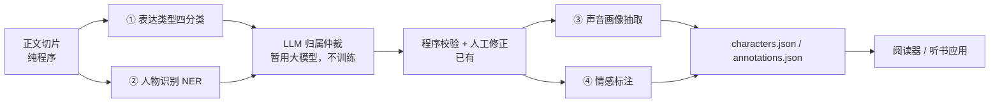

# 小模型训练规划

> **状态：规划中，未实现。** 本文档描述用本地训练的小模型承接部分 LLM 分析任务的长期计划，是 `docs/implementation-roadmap.md` 的姊妹篇：路线图跟踪协议与工作流演进，本文档跟踪模型侧的并行路线。撰写时仓库内没有任何训练或非 LLM 推理代码，全部语义判断仍由 `AnalysisModel` 后端的单次生成调用完成。

## 背景与动机

阶段 B 的三个语义判断（表达类型、归属、角色与别名发现）目前全部由提示词驱动的大模型完成。现有评测已经给出两个方向性事实：

- [归属评测基线](attribution-evaluation-baseline.md)：MiniMax-M2.5 整体严格联合 90.2%、类型字节准确率 93.4%；本地 Qwen3-14B（Q4_K_M，未微调）分别只有 33.3% 和 70.5%。差距集中在幻觉身份、强行归属未知说话人、编造别名后缀——归属核心判断；同时类型字节准确率也说明，即使是"判断题"，未微调的本地小模型同样不可用。
- [项目企划](project-plan.md)已引证微调路线的先例：ModernBookNLP 用 149M 微调编码器在 PDNC 达 94.5%，JY-QuotePlus 家族上微调后的 PromptCLUE 达 95.07，而零样本提示的 GLM-6B 约 66–76%。"小模型微调"与"提示大模型"是两条并行路线，95% 以上的成绩均来自微调。

由此确定分工：**小模型接管判断题，大模型留守作文题。** 表达类型四分类、人物识别、声音画像、情感标注是局部上下文内的分类问题，适合 1–3 亿参数编码器全参微调；跨章身份仲裁与歧义推理保持现有 LLM 后端。归属任务的 LoRA 微调挂起，触发条件见文末。

## 任务分级

| 任务 | 题型 | 现状 | 小模型定位 |
| --- | --- | --- | --- |
| 表达类型四分类（narration/speech/thought/quoted_text） | 判断题 | LLM 每窗口输出 | 高，首选训练目标 |
| 人物与别名发现 | 判断题 + 聚类 | LLM 每窗口输出 | mention 识别可训练；同名人区分与别名归并留给 LLM |
| 说话人归属仲裁 | 作文题 | LLM 每窗口输出 | 状态三分类可做；身份仲裁暂不训练 |
| 声音画像（gender/age_band/impressions） | 判断题 | schema 已定义，提示词 v5 禁止 LLM 输出，无 producer | 高，空槽位 |
| 每片段情感标注 | 判断题 | 规划字段，标签体系未定义 | 高，需先与合成端协同设计标签 |

## 目标架构

统一策略与三条纪律：

1. 四个分类器共享同一编码器底座家族（如 chinese-roberta-wwm-ext 系，110M 起步），只换任务头，降低训练、导出与部署的重复成本。
2. 已有规则代码不删除，降级为三个角色：评测基线（模型须打赢才上岗）、蒸馏预标注器（先粗标再让 LLM 校对，降低 API 成本）、模型文件缺失时的降级路径。
3. 小模型产出注入 LLM 归属提示词作为预消化事实，LLM 只做仲裁；不改变"模型只建议、程序校验"的边界。

## 分阶段计划

每个阶段先建冻结金标评测集，后训练。评测套件沿用 `evaluations/` 的 suite 模式：gold 产物加 freeze 哈希清单，开发/留出对半，失败计入分母。

### P0 地基（1–2 周）

- 训练环境：Windows + RTX 5070（12GB）。编码器全参微调占 4–8GB，宽裕；更大负载见硬件预算表。
- 框架选边：先用 PyTorch 在公开中文分类数据上跑通一次编码器微调（训练循环的行业通用语言），再用 Burn 重跑同一任务，此后编码器任务固定一边为主线。
- 蒸馏管道：MiniMax（现基线 90.2%）批量标注真实章节，人工抽检约 5%。外部种子语料导入：JY-QuotePlus（8,144 条《射雕英雄传》引语，说话人与听话人双标注，一致性 99%+；**仓库无 license 文件，先限内部评测，分发前联系作者**；JY-Quote4 已确认为空壳）与 CSI（18 本中文小说，NAACL 2022，带 license.txt）。
- 产出：每任务 50–100 条人工金标冻结评测集；统一 `training-data/` 标注目录。标注数据可提交；模型权重永不入 Git。

### P1 表达类型四分类（2–3 周）

- 输入：目标片段 + 前后各 3 个上下文片段；输出四分类。
- 数据：蒸馏 1–2 本书（约 5,000–20,000 片段）+ JY-QuotePlus 映射。
- 验收：冻结评测集 ≥95%，且明确优于引号/标点规则基线。
- 交付：导出 ONNX，在独立测试壳中验证 Rust 加载；CastGlean 集成放 P5。

### P2 人物识别 NER（1–2 周）

- 与 P1 共用同批蒸馏数据，标注时人名 span 一并产出。
- 范围：mention 级识别（含只被提到的人）；同名人区分与别名归并不做，留给 LLM 仲裁。
- 验收：mention 级 F1 ≥90%。

### P3 声音画像抽取（2 周）

- 输入：某角色全部相关片段及上下文；输出 gender / age_band / impressions 及证据 span，直接对应 `schemas/characters.schema.json` 的 `voice_profile`。
- 代词他/她规则可覆盖 gender 大半；评测集应集中在规则打不准的 age_band 与 impressions 上。
- 交付后 `voice_profile` 首次有 producer，与路线图 C 的可选画像更新衔接。

### P4 情感标注（2 周，含标签体系设计）

- 前置：每片段情感标签体系需与听书合成端协同设计——标签最终要喂给合成侧的语气/样式映射，两侧口径一起冻结；仅协同设计标签，不在核心 API 耦合对方类型。
- 标签冻结后复用 P1 管道换头重训。

### P5 Rust 集成（1–2 周）

- CastGlean 增加显式 feature-gated 分类模块（ort 或 candle 加载，随 P0 选边）；原生依赖的平台问题参照 talechime `tts-candle-platform` 的隔离模式。
- 模型权重走用户资源目录约定，不随仓库分发，manifest 固定修订号；普通测试不加载模型。
- LLM 归属提示词瘦身：四分类与 NER 结果作为预消化事实注入，大模型只做仲裁。

## 挂起项：归属 LoRA 微调

对 Qwen3 级底座做 LoRA/QLoRA 微调，让本地小模型逼近蒸馏老师的归属质量。同时满足三个条件再启动：

1. 蒸馏数据积累到约 50,000 片段量级；
2. 归属协议冻结（路线图 D）；
3. LLM API 成本或延迟在真实使用中成为实际痛点。

在此之前，归属仲裁全部由现有 LLM 后端承担。

## 硬件与框架预算

训练机为 Windows + RTX 5070，12GB 显存（Blackwell，需 CUDA 12.8 及以上的 PyTorch 构建）。

| 工作负载 | 方式 | 预算 |
| --- | --- | --- |
| 编码器（110M–330M）四任务全参微调 | bf16 | 4–8GB，宽裕 |
| Qwen3 0.6B–4B（挂起项） | LoRA | 5–8GB |
| Qwen3 8B（挂起项） | QLoRA 4-bit + 梯度检查点 | 10–12GB，紧 |
| 14B 及以上微调 | — | 16GB+，超出本机 |

部署侧与 talechime 同构：训练产出权重，Rust 侧以 ort 或 candle 推理。训练框架（PyTorch/Burn）的选择不约束部署运行时；Burn 训练的模型可直接以 Burn record 部署，省去 ONNX 中转。

## 立即可做

1. 挑一本有代表性的书跑现有 LLM 分析，人工标注第一个 50 条四分类金标。
2. 在训练机上完成 PyTorch/Burn 双跑选边实验。
3. 导入 JY-QuotePlus，评估其双标注与四分类口径的映射关系。
