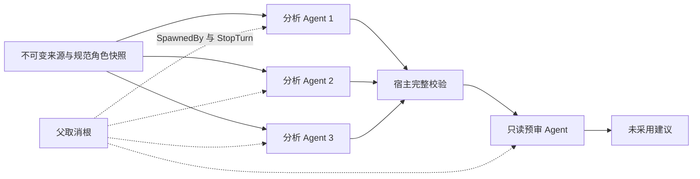

# Rig ECS 0.46 隔离原型

这是 CastGlean 的实验 package，不是另一个产品后端。生产仍是 `src-tauri` 单 crate；没有修改其 Cargo、IPC、SQLite 或默认执行路线。显式 feature 才构建二进制。上游仅使用真实 `rig-ecs` 内核，不加载 coding harness 或 subagents 插件。



每个 agent 经 `AgentPlugin → Deliver → TurnCall → ModelAdapter → TurnOutcome`；MockCompletionModel 只替换模型传输边界，调度的不是普通 future 冒充的 agent。现阶段 CLI **仅离线受控模型**，不会读取系统密钥或发网关请求。模型请求显式设置 low，公共评测 scope 为 known-only，不测角色发现。`Kernel::launch` 接收通用 ErasedHandler，实际网关/宿主连接租约接入仍未实现或验证。

从仓库根目录运行：

```bash
cargo build --locked --manifest-path experiments/rig-ecs-prototype/Cargo.toml --features rig-ecs-prototype
cargo test --locked --manifest-path experiments/rig-ecs-prototype/Cargo.toml --features rig-ecs-prototype -- --test-threads=1
cargo fmt --check --manifest-path experiments/rig-ecs-prototype/Cargo.toml
cargo clippy --locked --manifest-path experiments/rig-ecs-prototype/Cargo.toml --all-targets --all-features -- -D warnings
RUSTDOCFLAGS='-D warnings' cargo doc --locked --manifest-path experiments/rig-ecs-prototype/Cargo.toml --all-features --no-deps

# 只读调用父任务维护的公共 evaluator、suite、mock adapter 和固定数据。
# 合并公共工具后可改为 --shared-root .；此命令不写传入的 shared-root。
python3 experiments/rig-ecs-prototype/check_shared.py --shared-root /Volumes/yexiyue/castglean
python3 experiments/rig-ecs-prototype/check_process_recovery.py
```

共享检查会执行公共 Python 测试、运行全部十例、与公共“全旁白/零问题”基线比较，生成 target 中的报告。它没有自定义 gold 或评分器；两个基线都不读答案。`--mode mock` 的相同评分只证明字节覆盖、身份、trace、独立预审及比较机制对齐，不证明 AI 质量。

## 适配器输入与运行

stdin 接受一行 v1 case，stdout 输出一行 v1 结果。处理过的 cancelled/failed/interrupted 返回合法结果并退出 0，让公共 runner 保留 trace；输入/存储等未处理错误退出非零。原型没有 publish 阶段。

- `evaluationTask:analysis`：拒绝 reviewInput；创建三个并发分析 agent、宿主完整校验、一次自带只读预审。公共 runner 不用这次自带预审评植错召回，但其成本如实入 trace。
- `evaluationTask:review`：只验证并预审 reviewInput；一个 agent 请求，不重新分析。按实际候选边界生成 sN targets，宿主检查 issue 精确引用和 suggestion 的规范角色/类型。
- 无 evaluationTask 的显式控制用例：pipeline，与三路分析＋预审同义；恢复/取消测试使用这一模式。

```bash
# 独立命令示意；输入和响应脚本均须是已授权材料。
experiments/rig-ecs-prototype/target/debug/rig-ecs-prototype \
  --case /absolute/path/to/case.json --script /absolute/path/to/script.json \
  --checkpoint "$PWD/experiments/rig-ecs-prototype/target/manual/checkpoint.json"

# 公共 evaluator 可直接调用这个 argv。每个 case/task 有独立检查点。
experiments/rig-ecs-prototype/target/debug/rig-ecs-prototype \
  --smoke-narrator --checkpoint-dir "$PWD/experiments/rig-ecs-prototype/target/batch" \
  --dataset-hash PUBLIC_MANIFEST_DATASET_HASH --dataset-version chapter-analysis-v1.0
```

`--smoke-narrator` 刻意把三个合法 UTF-8 范围全设旁白、预审报零问题；不读取 gold 或植错候选标签生成分析。`--plan FILE` 输出固定三片字节范围。自定义 script 为 `{analysis:[events1,events2,events3],review:events,delayMs:[a,b,c,d]}`；events 是 rig-core 0.46 MockStreamEvent 的 serde 格式，Rust 受控样例见 `src/tests.rs`。没有响应自动续用或 SDK fallback。`--timeout-ms` 是整轮本地期限，`--cancel-after-ms`、`--interrupt-after` 和 `--smoke-delay-ms` 用于可控故障注入。

## 身份、观察与恢复

configurationHash 只覆盖 `configuration:{model,maxOutputTokens,temperature}`、`reasoning:"low"`、`identityScope:"known-only"`；当前 model 为 controlled-script。route、代码、提示词、协议、脚本摘要及执行控制不混入模型配置身份，但恢复指纹另包含它们和来源、角色、候选、datasetHash/datasetVersion。真实两路线评测应传同一模型配置和冻结数据；不能把这里的 mock 模型身份改名冒充真实配置。

trace 的 startedAt 为 UTC 六位微秒，isRequest=true 仅出现在模型请求。metadata 包含配置/来源/提示/协议/代码/数据集及角色快照摘要。低层完整 EffectRecord 留内存，只提取 effect ID；不把其 kind/outcome 原文落盘。token 未报告为 null，已报告缓存是输入的子集。`requestCount` 是本进程新模型 dispatch 数；恢复报告的历史 trace 仍保留旧请求，不代表本进程重发。峰值另由实际 active 计数和公共 trace 区间核验。

只允许向本 package 忽略的 target 树写产物；检查路径穿越和符号链接逃逸。OS 锁保证同一检查点单写；发送前持久化 in_flight，结果结构校验后才记 completed。重开重新校验已完成输出；在途变 unknown，失败/取消/超时也不自动重发。源码、配置或冻结输入身份改变拒绝恢复。恢复不是新运行授权，不在检查点改状态制造重试。

每次独立公共评测使用新的 checkpoint-dir；重复使用则是在验证恢复，不是新模型实验。真实网关、服务商取消/计费、SQLite 事务、Tauri 原生线程/响应性和跨平台仍需独立验收，见[验证记录](../../docs/desktop-studio/rig-ecs-prototype-validation.md)。
