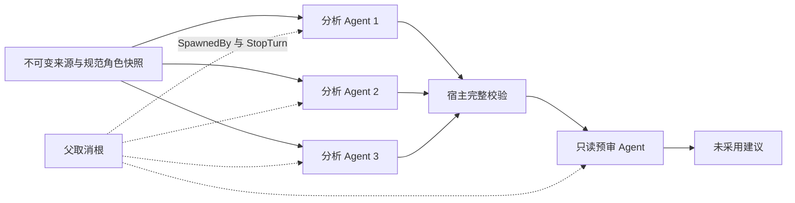

# Rig ECS 0.46 隔离原型

这是 CastGlean 的实验 package，不是另一个产品后端。生产仍是 `src-tauri` 单 crate；没有修改其 Cargo、IPC、SQLite 或默认执行路线。显式 feature 才构建二进制。上游仅使用真实 `rig-ecs` 内核，不加载 coding harness 或 subagents 插件。



内核路径为 `AgentPlugin → Deliver → TurnCall → TurnOutcome`；受控模型经 ModelAdapter，native live 经 Serve/ErasedHandler，MockCompletionModel 只替换受控传输边界，调度的不是普通 future 冒充的 agent。默认 CLI 仍为离线受控模型。新增显式 `native-live` feature 和 `--live-config`，用实际内核 CompletionRequest 委托原生 call helper；密钥只由 helper 经原有系统凭据边界获取。模型请求显式设置 low，公共评测 scope 为 known-only，不测角色发现。上线质量并未通过，真实固定 suite 的失败与对照见[原生 live 验证](../../docs/desktop-studio/rig-ecs-native-live-validation.md)。

从仓库根目录运行：

```bash
cargo build --locked --manifest-path experiments/rig-ecs-prototype/Cargo.toml --features rig-ecs-prototype
cargo test --locked --manifest-path experiments/rig-ecs-prototype/Cargo.toml --features rig-ecs-prototype -- --test-threads=1
cargo fmt --check --manifest-path experiments/rig-ecs-prototype/Cargo.toml
cargo clippy --locked --manifest-path experiments/rig-ecs-prototype/Cargo.toml --all-targets --all-features -- -D warnings
RUSTDOCFLAGS='-D warnings' cargo doc --locked --manifest-path experiments/rig-ecs-prototype/Cargo.toml --all-features --no-deps

# 只读调用父任务维护的公共 evaluator、suite、mock adapter 和固定数据。
# 合并公共工具后可改为 --shared-root .；此命令不写传入的 shared-root。
python3 experiments/rig-ecs-prototype/check_shared.py --shared-root /Volumes/yexiyue/castglean
python3 experiments/rig-ecs-prototype/check_process_recovery.py
```

共享检查会执行公共 Python 测试、运行全部十例、与公共“全旁白/零问题”基线比较，生成 target 中的报告。它没有自定义 gold 或评分器；两个基线都不读答案。`--mode mock` 的相同评分只证明字节覆盖、身份、trace、独立预审及比较机制对齐，不证明 AI 质量。

## 适配器输入与运行

stdin 接受一行 v1 case，stdout 输出一行 v1 结果。处理过的 cancelled/failed/interrupted 返回合法结果并退出 0，让公共 runner 保留 trace；输入/存储等未处理错误退出非零。原型没有 publish 阶段。

- `evaluationTask:analysis`：拒绝 reviewInput；创建三个并发分析 agent、宿主完整校验、一次自带只读预审。公共 runner 不用这次自带预审评植错召回，但其成本如实入 trace。
- `evaluationTask:review`：只验证并预审 reviewInput；一个 agent 请求，不重新分析。按实际候选边界生成 sN targets，宿主检查 issue 精确引用和 suggestion 的规范角色/类型。
- 无 evaluationTask 的显式控制用例：pipeline，与三路分析＋预审同义；恢复/取消测试使用这一模式。

```bash
# 独立命令示意；输入和响应脚本均须是已授权材料。
experiments/rig-ecs-prototype/target/debug/rig-ecs-prototype \
  --case /absolute/path/to/case.json --script /absolute/path/to/script.json \
  --checkpoint "$PWD/experiments/rig-ecs-prototype/target/manual/checkpoint.json"

# 公共 evaluator 可直接调用这个 argv。每个 case/task 有独立检查点。
experiments/rig-ecs-prototype/target/debug/rig-ecs-prototype \
  --smoke-narrator --checkpoint-dir "$PWD/experiments/rig-ecs-prototype/target/batch" \
  --dataset-hash PUBLIC_MANIFEST_DATASET_HASH --dataset-version chapter-analysis-v1.0
```

`--smoke-narrator` 刻意把三个合法 UTF-8 范围全设旁白、预审报零问题；不读取 gold 或植错候选标签生成分析。`--plan FILE` 输出固定三片字节范围。自定义 script 为 `{analysis:[events1,events2,events3],review:events,delayMs:[a,b,c,d]}`；events 是 rig-core 0.46 MockStreamEvent 的 serde 格式，Rust 受控样例见 `src/tests.rs`。没有响应自动续用或 SDK fallback。`--timeout-ms` 是整轮本地期限，`--cancel-after-ms`、`--interrupt-after` 和 `--smoke-delay-ms` 用于可控故障注入。

## 身份、观察与恢复

configurationHash 只覆盖 `configuration:{model,maxOutputTokens,temperature}`、`reasoning:"low"`、`identityScope:"known-only"`；当前 model 为 controlled-script。route、代码、提示词、协议、脚本摘要及执行控制不混入模型配置身份，但恢复指纹另包含它们和来源、角色、候选、datasetHash/datasetVersion。真实两路线评测应传同一模型配置和冻结数据；不能把这里的 mock 模型身份改名冒充真实配置。

trace 的 startedAt 为 UTC 六位微秒，isRequest=true 仅出现在模型请求。metadata 包含配置/来源/提示/协议/代码/数据集及角色快照摘要。低层完整 EffectRecord 留内存，只提取 effect ID；不把其 kind/outcome 原文落盘。token 未报告为 null，已报告缓存是输入的子集。`requestCount` 是本进程新模型 dispatch 数；恢复报告的历史 trace 仍保留旧请求，不代表本进程重发。峰值另由实际 active 计数和公共 trace 区间核验。

只允许向本 package 忽略的 target 树写产物；检查路径穿越和符号链接逃逸。OS 锁保证同一检查点单写；发送前持久化 in_flight，结果结构校验后才记 completed。重开重新校验已完成输出；在途变 unknown，失败/取消/超时也不自动重发。源码、配置或冻结输入身份改变拒绝恢复。恢复不是新运行授权，不在检查点改状态制造重试。

每次独立公共评测使用新的 checkpoint-dir；重复使用则是在验证恢复，不是新模型实验。真实网关、服务商取消/计费、SQLite 事务、Tauri 原生线程/响应性和跨平台仍需独立验收，见[验证记录](../../docs/desktop-studio/rig-ecs-prototype-validation.md)。

## 可选原生 live adapter

```bash
cargo build --locked --manifest-path experiments/rig-ecs-prototype/Cargo.toml --all-features
cargo test --locked --manifest-path experiments/rig-ecs-prototype/Cargo.toml --all-features -- --test-threads=1

# 只检查非密钥配置和 helper 身份，不调用模型。
experiments/rig-ecs-prototype/target/debug/rig-ecs-prototype \
  --inspect-live-config "$PWD/experiments/rig-ecs-prototype/target/native-live/binding.json"

# 原型自己的测试 helper，无网络、无凭据；使用 controlledHelper:true 的显式 manifest。
python3 experiments/rig-ecs-prototype/check_shared.py --shared-root /Volumes/yexiyue/castglean \
  --native-config experiments/rig-ecs-prototype/target/native-live/controlled-binding.json

# 实际在线：仅在已授权和排期后执行。runner 固定 workers=1；每 case 内最多三路。
python3 experiments/rig-ecs-prototype/run_live.py --shared-root /Volumes/yexiyue/castglean \
  --live-config experiments/rig-ecs-prototype/target/native-live/binding.json \
  --split development --output-dir experiments/rig-ecs-prototype/target/live-evaluation/development-v1
```

manifest 是显式本机材料，放 target，不提交：

```json
{
  "bridgeBinary": "/absolute/path/to/frozen-native-test-bridge",
  "configPath": "/absolute/path/to/non-secret/llm-connections.json",
  "selection": {"connectionId": "explicit-connection-id", "modelId": "explicit-model-record-id"},
  "controlledHelper": false
}
```

`bridgeBinary` 必须支持 `CASTGLEAN_EXPERIMENT_JOB` 和 `--exact chapter_analysis::experiment::protocol_experiment_bridge --ignored --nocapture`，接收 `{op:"call",configPath,selection,system,user,schema,low:true}`，返回同路径 `.result.json` 的 `{ok,text,usage,model}`。usage 使用 snake_case；缺失字段仍未知。adapter 不带硬编码地址、密钥或模型 ID。Python runner 只处理 manifest 和公共白名单，不打开系统凭据或非密钥 LLM 配置；Rust 读取选中配置核验 revision、API model 与可空容量。

Live configurationHash **替代离线控制模型的 hash 形状**，严格采用父线 canonical sorted JSON：`{configuration:{revision,selection},capacity:[contextWindow,maxOutputTokens],model:<实际API模型ID>,reasoning:"low"}`。known-only、route、代码、协议、提示、并发不混入该 hash。routeHash 只包含非密钥路由摘要，helper hash、mode、dataset/version、代码和执行控制另入恢复指纹。`controlledHelper:true` 永远标为 mock，不能产生 live 证据。

每请求 600 秒，无自动重试；子进程由 Tokio supervisor 持有，取消/超时 kill＋wait，本地 owner 等待清理完成。Ctrl-C/SIGTERM 变为父取消；SIGKILL 无法提供清理保证。helper 结束不证明提供商停算，已开始 live 请求取消后子结果为 unknown，恢复不重发。外层 suite 期限大于分析＋串行预审两次请求期限。私有 job/result 处于 target 的独立临时目录（目录 0700、job 0600），成功/失败/协作取消后删除；stdout/stderr 不进公开报告。

`--inspect-live-config` 计算 helper 实际 SHA256 与文件身份；runner 写出冻结 manifest，后续请求复核 identity，避免每次重新摘要大二进制或调用被替换的 helper。实际模型为 declared provider 的 ModelSpec，容量读自配置；tools/structured output/价格不从 DeepSeek 或其他模型继承，metadata 明示 capabilitiesVerified=false。桥使用 Schema 不等于实际模型已证明严格遵守 Schema：仍须完整宿主验证。

协议 `chapter-analysis-v1/ecs-owned-utf8-v2`：分析 start/end 的 Schema enum 限本任务 UTF-8 边界，speaker enum 限规范身份；审阅 issue 范围限候选 sN targets，人工状态仍 unreviewed。它与推荐紧凑协议及切片策略不同；native helper 启动/编排方式也不同，只能比较路线组合。开发集后未据留出结果修改提示、协议或校验。

## 方案 C：共同工具与反馈修正

后续实验见[方案 C 验证](../../docs/desktop-studio/chapter-tool-agent-validation.md)。两路线均使用真实工具循环，同一二进制以 `--plan-c-route classic|ecs --live-config FILE` 选择运行时，stdin 是公共评测白名单的一行 Case；`native-live` feature 必须显式启用。每个进程只执行一个 case/task，默认不改产品工程。

```bash
cargo build --manifest-path experiments/rig-ecs-prototype/Cargo.toml --all-features --locked
python3 scripts/ai_eval/run_tool_comparison.py \
  --shared-root /absolute/path/to/shared-evaluator-repository \
  --dataset evaluations/chapter-tool-agent-v1 --split holdout \
  --binary /absolute/path/to/frozen/rig-ecs-prototype \
  --config /absolute/path/to/native-config.json \
  --output experiments/rig-ecs-prototype/target/plan-c/new-run --mode live
```

NativeConfig 沿用上节字段，但 helper 需支持新增的测试桥 `op:completion`（保留完整工具请求/响应），旧只读 `op:call` helper 不能代用。密钥仍只由 Rust 原生 helper 读取。成对入口冻结 binary/helper/config/实际连接/evaluator/数据/脚本，按 case 交替先后顺序。`tool_agent_adapter.py` 保留独立预审身份；结束后必须通过 `verify_tool_comparison.py` 的逐例逐任务检查，门禁失败退出 2 并标记不可比。

`run_private_tool_smoke.py` 仅接收此前已授权冻结的章文本，通过 `--discover-characters` 做单独 smoke；不使用 gold、不加入公开准确率、不发布用户工程。所有输入/响应与模型产物保持在忽略的 target 下。


方案 C 追加无 token 上限实验：原生 live 配置可显式指定 `"unlimitedTokens": true`，此时不设置请求输出 token 上限、ModelSpec 输出上限或累计 64k 阈值；默认配置维持旧限制。模型请求/工具/修正/300秒任务限制分别保留。原生 helper 需包含匹配的新测试桥，并明确验证 opt-in 与 `max_tokens: None`。`scripts/ai_eval/run_unlimited_chapter_comparison.py` 对已授权的固定章节进行两轮 JSON/classic/ECS 反序对照，私人快照及结果只存 target；不自动读取新小说、写工程或重试失败。实验结果见[方案 C 验证](../../docs/desktop-studio/chapter-tool-agent-validation.md)。


修复工具协议 `chapter-tools-c3-batch-feedback`：人物提议按批次声明并使用局部ref，补丁支持稀疏原子提交；严格保护冲突范围和最终完整覆盖。追加 `"unlimitedTime": true` 可关闭所有实验执行期限；仍保留16次模型/32次工具/3次失败校验与独立清理控制。`"reasoningEffort": "low"`（默认）或 `"default"` 分别显式请求低思考或使用服务默认，不支持将GLM-5.3-Flash伪装成关闭思考。匹配的native helper提供仅含白名单字段/计数的wireFacts；实时审计含模型/工具事件，不含参数/正文/推理文本。真实canary、小说对照和各层期限边界见领域验证文档。


后继 `chapter-tools-c4-piece-assignment` 使用pieces集合指派，由宿主生成坐标，冲突反馈含双方索引；完整缺口以missingRanges表示，missingIds最多512。旧区间端点仅为内部兼容，公开Schema不再要求模型计算范围。修复不放松原子性、身份、stale冲突与最终整章覆盖。dev包仅优化sha2以降低221MiB helper全量摘要验证的开销，不能把跨版本墙钟变化全部归因工具优化。


无期限实验完成后用 `scripts/ai_eval/verify_unlimited_chapter_comparison.py --run-dir DIR --fixture-root FIXTURE --protocol PROTOCOL --binary BINARY --config CONFIG` 作只读核对。核对来源/冻结程序/计划槽位/实际HTTP限制与思考字段，不读取gold语义，不代表人工质量验收。最终C4真实结果见领域报告；后置 `chapter-tools-c5-terminal-feedback` 的预算耗尽立即停请求与finish参数Schema反馈只有受控验证，不混入冻结C4结果。
