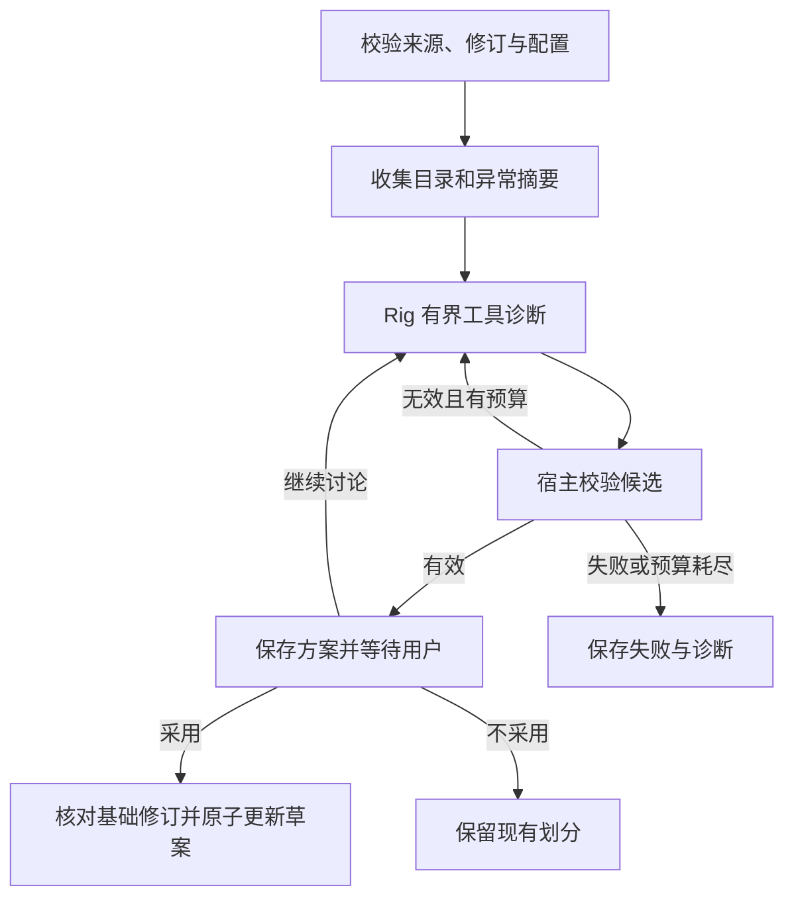

# 整书分章与诊断设计

## Context

动机与范围见 `proposal.md`。当前 `src/lib/chapter-import.ts` 在浏览器逐文件读取 UTF-8、每文件生成一章；`preview-projects.tsx` 仅保存内存草案。`project/document.rs` 和 `project-files.ts` 分别校验 v1，最多 50 章、每章 5 MiB、合计 20 MiB；Rust 已提供同目录临时文件和原子替换。设置页的文本服务只有禁用预览，当前 Cargo/package 清单没有 LLM、图执行或聊天依赖。

现有任务采用宿主权威快照、任务身份、递增序号与 Channel。沿用这些边界，而不是把浏览器聊天历史或 graph Context 当成工程事实。三个现有主规格不覆盖本变更；`legacy-main` 和 TRNovel 的规则实现只供参考，不恢复旧库和 CLI。

本设计涉及新依赖、工程格式、凭据与恢复，满足创建独立设计文档的条件。

## Goals / Non-Goals

**Goals:**

- 先交付 LLM 连接管理，再以真实 TXT 分章验证图执行、工具调用、人工确认及恢复。
- 使用同一套宿主检测和校验能力承接手动操作与助手；规则建议和边界补丁都可检查、撤回、重新计算。
- 把应用数据与框架类型隔离，后续章节分析能使用单次模型调用，不被迫进入工具循环。

**Non-Goals:**

- 本轮不构建通用 agent 平台、节点编辑器、跨设备同步、云端任务服务或语音工作流。
- 分章表示小说结构，不按 TTS 模型长度限制切章；本轮不实现已有音频的失效传播。
- 不承诺模型语义正确、网络请求恰好执行一次或任意断电点无损。

## Decisions

### 1. 私有宿主模块与分阶段交付

新增私有 `llm.rs` 与 `llm/{types,config,credentials,providers,transport,commands}.rs`；导入与分章置于私有 `novel_import.rs` 和具名子模块，诊断置于其 `diagnostics.rs` 与子模块。`novel_import/encoding.rs` 独立负责严格解码；记录时间统一使用宿主 `timestamp.rs`。DTO 可集中定义，类型与其自身转换保留在一起，不把文件名当成业务边界。模块门面显式重导出实际需要的 API。`project` 继续拥有可移植格式和发布。名称可按实际职责收敛，不预先拆新 crate 或增加通用仓储层。

网络 future 复用 Tauri async runtime；解码、扫描、JSON I/O 在受限 blocking worker 上。绝不将 TaleChime Registry/Rc 放入这些任务，也不占用 engine owner 线程。前端绑定只包含应用 DTO、错误码、受控身份和度量。

顺序为：依赖契约验证 → LLM 设置闭环 → 本地整书导入与 v2 → 图诊断与恢复 → UI 与真实验收。没有可用连接时，本地导入、修章和保存照常可用。

替代方案：把逻辑继续放在 React 中会产生两套权威状态；新增 HTTP/Node 后端会给桌面引入无必要的生命周期和凭据路径。

### 2. LLM 连接、模型与密钥

应用配置目录新增 `llm-connections.json` v1。每个连接具有稳定 ID、名称、协议、端点、配置修订、密钥引用及密钥修订；每个模型具有连接内稳定 ID、实际 provider model ID 和显示名称。全局默认是二元引用，支持任务覆盖；首版不做任务类型路由、自动模型降级和无限参数编辑。

协议固定为 OpenAI Chat Completions 兼容、Anthropic Messages、Gemini 原生生成接口；第一版不把 OpenAI Responses 作为第四种连接模式。兼容服务通过自定义端点接入，Ollama 可用兼容模式。适配层统一端点规范化与请求路径，拒绝 userinfo、片段或含凭据的查询；本机允许 HTTP，其他地址的校验与错误如实呈现。带鉴权请求不自动跟随跨源重定向。明确的 localhost 和 IP loopback 端点直连，不通过系统代理；远程端点保留系统代理策略。系统提示、工具定义由宿主构造，正文仅作为不可信内容数据。

模型列表由用户显式获取，处理分页、超时与不支持列表；不会因获取失败清空手动模型。空密钥是显式配置，不等同于凭据库读取失败。文本连接独立于现有远程语音服务预览和本地模型中心。

密钥使用系统凭据库（macOS Keychain、Windows Credential Manager、Linux Secret Service）的受维护 Rust 适配；IPC 更新可单向传入新密钥，读取仅返回是否配置。UI 提交后立即清除输入，不保存到前端持久化。引用采用不透明 UUID，不包含密钥摘要。凭据库锁定、不可用、取消授权等均返回可操作错误，不回退明文文件。

跨凭据库与 JSON 无共同事务：先写新引用，再原子更新非密钥配置；失败时旧引用与配置继续生效，孤立引用仅按明确记录清理。删除顺序和清理失败单独记录，不虚报删除成功。活动运行或探测固定配置快照，相关连接/模型的端点、协议、密钥和 model ID 的修改/删除在活动期间返回忙状态；改名不改变请求配置。全局默认切换不影响活动运行。

连接测试发起小型文本请求；工具测试要求一个无副作用本地工具真正完成往返；结构化输出测试实际解析并校验小 Schema。结果分别为未测试、通过、失败或过期，记录时间、实际模型和配置修订。能力失败不证明所有任务不可用；分章任务仅依赖工具能力，通过连接/工具测试后可启动，结构化测试结果独立展示。测试本身不发送小说正文、不自动重试，不把普通文字声明当工具支持证明。

替代方案：单连接不能覆盖多模型用途；把凭据写入工程会破坏可移植和隐私边界；以远程模型列表推测能力不可验收。

### 3. 不可变来源、编码与工程 v2

桌面文件选择由宿主完成，前端只持受控导入会话。读取后记录原文件字节摘要和大小；优先严格 UTF-8，GB18030/GBK 解码也禁止静默替换。编码只能提出候选，不能声称总能自动区分；用户在首/中/尾预览确认，解码失败保持旧草案。确认前可切换编码，确认后换编码产生新的来源身份，旧范围不得复用。

冻结的是确认解码后的精确 UTF-8 文本：不 trim、规范化换行或 Unicode；UTF-8 BOM 作为来源内容保留。使用来源 SHA-256 与 UTF-8 字节坐标，行 ID 绑定来源身份，CRLF、CR、LF 均建索引。原文件不写回。可移植工程保存解码文本、所选编码、原文件摘要和来源摘要；未嵌入原始 GB 字节时，原文件摘要只作为导入记录，不宣称可重新验证原始编码字节或证明来源真实性。

`.castglean` v2 继续使用 versioned JSON 和 camelCase，拒绝未知核心字段。工程含 `sources`、有序 `chapters`、`volumes` 与当前分章修订。每个来源只存一次全文；章节保存稳定 ID、显示标题、sourceId、非空 UTF-8 字节范围和可选标题行范围。卷为分组元数据，不生成空章。每个来源的章节范围按源顺序构成从 0 到全文末尾的完整分区，所有正文、标题及空白都必须被覆盖一次。

首标题前内容保留为“前置内容”章节；无标题整篇作为一章。只有空白的独立范围并入相邻章节，不丢弃字节；全文件空白拒绝。卷标题、书前目录也保留原文，可作为前置内容或相邻章前缀，不因排除标题规则而删正文。重排多文件来源不改写各来源字节顺序；跨来源合并不在本轮范围。

拟定初始限额：每输入文件 32 MiB、每个解码来源 64 MiB、每工程累计 UTF-8 128 MiB、最多 128 来源与 10,000 章、工程容器 1 GiB。超限显式拒绝，不截断；容器限制按最坏 JSON 转义留空间，加载仍执行解码后限额。UI 按章/范围分页读取，不把整书经 Channel 重复发送。压力验证若不能满足响应要求，先调整公开限额并同步测试，不能保留无法兑现的上限。

按用户最新决定，仅支持 v2，不保留 v1 读取、转换或旧 UI 适配。旧版本明确报不支持且不修改原件。浏览器仅保留示例预览；真实工程打开、校验、保存与正文读取统一由桌面宿主负责，不保留 TypeScript 格式校验副本或浏览器正文缓存。

替代方案：按章复制正文无法可靠表示重新分章与整书来源；静默改 v1 字段会被现有严格解析器拒绝。

### 4. 本地规则与人工覆盖

借鉴 TRNovel 的卷/章/排除规则、逐行候选、编号和间距统计；独立实现适合本项目的检测结果，附规则身份和命中证据。支持中文数字、阿拉伯数字、英文章节、序章/尾声，混合格式可组合规则。标题短行只是候选特征，不能把最大命中数直接当正确率；书前目录重复、疑似正文误匹配、异常长短章与编号跳变均提供定位提示，不擅自丢章。

首版使用 Rust `regex` 的有界语法，不支持回溯、前后向断言和反向引用；手写与 AI 同一引擎。限制模式 4 KiB、单次最多 32 条规则、编译体积、候选行长度和匹配返回量，逐行可取消扫描。明确解释不支持的语法，助手可用排除规则或具体行补丁替代。不为了兼容 Legado 规则引入不可控回溯。

人工可改显示标题、添加章节起点、移除起点以合并相邻章、设置卷、撤销草案调整。人工覆盖按稳定行身份持久化为 include/exclude/title/group 记录。重新检测产生新候选并尊重这些记录；AI 若提出冲突，只展示待处理冲突，不覆盖人工选择。边界不变时章节 ID 稳定；拆分时保留原章 ID 给第一段、分配其余 ID；合并保留首章 ID并记录替代关系。未来音频失效策略另立变更。

### 5. graph-flow 负责外层推进，Rig 负责局部诊断

图节点采用逐步返回、每节点后持久化的模式，不用 `ContinueAndExecute` 串联需要恢复的阶段。等待输入节点不产生模型调用；用户后续消息和采用动作使用命令 ID 去重。图位置管理执行进度，不直接替代草案修订、人工覆盖或方案有效性校验。

使用 graph-flow 关闭默认 PostgreSQL。其当前源码 `0.8.1` 的可选 `rig` feature 依赖 rig-core `0.42`；本项目先不启用该消息桥，使用应用 DTO 连接图节点与 Rig，避免前端/持久格式绑定框架 Message。实施时锁定一套实际编译、工具与流测试通过的 graph-flow/Rig 版本，记录 Cargo.lock 和 feature tree；不是直接追随网页 latest 示例。

每次用户启动或后续消息形成有界 Rig 子运行。工具仅有目录摘要、标题检索、局部上下文、规则测试、边界补丁预览和候选提交。使用已有 source/line ID；模型不能提供任意路径、可执行代码、原文替换或自行编造字节偏移。工具提交只暂存候选，无正式采用工具。来源里的命令和提示不得改变工具权限。

规则与补丁都必须在全来源运行宿主校验，生成相对当前草案的增删边界与标题/分卷差异。规则命中数、模型理由和自报置信度不是正确性证明。用户采用必须同时核对 source hash、base revision、proposal ID 与人工覆盖修订；旧建议不能套到新来源或新划分。

初始默认预算：每次用户轮次最多 8 次模型请求、24 次工具调用、总计 600 秒、单请求 120 秒和 4,096 输出 token；单工具返回最多 8 KiB 文本或 100 个候选，搜索分页但每轮累计工具返回最多 64 KiB；序列化后的单请求模型输入最多 128 KiB，单响应 256 KiB。请求中重复发送的历史/上下文按实际序列化字节累计，每次用户轮次上限 512 KiB；会话最多 64 次模型请求。模型/端点限制更小时取更小值。摘要、错误、搜索结果和工具输出统一计数，不能通过重复读/分页绕开。真实 usage 缺失显示未知。

宿主在发起请求前落盘扣减请求计数与在途身份；工具 dispatch 前也扣减。预算耗尽保留现场，继续聊天可以建立新的轮次预算，但会话总请求上限不重置；达到会话上限需要显式新建诊断，旧会话保持只读。重启、恢复、失败和换模型续接同一会话都不重置已用预算。网络错误、截断、非法工具参数与未知工具均计数并有界退出，不隐式网络重试或降级到其他提供商。

替代方案：完全自主决定读取与提交会弱化覆盖和修订保证；手写所有图推进会重复分支与等待控制；将未来全章分析也强制改成 agent 会损失确定性，本轮不作此承诺。

### 6. 本地恢复的真实边界

应用数据目录新增 `chapter-imports/<draft-id>/`，包含不可变来源文件和一个版本化恢复文档；文档内同时保存草案修订、人工覆盖、graph session 投影、诊断会话、方案、预算、去重命令与递增事件序号。来源先完整写入并同步，再由原子替换的恢复文档引用；失败不发布未完成来源。持每草案进程内锁和文件锁，以期望 revision 作 CAS，防同一草案并发运行。实现 graph-flow 所需本地存储适配，框架会话与应用记录共享同一个写入边界，不能双写两个互不一致的权威文件。

图节点成功返回前先持久化其应用结果。Rig 内部已完成工具调用的身份/结果、已完成消息与在途调用标记及时记入同一日志；单次未完成模型流不是可靠 checkpoint。恢复时保留完成结果和预算，将在途请求标为 `interrupted`，未闭合消息片段显示中断，不拼成成功工具交换。不会从框架内部任意 token 处自动继续，也不宣称恢复能避免所有重复计费；用户主动继续从最后已校验图边界开启新的子运行。

运行状态为 queued/running/cancelling/waiting_for_input/succeeded/failed/cancelled/interrupted。取消先设取消事实、关闭新工具入口、使输出失效，等待本地 future 和 blocking 扫描退出再报告 cancelled；远程取消不代表撤销已发生费用。图恢复与任务重放不能重放正式采用；采用在同一恢复文档中更新草案和命令回执，重复命令只回读结果。正式工程保存仍由 project 模块另行发布，不能把自动恢复副本标成用户工程已保存。

重启仅加载验证过的记录，显示“待继续”；连接丢失、凭据不可读、来源摘要变化、图版本不兼容时停止并保留原记录，不自动迁移/删除。不兼容图可查看原目录和建议、显式启动新诊断。凭据不进入快照，恢复需解析当前相同修订引用；修改配置必须由用户显式重新绑定并创建新执行身份；启动须核对期望配置修订，确认后配置再次改变仍拒绝请求，保留同一会话已用预算和旧调用记录。

未另存的新建草案也可恢复，首页单列“未完成导入”，与最近工程和示例区分。显式放弃前展示影响，仅删除本功能拥有且未被其他草案引用的数据。恢复文档包含私人正文和对话，只存应用私有目录，不写普通日志、Git、浏览器 localStorage 或模型配置。可移植 v2 不包含诊断聊天、执行 checkpoint 或连接配置；复制工程不声称带走本机恢复状态。

### 7. UI 消息是投影，宿主是权威

沿用 `/new`，提供整本分章与已有“每文件一章”两种明确入口；确认编码后显示可扫描目录、正文与异常定位，保留高级规则编辑和手动调整。诊断面板就地打开，显示模型选择、文本发送范围、工具执行摘要、失败/取消/待继续与方案差异，不把底层 IPC 错误直出。未准备 TTS 模型不阻止导入。

AI SDK UI 使用自定义 `ChatTransport`，通过 Tauri 命令接受用户消息、通过 Channel 接收带 runId/sequence 的应用事件，映射到完整合法的 UIMessageChunk 生命周期；AI Elements 只采用需要的消息、输入与工具展示组件，适配现有 Base UI、主题与 Lingui，不另加 Radix UI 栈。小说目录差异由业务组件渲染，聊天正文中的“同意”不代替采用命令。

订阅先取得原子快照再收更新，重连按序号去重与补全，完整会话从宿主重建。切页只释放订阅；“停止”必须调用宿主取消，不能仅 abort 前端流。测试/诊断计入统一窗口关闭提示；重启不恢复运行中请求。前端不能提交伪造 system/tool history，新增消息仅允许 user 输入，历史和工具结果由宿主读取。

浏览器显示宿主不可用，不能伪造真实能力测试、AI 结果或保存成功。验证最小 1024×680、小窗口面板切换、亮暗主题、中英文、长模型 ID、键盘定位及 IME；大目录虚拟化/分页不破坏原文选择与边界坐标。

## Risks / Trade-offs

- [图持久化不等于网络恰好一次] → 请求前记录预算，恢复仅手动继续，工具只读或幂等暂存，采用有独立事务回执。
- [系统凭据库授权和平台差异] → 首阶段验证读写/锁定/缺失，不支持时显式失败；各平台验收分开，不用 macOS 结果代表其他平台。
- [框架版本及协议快速变化] → 锁定依赖和消息适配契约，工具/取消/恢复使用可控端点测试；不将 Rig、graph-flow 或 AI SDK 类型写进正式工程。
- [编码可解码但内容不正确] → 首中尾预览与手动选择；所有范围基于确认后的唯一快照。
- [分章匹配数量看似正常却漏章或误报] → 本地异常提示、目录差异、公开合成真值夹具和人工对照；语义质量与结构通过分开。
- [大文件导致内存和界面卡顿] → 宿主流式限额检查、按章读取、分页列表、合并流更新；实测记录后才能声称达到上限。
- [人工修正与旧建议竞争] → 同草案单写者、版本核对、来源身份绑定、过期结果只读。

## Migration Plan

1. 先验证锁定依赖、三协议调用、凭据库和 Tauri transport；不满足时报告具体阻塞，不以其他组合冒充验收。
2. 交付 LLM 设置，再交付本地导入、恢复草案与 v2 打开/另存；移除旧格式读取和旧浏览器格式逻辑，旧用户文件保持原样。
3. 接入图诊断与聊天，在启用真实请求前完成取消、迟到响应、预算和故障注入测试。
4. 更新 README、工程格式、技术选型、工程约定与路线图，纠正“无工作流引擎”和 genai 待引入的旧建议，仅记录已验证范围。
5. 回退应用版本前另存用户需要的数据；旧应用不支持 v2，新版不能覆盖 v1 原件。本地恢复目录保留，回退不自动重放、降级或删除。

## References

- [graph-flow 仓库与执行语义](https://github.com/a-agmon/rs-graph-llm)，[当前依赖配置](https://github.com/a-agmon/rs-graph-llm/blob/main/graph-flow/Cargo.toml)。版本信息为规划时参考，交付以锁文件和测试为准。
- [Rig 分层能力](https://rig.rs/docs/concepts/)，[AI SDK 自定义传输](https://ai-sdk.dev/docs/ai-sdk-ui/transport)。
- [comfy-agent 展示历史适配](https://github.com/yexiyue/comfy-agent/blob/main/crates/server/src/protocol.rs)：参考模型历史与 UI 历史分离，不引入其服务部署和数据库结构。
