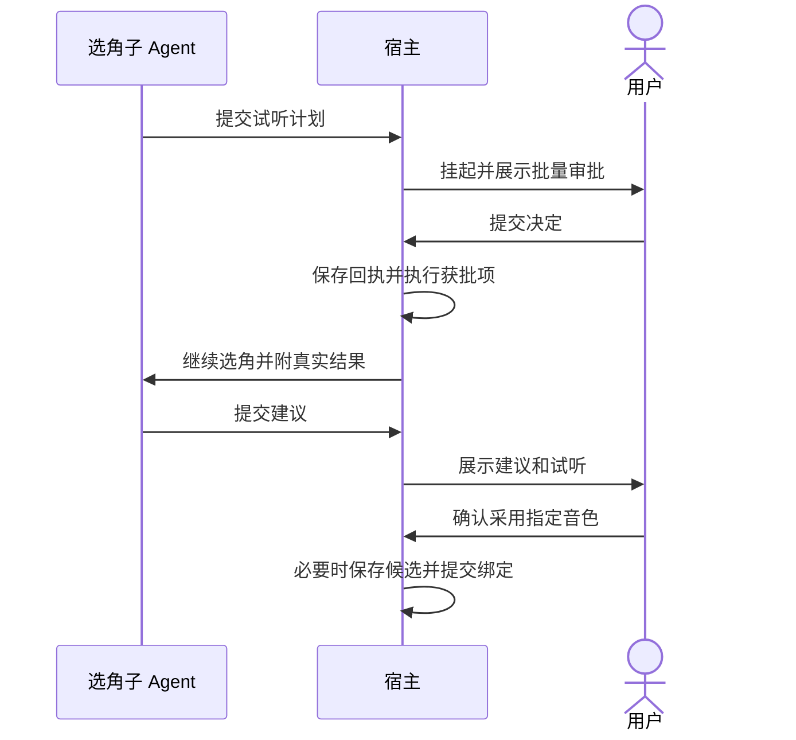

# Design

## Context

选角执行器通过 `finish_casting` 原子提交建议。AG-UI 已支持持久中断和子任务归因，问答目前只接受文本。Studio 已能合成、播放和保存设计候选，普通 Studio 临时候选随进程和缓存回收。既有建议采用命令校验目录候选和期望修订。

## Goals / Non-Goals

将批准、生成、建议发布和绑定串进现有选角专业任务。整章目标记录、跨步骤自动推进与通用助手音频任务继续由 [assistant-guided-production](../assistant-guided-production/proposal.md) 跟踪。该方案日后可读取绑定领域的完成状态。

## Decisions

### 1. 冻结计划并复用 AG-UI 中断

`propose_auditions` 提交有界计划。宿主分配计划和条目身份，校验目标、首选目录引用或设计参数、冻结证据和引擎限制。每个目标只提议一项。默认优先用该角色冻结的台词，缺少合适摘录时要求补充可审阅文本。宿主在批准时重新校验来源和资源。审批入口复用助手的整组中断入口，按类型渲染计划及其结构化回答。部分批准发生在计划内部，一个计划对应一个中断。

预置音色沿用其模型，库内参考音色由宿主预选已就绪、支持参考克隆且有可用设备的模型。审批卡展示所选模型和设备，并将其与音色及文本一起冻结。没有就绪模型时显示资源状态，资源准备后重新核对计划。

### 2. 宿主消费批准并记录尝试

选角子调用以 suspended outcome 挂起，外层 run 以 interrupt outcome 结束。宿主在继续受理事务内校验中断归属、计划版本、条目和最终文本，同时记录批准回执与尝试身份。执行器提交前再核对依赖，按持久化条目身份取得执行权。批准只授权本次确定参数的合成，缺资源显示阻塞，资源准备走既有入口。

继续使用新 run 关联既有选角任务。宿主从检查点恢复冻结输入、计划及真实工具事实，生成后补齐合法的工具调用与结果配对，再让选角子 Agent 收尾。拒绝反馈进入有界修复。每次重提计划须重新审批。重放以持久回执和每条尝试状态去重。正式发布前中断的在途尝试标记为中断，已发布结果复用。显式重试创建新的条目尝试且校验仍有效的批准，参数或依赖变化时重新审批。普通文字问答沿用现有语义。

### 3. 保留试听对应的实际候选

复用 Studio 的校验、引擎线程和媒体读取。为选角保存最小持久产物记录，记录工程、任务、条目、尝试、音色身份及受控媒体引用。设计产物还保留可直接入库的候选数据。音频和候选完整发布后才开放播放及采用。宿主把试听关联到最终建议中的准确来源。seed 可记作生成参数，采用使用已生成的候选。

本方案选择让有效建议的试听和设计候选在重启后继续可用。仍被有效建议、在途采用或媒体租约引用的产物受回收保护。建议被替代或失效后按引用回收，保留历史结果与可用状态。普通 Studio 的手动设计沿用原有生命周期。

### 4. 采用是一次用户操作，入库与绑定有独立回执

目录音色继续走既有建议采用入口。设计采用接收明确的建议、目标、候选、命令身份和期望修订。宿主先校验当前建议和绑定状态，再用候选身份幂等保存原产物，最后通过现有绑定领域用例提交库资产引用和建议来源。入库所用身份及其库资产映射需跨重启可追溯，覆盖资产写出后回执尚未落库的窗口。绑定冲突时保留已入库资产及其回执，用户重读并确认最新状态后可用新命令身份重试绑定。成功命令重放返回原回执。

## Risks / Trade-offs

- 多窗口答复和迟到任务可能抢占状态。用事务消费、尝试租约与条件发布处理。
- 磁盘文件与 SQLite 无法共用一次事务。用稳定发布身份、完整文件发布和恢复核对覆盖中途退出。
- 持久候选增加存储占用。复用 Studio 输入及输出限额，按引用回收无效产物。

## Migration Plan

新增可选的计划、回执和产物记录。已有建议继续以原方式审阅，缺少试听引用时正常显示。有持久数据变更时补齐格式版本、升级和故障恢复验证。
