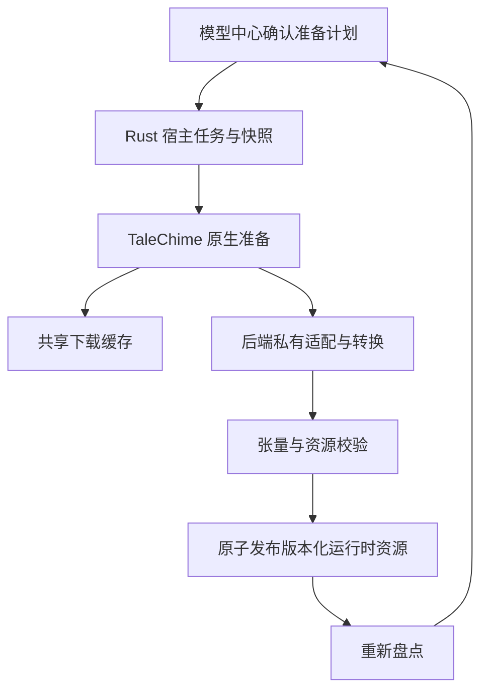

# Design

## Context

动机见 proposal.md。变更前三类 Adapter 通过 `ResourcePreparation::LocalConversion` 返回准备文档；IndexTTS 的加载器读取拆分 F32 safetensors，Kokoro 要求固定官方配置、F32 折叠权重、中文前端和音色清单，CosyVoice3 按固定大小和 SHA-256 检查七个文件。

`complete-voice-center` 已接入宿主资源目录、后台引擎线程、缓存设置、下载日志与快照。本变更在其上扩展准备流程，不另建运行时或下载器，也不将其剩余五项验收自动勾为完成。

### 提案初始调查与证据边界

提案初始阶段（2026-11-05）读取仓库元数据、转换报告和受限文件头，未下载完整候选权重或执行真实数值对照。以下均为待验证输入，不是已批准的运行时资源配方：

| 来源 | 调查 revision | 当前证据 |
| --- | --- | --- |
| [CosyVoice3 Candle](https://huggingface.co/spensercai/CosyVoice3-0.5B-Candle) | `ccdf65f11d4352c13692e700560076bd61a531e3` | LLM、Flow、campplus、speech tokenizer ONNX 的公开摘要与本地清单一致；HiFT、tokenizer.json、config 不同 |
| [IndexTTS MLX FP16](https://huggingface.co/mlx-community/IndexTTS-2.5-fp16) | `65644cd70da15309ffeb74aa03f3686bb04e3eb1` | 报告包含映射/忽略项与 FP16 转换，且仍带原始 feat/stats `.pt`；不是完整当前 F32 布局 |
| [Kokoro 中文 MLX](https://huggingface.co/1038lab/Kokoro-82M-zh-MLX) | `4bd6c9644da381fee105f37fcd8cb63d038ba7e8` | 548 个 F32 张量，存在 `weight_g/weight_v`；`zf_001` 的 `voice` 为 F32 `[510,1,256]`，仅形状匹配不证明数值同源 |

实现前按固定 revision 验证真实资产来源、许可证、张量覆盖、配置和数值。不得仅凭模型卡、形状或扩展名批准资源。

## Goals / Non-Goals

**Goals:**

- 三类模型及 Kokoro 的普通中文/g2pW 变体都能经宿主显式确认准备，无终端用户 Python 环境依赖。
- 在资源可复现、推理语义正确的前提下减少下载和转换；复用现有缓存与相同文件。
- 保持职责清楚：模型适配归后端，下载/暂存/发布归共享准备基础设施，任务持久化归宿主，展示归 React。

**Non-Goals:**

- 不引入 Kokoro ONNX 声学路径、MLX 推理、量化模型或通用任意 checkpoint 转换平台。
- 不改变语音生成算法以迁就未通过的社区权重，不静默改变精度或模型版本。
- 不实现资源自动更新、旧格式迁移、任意脚本执行、CUDA/其他平台发布；不把资源准备成功当作人工听感通过。

## Decisions

### 1. 社区复用以组件为单位，配方在开发阶段固定

后端拥有少量显式的类型化准备配方；每个配方包含来源仓库/revision/path/摘要/大小、变换版本、运行时输出格式及依赖资产。先用真实输入完成核验，再将接受的配方编入发布代码。运行时仅执行已发布配方，不运行远端提供的转换代码，不动态信任 `main`。

Kokoro 优先验证社区 F32 数据、音色与原始官方资产的对应关系，再实现受限权重折叠。中文词典、分词、规则及可选 g2pW 上下文单独形成带来源与许可证的版本化运行时数据；可在开发阶段用固定 Python 环境导出并对照，最终准备流程仅下载或原生构造这些数据。若社区模型或音色不能证明符合官方基线，使用固定官方原始资产的受限 Rust 导入路径，不放宽配置或精度约束。

CosyVoice3 复用四个一致组件；HiFT 必须保留官方要求的 F64 F0 路径，完整 tokenizer 保留专用 token 及 ID。差异组件优先寻找可核验产物，否则从固定官方源原生转换。新的可接受输出允许登记新配方清单，但须先完成张量和组件对照，不直接修改旧摘要掩盖差异。

IndexTTS 为社区文件建立显式名称、形状、精度及布局映射，核对被忽略张量的用途，并补齐 CAMPPlus、BigVGAN 配置、feat/stats 和 w2v 资源。FP16 转回 F32 不能恢复原始精度；本轮维持现有 F32 基线，社区组件不符合时使用固定官方源原生导入，而非默认换用 FP16。最终选用哪一组件由核验结果决定，不改变必须交付三类准备能力的范围。

备选：整个社区包直接替换，无法解释不兼容辅助件与数值差异；全部重新转换则浪费可复用组件。选择逐组件固定配方，并保留明确的原始资产导入方案。

### 2. TaleChime 提供计划与执行，CastGlean 只映射应用状态

共享准备模块负责输入摘要校验、磁盘/内存预算、来源记录、同配方锁、暂存、完成清单及原子发布。三个后端的具名私有模块负责自身张量转换和运行时结构校验，公共入口经有意的 re-export 提供，不引入通用 Repository、插件系统或额外 crate 来承载少量策略。

公开准备计划按模型、配方版本和当前缓存计算：缺失下载字节、预计新增/峰值磁盘空间、转换阶段及资源复用。计划指纹覆盖所有有效输入和输出版本；执行确认后只允许执行同一计划。缓存配置或计划发生变化时重新确认，禁止在失败后静默切换来源并扩大下载。

所有网络继续消费宿主 Registry/Downloads 的镜像、令牌及共享 Hugging Face 缓存策略；令牌不写清单、事件或日志。宿主自己的 DTO 表达计划和状态，绑定不泄漏基础库内部对象和任意可执行命令。

备选：前端按后端拼装下载/转换流程会重复业务规则；宿主自行重写基础库准备则破坏其他消费者的一致性。

### 3. 准备阶段与字节进度分开，取消等待底层退出

任务阶段包括计划、下载、转换、校验、发布、完成；取消中、已取消/暂停和失败独立表达。仅下载阶段计算网络速率；转换采用组件或张量计数/不定进度，不虚构下载速度或剩余时间。

耗时转换由受控 worker 持有，遵循现有运行时与所有权约束，不在 UI 或引擎 LocalSet 上执行大量同步计算。一次处理一个组件，张量和输出受声明预算约束，不同时复制整套模型。原始 `.pt/.pth` 如确需解析，仅支持固定输入格式的受限张量导入；拒绝任意对象执行、未知操作码、越界 storage/stride、超量分配和逃出资源根的路径。

取消先设置事实并通知 worker，在组件/张量边界退出；等待底层任务结束后再释放锁、清理暂存和发布终态。下载断点保留；转换只复用具有完整指纹且已验证的完成组件，中断组件在用户重新准备后重做，不承诺算子级中断或任意中间张量恢复。重启只恢复可说明的暂停/中断状态，不自动继续网络或转换。

### 4. 先校验再发布，已有就绪资源保持可读

运行时资源放在后端/模型/配方版本隔离目录，输入保留在共享缓存。清单记录来源摘要、变换版本、输出文件摘要、张量契约和许可证；生成输出按清单验证，不把用户自行生成的摘要当作可信来源证据。

暂存位于目标文件系统。全部必需文件验证、flush/sync 完成后原子发布整个新版本；模型只解析已发布版本。单配方锁防止并行发布和共享资源变换冲突；取消、断电或空间不足不修改旧版本，也不从不完整目录返回 Ready。清理仅覆盖本准备命名空间中可取得租约的暂存，不删除 HF 缓存、用户录音或音色。

资源就绪仍表示资产完整可信；设备可用、加载成功、真实合成和听感在目录/验收中分别表达。准备不隐式触发生成或写音色库。

### 5. 宿主扩展已有任务，不另起第二套下载系统

复用 `engine` 的资源任务、序号、确认和快照，在单一任务中呈现多阶段准备，并与设计/合成/设置更改协调 Busy。采用新版本 `resource-preparations.json` 记录必要恢复事实，旧 `resource-downloads.json` 原样保留、不迁移；已有缓存仍按内容身份重新盘点复用。沿用用户不考虑兼容性的要求，三类入口不保留仅手工转换的兼容分支。

界面用“准备资源”替代三类模型的纯手工转换提示，确认中列出下载量、转换说明和峰值空间。错误区分来源/下载、空间、格式不支持、数值/结构校验、取消与内部错误，保留可理解且脱敏的诊断。未知外部来源不可用时如实失败，不自动下载另一套未确认模型。

## Risks / Trade-offs

- [社区来源无法证明与官方一致] → 发布前真实张量对照；不通过组件使用固定官方输入，不降低验收。
- [CosyVoice3 浮点归约差异被放大] → 独立 HiFT/F0 对照覆盖 F64；旧端到端数值门禁若仍失败，明确报告，不以本变更成功覆盖。
- [Kokoro 中文数据分发尚无现成合格包] → 将固定版本导出、许可证核验和可下载资产发布列为交付任务；无可访问合法来源则该模型保持阻塞，不要求用户装 Python。
- [大模型转换峰值空间/内存过高] → 计划估算覆盖输入、暂存、输出并计缓存复用；逐组件受限处理，预检失败不开始变换。
- [下载和转换恢复语义不同] → 分开持久化，重试时复核指纹，不把临时文件视为已完成资源。

## Migration Plan

1. 核验输入并确定固定组件配方；按来源许可保留声明，权重不进入 Git。
2. 在 TaleChime 实现计划、转换、发布及公开事件，完成注入和真实资源验证后记录可消费源码版本。
3. CastGlean 切换准备契约、重生成绑定和新版本日志，执行桌面端流程验收；旧日志保留，新盘点从真实文件重建。
4. 回退时选择此前已验证的源码与配方版本，保留新缓存/产物，不在回退中删除或重写用户资源。此流程不表示已发布 SDK 或应用。

### 实施澄清：参考音色与不可变模型版本分开

原来的 IndexTTS/CosyVoice3 参考音色缓存使用模型版本目录作为根；离线导入参考音频会提前创建目标版本目录，阻挡完整资源的原子发布。两类后端改为显式消费引擎资源根：模型位于 `<backend>/models/<model>/<recipe>/`，参考音色位于根下独立 `voices/<backend>/<model>/<revision>/`。推理 owner 从资源根分别解析这两个域，不将用户音频写入模型发布暂存，不迁移或删除原目录。宿主正式音色资产仍由宿主自己的持久层负责。这是落实已有原子发布和用户数据保留要求的内部边界修正。

### 2026-11-05 分发决策补充

按用户后续确认，已验证且可再分发的转换结果由维护方生成后上传公开、非 gated 的 Hugging Face 资源仓库；终端用户优先直接下载固定成品。原生转换配方保留为可复现的构建依据，不要求每个用户重复转换。成品配方继续使用共享下载、全量摘要验证、计划确认和原子发布；不因省去转换而绕过资源可信边界。

只发布缺少的成品组件，已有相同字节的固定上游资源继续复用。公开分发保留原许可、来源/转换记录及必要声明；IndexTTS 不标注为 Apache 权重。成品使用新的版本目录，保留已生成的旧版本。Kokoro 的声学执行保持 Candle。
