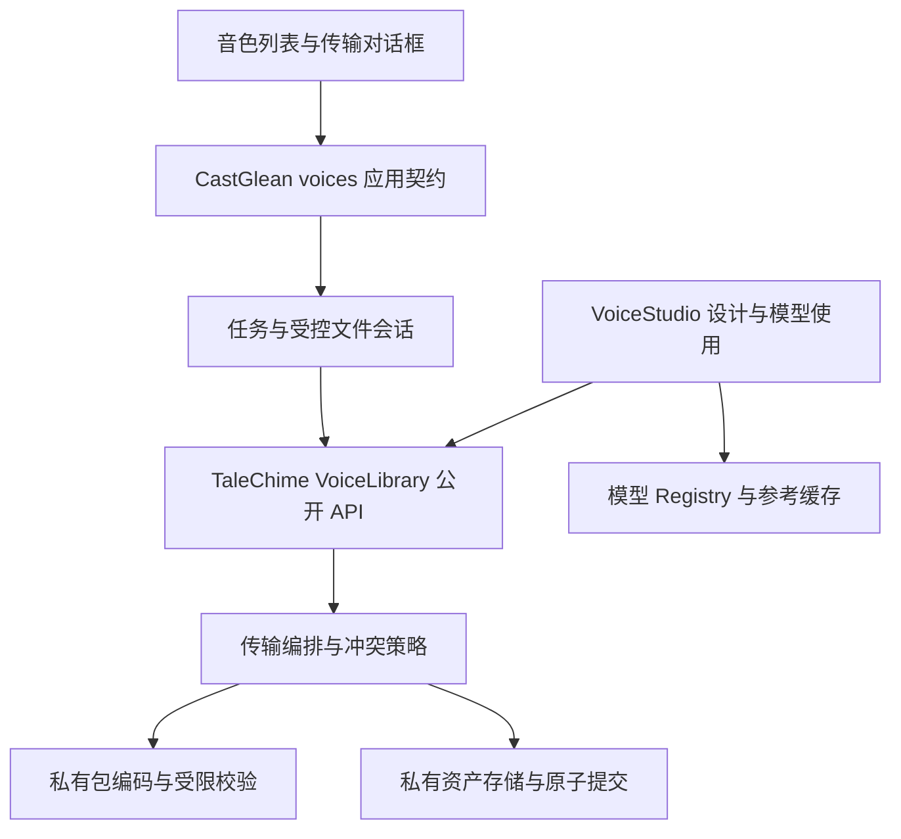

# Design

## Context

动机与范围见 proposal.md。当前 TaleChime 的 `voices/bundle.rs` 在清单中只存一个 `VoiceAsset`，`VoiceLibrary::create` 已有锁、暂存目录和发布边界，但 ZIP 读取没有资源上限。`VoiceStudio` 同时持有 Registry 和 Library，传输入口只是单项委托，错误主要是文本。CastGlean 的“我的音色”来自 `sampleVoices`，导入和导出按钮尚未接入；模型目录已真实化。

在进行的 `talechime-engine-integration` 明确排除 B2 音色库。本变更复用其模型目录与运行时约束，不修改模型下载任务状态机。现有交互文档把库管理写成“所属后端”，与模型无关资产结构冲突；实现时修正文档并区分资产身份与模型本地声音标识。

本规划位于 CastGlean，本次只编辑该变更文档。TaleChime 是独立依赖仓库，下面的基础库设计作为外部交付契约；后续在对应项目范围落地、验证并提供源码提交，再消费 path 依赖。不在 CastGlean 复制基础库实现。

## Goals / Non-Goals

**Goals:** 让宿主无需模型对象即可完成批量搬运；用可验证类型建立检查、决策、提交边界；冻结输入而不是长期锁住整个库；失败和取消语义可测试。

**Non-Goals:** 不建立通用任务引擎、插件体系、HTTP 服务或存储适配框架；不实现整批跨文件事务回滚、任务重启自动续跑及整库覆盖恢复。非传输相关的预置声音、设计候选、角色绑定和模型推理实现保留自身职责，不借机重写。

## Decisions

### D1：四大原则落实为可检查的依赖边界

| 原则 | 决策 | 审查标准 |
| --- | --- | --- |
| 抽象 | 公开层只表达音色、导入预览、决定、进度和报告 | 调用方不接触 ZIP、清单 DTO 或模型 Registry，也不匹配错误字符串 |
| 封装 | 身份、已验证包和提交计划字段私有，经校验构造 | 调用方无法伪造已校验状态，提交再次检查库内不变量 |
| 模块化 | 格式、校验、存储事务、传输编排和宿主任务分别拥有单一变化原因 | 改容器布局不修改 UI；改 IPC 不修改基础库；改模型适配不修改导入冲突逻辑 |
| 信息隐藏 | 文件布局、摘要编码、锁、临时路径和重命名策略私有 | `lib.rs` 只重导出有意的 API；bindings 不出现 TaleChime、ZIP、缓存类型或本机内部路径 |

以现有 crate 为边界，不增加 crate、通用 Repository trait 或每层一套无行为服务。模块采用具名文件，默认私有；公开 API 的委托只保留实际装配需要的一层。



### D2：TaleChime 内部模块与公开 API

在 `talechime-core/src/voices.rs` 保持模型参考缓存入口的现有职责，将资产相关子模块分为：

- `asset.rs`：`VoiceId`、只读资产、元数据、声音内容摘要；将 facade 已有 ID newtype 下沉为单一定义。
- `library.rs`：库的公开入口与配置，私有字段；重用同一资产校验，不另建模型注册表。
- `store.rs`：记录读写、锁、暂存和原子发布，元数据盘点不重复读取整份 WAV；使用前和导出时进行完整校验。
- `package.rs`：私有磁盘 DTO、ZIP 编码、严格版本与条目检查。
- `transfer.rs`：预览、批内和库内冲突、ID 分配、提交计划、进度与逐项报告。

`voices.rs` / core `lib.rs` / facade `lib.rs` 通过 re-export 提供必要类型，停止公开 `bundle` 的内部格式和可直接构造的已验证对象。模型缓存 `VoiceStore` 不作为音色库传输 API，也不删除其仍被适配器使用的实现。

公开语义草案如下，具体 Rust 参数命名可调整，状态转换不可弱化：

```rust
VoiceLibrary::open(config) -> Result<VoiceLibrary, VoiceLibraryError>
library.inspect_import(request, control) -> Result<ImportPreview, VoiceLibraryError>
library.plan_import(preview, decisions) -> Result<ImportPlan, VoiceLibraryError>
library.import_selected(plan, control) -> ImportReport
library.export_bundle(request, control) -> Result<ExportReport, VoiceLibraryError>
```

`ImportPreview` 拥有经过校验的私有暂存内容；`ImportPlan` 消费预览并固定选择、目标 ID 与导入来源键。只读视图提供元数据、时长、大小、冲突状态；不提供可修改的内部 DTO。导出请求传入 `VoiceId` 集合及明确的 `CreateNew` / `ReplaceConfirmed` 目标策略。`TransferControl` 只提供线程安全取消标志和轻量进度回调，不依赖 Tokio、Tauri 或自行创建 runtime。

错误为可匹配的 enum，至少区分 `UnsupportedFormat`、`InvalidPackage`、`LimitExceeded`、`InvalidAudio`、`ContentMismatch`、`Conflict`、`StalePreview`、`Busy`、`Cancelled`、`Disk`、`Io`；源错误用于诊断，展示文本不作为协议。基础库保持同步有界文件操作，由宿主安排后台执行。

VoiceStudio 消费同一个 VoiceLibrary 的资产和导入录音入口；旧传输方法、旧 CLI 解析分支、旧格式 DTO 及对应兼容测试删除，CLI 直接使用新库传输 API。原始录音创建仍是独立语义，不能把 `.voice` 包传输与录音克隆混为一谈。

替代方案：仅给 VoiceStudio 增加批量循环仍要求持有 Registry，并让 UI 自己拼预览与事务，因此不采用。

### D3：一个容器、一套当前格式

新 `.voice` 使用 ZIP，清单格式标识 `talechime/voice-bundle/2`。`manifest.json` 包含格式标识、资产数组、相对 WAV 条目名和逐项摘要；录音路径由受验证的 ID 生成，如 `voices/<id>/reference.wav`。不嵌套旧 `.voice`，不支持历史版本。

新资产记录使用显式版本 2，保留原始创建时间，另记本机导入时间；来源以数据保留，不把来源引擎变成必须使用的后端。包里不输出本机导入时间、内部路径、导入任务和缓存信息。模型无关的声音内容摘要用于克隆缓存失效及重复提示，另用资产摘要覆盖 ID、名称、来源、原创建时间和声音字段；采用确定性的带域分隔编码，格式编码细节不进入公开 API。摘要只证明内容一致，不证明发布者身份。

新默认资产根使用 `voices-v2`，由 TaleChime 路径模块定义；CastGlean 显式使用 app-data 下的 `voices-v2`，不放在可切换的模型缓存目录。对显式传入的旧记录目录返回格式错误；不自动扫描、复制、转换或删除旧目录。消费者调用点统一更新为新资产类型，旧默认路径及读取分支删除。

初始硬上限：一次最多 32 个包、合计 256 个资产；每个清单 4 MiB、所有清单合计 16 MiB；每条 WAV 64 MiB，包文件总输入与累计解压音频分别最多 1 GiB。元数据名称最多 256 UTF-8 字节、转写 16 KiB、描述 16 KiB、来源引擎标识 128 字节。公开 Limits 只能收紧这些硬上限。计数使用检查算术，读取使用 limit+1 检测，不先分配声明大小。

拒绝重复 ZIP 条目、清单重复 ID、绝对路径、父路径、符号链接、未声明文件、未知字段、缺文件、非法元数据和版本；不按归档路径直接解压。流式受限读取到私有暂存文件并计算摘要，完整解析 WAV；不把整批录音存内存。限制在导入、导出和临时空间预算上对称执行。

替代方案：多选后仍输出数百个旧单音色文件不能解决分享管理问题；先打包旧包再嵌套会保留双重格式逻辑，因此不采用。

### D4：冻结输入、明确冲突、稳定重试

检查阶段为每个输入保存冻结快照并验证全部内容，正式库不变；有任一输入错误就不允许生成提交计划。用户移除问题文件后重新检查。预览关闭、会话释放或应用退出清理其暂存；重启只清理本应用新格式命名空间内的遗留暂存，不遍历历史目录。

冲突比较涵盖本地库与所有包：同名仅提示；同 ID 同声音默认已存在，元数据差异单独提示并保留本地；同 ID 不同声音必须跳过或 `ImportAsNew`；不同 ID 相同声音提示可能重复，用户可以跳过或保留。一个批次中相同 ID 的相同内容合并展示并保留来源映射，不静默丢弃元数据差异；同 ID 不同内容分开决策。

`ImportAsNew` 在计划阶段分配合法新 ID。新记录内部保存稳定导入来源键（原 ID + 原资产摘要），相同输入重试时优先识别已提交副本，并返回其本地 ID，不连续生成副本。该键是本地导入依据，不随再次导出传播；本次不提供“强制再复制一份”操作。实际提交前在库锁内重新核对所有目标 ID 和来源键；变化转为具体冲突，不能临时改选另一策略。

计划和预览都不持有长期库锁。每项校验与 WAV I/O 在受控阶段完成，事务锁只覆盖重复检查和完整记录发布。磁盘或批次级 I/O 故障停止剩余项，单项身份冲突可以报告失败后继续无冲突项。忙锁返回类型化 Busy，不无限自旋。

### D5：逐项原子导入，整体原子导出

每条导入先写同文件系统暂存、同步文件，再发布目录；取消在发布边界检查，已经进入不可分割发布步骤的项可以完成，最终报告必须记录实际结果。状态为 `Imported`、`AlreadyPresent`、`Skipped`、`Failed`、`Cancelled`、`NotAttempted`，所有选择项都有结果和可用 ID 映射。不声称整个批次事务回滚，也不自动重试不明提交。

进程异常后库盘点只读完整正式记录；未发布暂存不会作为音色出现。再次导入依赖同 ID 和来源键识别已完成项；不持久化通用任务日志，不恢复先前 UI 的全部决定。

导出先取得所选资产的逐项完整冻结快照，再构建一个包；本变更不引入修改录音的入口，名称变动也只影响后续获取的快照。文件写入目标同目录临时文件，完成 flush/sync 后原子发布，取消/错误清理临时文件。所有已选音色必须可导出，否则不发布包。未确认覆盖时使用不覆盖发布语义，确认覆盖也不能破坏失败前的旧文件。平台原子性、文件句柄占用与发布后错误状态通过目标平台测试明确，不能将已发布事实报告成未发布失败。

替代方案：整个批次回滚会显著增加故障恢复状态和磁盘代价，当前独立音色没有整体一致提交需要，因此不采用。

### D6：CastGlean 独立 voices 域

新增 `src-tauri/src/voices.rs` 与私有 `voices/{commands,library,transfers,events}.rs`：

- `library` 解析应用资产路径、持有无模型库句柄、映射真实列表和错误。
- `transfers` 持有受控输入/输出句柄、预览/计划和任务登记；每次只允许一个写入传输任务，检查会话有数量与磁盘总预算。
- `commands` 只装配系统对话框和应用命令，前端拿 preview/task ID，不接受任意绝对路径。
- `events` 定义应用语义 DTO、阶段、递增序号与快照；只传元数据，不传 WAV、ZIP 或模型内部类型。

采用宿主既有 async runtime 的 blocking 执行资源运行库文件操作，传入协作取消；不发送 Rc Registry 到线程池，也不占用 `engine/resources.rs` 的 LocalSet。不能仅 abort 包装 future 并声称底层文件 I/O 已停止。

命令语义为选择并检查导入、释放预览、提交选择、选择保存位置并导出、取消任务、查询任务及列出音色。任务快照包含有界最终逐项报告，页面离开不删除活动任务；终态保留到显式关闭或应用退出。快照+带序号事件避免丢事件和迟到事件覆盖新任务。重复提交相同 preview/task 请求返回原任务，不启动第二个写入。

### D7：前端只呈现真实状态

`use-voice-library` 和 `use-voice-transfers` 通过生成 bindings 获取快照/事件；列表只保留选择、筛选和对话框草稿。我的音色接入真实数据；示例的重命名/移除覆盖不得作用于真实列表，未接入操作禁用。预置音色继续明确自身来源，不在本变更顺带实现全部模型预置目录。

导入对话框依次呈现检查、勾选/冲突、执行、结果；原“连接音色服务”跳转删除，传输不需要模型服务。列表支持多选、筛选结果全选、取消选择和单包导出；改变筛选不默默扩大选择，导出前显示确切数量。详情导出复用同一任务流程。浏览器仅展示明确不可用状态，不伪造本机导入成功。

真实资产不预填示例性别、音色标签或兼容模型；模型筛选不能按一个固定 modelId 排除跨模型资产。未进行具体录音适配校验时显示兼容性待验证，不以模型支持 cloning 就宣称该录音必然可用。

### D8：质量门与验收

基础库测试使用合成短 WAV、临时目录和故障注入，不下载模型；涵盖格式、预算、冲突矩阵、预览冻结、并发占位、重试、取消和原子发布。facade 与 CLI 有公开 API 集成测试，验证无需 Registry 或模型资源即可批量往返。

宿主测试覆盖任务重复提交、权限化句柄、事件与快照、取消、错误映射及路径独立性；重新生成 bindings 并检查无基础库内部类型泄漏。前端构建、Biome、Lingui 提取编译，并在 Tauri 实机验证选择器、多选、部分成功、切页、重启和大包交互。macOS、Windows、Linux 的原子发布与取消分别记录，未验证平台不称通过。

## Risks / Trade-offs

- [破坏性重构导致旧包和旧记录不可用] → 明确版本错误和新数据根，不迁移、不自动删除历史资产，不保留兼容实现。
- [冻结大包占用磁盘] → 输入/输出和暂存总量受限、会话释放清理、写入失败不发布；进度区分检查与提交。
- [批量部分完成] → 逐项报告与稳定来源键；重试识别已完成项，避免为同一输入重复创建新声音。
- [单个损坏本地记录影响列表] → 盘点返回有效条目和独立诊断，不让整个页面消失；导出仍要求所选资产完整有效。
- [跨仓改动和 B1 并行工作] → 先交付 TaleChime API 及调用点，再接 CastGlean；保留其他任务的未提交修改，不合并为本次已完成证据。
- [取消与原子发布竞争] → 协作取消、发布边界校验、最终结果来自实际发布事实，不承诺已提交项撤销。

## Migration Plan

1. 在 TaleChime 自身项目范围交付新格式、新资产 API、CLI 与全部消费者更新，删除被替代代码；不创建旧数据转换器，不自动发布库或应用。
2. CastGlean 接入经验证的新 path 依赖契约，新增独立音色域和真实 UI；更新格式说明、模块文档和路线图，列明未接入行为。
3. 从新空目录完成无模型批量迁移验收，再执行各平台异常路径验证。源文件和旧目录只读保留。
4. 若需回退源码，仅回退本变更涉及提交；旧程序不打开新格式数据，不将不兼容数据强行改写为旧格式。新数据保留待重新使用新实现，不自动回退文件。

## 调研依据

- [Anki 资源包与整库包](https://docs.ankiweb.net/manual/exporting)：借鉴媒体自包含和合并/覆盖的语义区分，本次只做新增合并。
- [Ableton Collect All and Save](https://help.ableton.com/hc/en-us/articles/209775645-Collect-All-and-Save)：借鉴收集实际媒体，避免路径引用迁移后失效。
- [Coqui 声音克隆缓存](https://coqui-tts.readthedocs.io/en/latest/cloning.html)、[Qwen 官方 Demo](https://github.com/QwenLM/Qwen3-TTS/blob/main/qwen_tts/cli/demo.py)：模型 prompt/embedding 缓存不等于跨后端资产格式，缓存不随本次音色包搬运。
