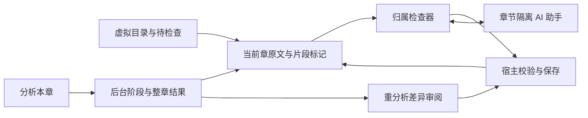

# Design

## Context

动机见 [proposal.md](proposal.md)。已核对的实现边界：

- `src/components/projects/imported-workspace.tsx` 使用每 50 章目录和只读正文，角色/演绎/音频为占位；`src/components/workspace/chapter-workspace.tsx` 的人物及片段是独立示例数据。
- `src-tauri/src/jobs/runtime.rs` 只派发 `chapter_splitting`；`ai/service.rs` 已支持章节作用域、幂等启动与配置绑定，但启动/重试使用全工程修订检查。
- `ai/messages.rs` 当前只有文本与工具 parts，`ResultReference` 位于工具 part 内；直接结构化分析尚无独立业务结果 part。
- `database/schema.rs` 当前版本 1，仅含工程/来源/章节/分章及通用 AI 数据，没有角色与分析表。`docs/data-format.md` 的 Legacy 离线标注部分不属于当前宿主实现；当前来源不规范化换行或 Unicode。
- 复用已完成但未归档的 `refactor-local-ai-task-runtime`、`improve-ai-conversation-controls`、`virtualize-source-reading` 与 `streamline-directory-and-inspectors` 契约。此变更不修改已归档音色/模型能力。

## Goals / Non-Goals

**Goals:**

- 真实工程从明确启动、有效初稿到审阅修正、重分析差异、重启继续的完整前后端链路。
- 范围与引用可验证，人工结果可保护，身份跨章稳定；模型语义不确定性保留给用户。
- 复用当前宿主运行时、数据库、模型配置和工作台交互，避免第二套消息/任务/恢复系统。

**Non-Goals:**

- 情绪/语气/停顿规划、声音绑定、TTS、音频候选与导出、整书批量调度、全书人物自动合并/拆分及 legacy 格式导入。
- 不将所有章节上下文、全部聊天历史或整书正文一次传给模型；不引入新后端服务、图执行框架或通用插件系统。

## Decisions

### 1. 业务模块与运行时分层

新增私有 `chapter_analysis.rs`，以 `types`、`source`、`validation`、`execution`、`store`、`review` 子模块分离 DTO、原文定位、纯校验、模型执行、事务发布与人工修正；只重导出 IPC 与 Worker 所需 API。名称可按工程规范细化，不复活 `legacy-main` 的分析 crate。

任务类型固定 `chapter_analysis`，章节必填。`jobs/runtime.rs` 增加明确业务派发分支；模型连接取得、取消令牌、并发名额、租约、用量与通知仍属于现有运行时。

主按钮调用 `chapter_analysis_start` 业务命令：在一次事务中创建/定位章节会话、持久化类型化分析输入及通用 run 意图，再由既有派发机制执行。分析启动具有独立 requestId，与普通助手提问区分；不能靠前端构造特殊聊天字符串触发整章重分析。重复点击同一命令补读原身份，其他会话对同一章的并发结果在发布时按版本串行处理。

助手消息沿用共享会话传输，默认执行当前章取证/解释及修正建议；建议只能生成待审阅补丁，不直接确认或修改业务结果。后续“重新分析”或“应用修正”通过明确业务动作启动。这样直接操作不被聊天绑架，也不让聊天绕过应用校验。

替代方案：复制分章 agent 或另建分析队列。拒绝原因是会复制模型配置、订阅和恢复缺陷，且分章的目录工具与分析输出不适用。

### 2. 版本与存储模型

新增存储实体，复杂载荷使用严格、带 `formatVersion` 的内部 DTO，不能由 React 直接写 JSON：

| 记录 | 主要内容与身份 |
| --- | --- |
| `analysis_inputs` | runId、动作 analyze/discuss、工程/章、依赖指纹、窗口计划与请求配置；宿主生成 |
| `analysis_versions` | 不可变整章有效标注、模型/协议/提示版本、来源摘要/范围、runId、父版本与产生原因 |
| `analysis_states` | 当前章版本指针、递增分析修订/人工修订、最近可撤回操作、失效原因 |
| `analysis_candidates` | 新版本引用、基础版本/人工修订、差异组、待审阅/已应用/已撤回/放弃/失效及处理回执 |
| `analysis_windows` | 窗口身份、owned/context 范围、请求状态、已校验输出与摘要、来源运行及完成次序 |
| `characters` | 全书稳定 UUID、显示名、候选/已确认状态、元数据修订及来源证据 |
| `character_aliases` | 身份引用、别名、确认状态和章/原文证据，名称允许重复 |
| `analysis_edits` | 当前章变更前后版本/人工字段保护、操作身份、范围及撤回信息 |

片段位于不可变版本载荷内，包含宿主生成 ID、全局 UTF-8 范围、`narration | speech | thought`、归属状态/身份或候选集合、证据及理由、独立 `unreviewed | confirmed`。旁白是独立语义角色，不创建一个叫“旁白”的人物冒充稳定角色。

角色候选也由宿主生成稳定 UUID，因此重开和审阅不变；候选不会进入其他章节的“已确认角色”上下文。模型只引用输入给定的角色 ID 或本次运行局部候选键，不能自行创建权威工程身份。跨窗口可以沿用同一次分析的局部候选键，其语义仍未确认。

采用“不可变版本 + 当前指针 + 显式编辑记录”，而不是覆写单份 JSON：差异、撤回、迟到输出和审阅依据都需要可追溯的旧版本。大量正文不进入载荷，读取正文始终根据宿主范围切片。

### 3. 原文坐标与模型输出协议

宿主先冻结当前章来源摘要、半开字节范围与原文锚点表。每个锚点包含确定性 ID、绝对行号、精确文本及 Unicode 标量位置到 UTF-8 字节偏移的映射；超长单行可按合法字符边界细分锚点，不改源文本。

模型通过锚点 ID 和锚点内 Unicode 标量索引表达边界及证据；宿主转换为绝对字节范围，不能让模型输出的重写正文成为保存来源。采用锚点/索引而不是模型自行计算中文字节数，允许同段多说话人与插入旁白，不把“一个自然段”固定成最小业务片段。

纯校验包含：工程/来源/章身份、摘要、锚点及索引合法、Unicode/UTF-8 边界、顺序、非空、整章完整覆盖、证据在当前章内、人物 ID 与候选引用合法、歧义候选有效且不重复、归属/片段类型兼容、无未知字段。空白可并入相邻片段，但不能 trim、重新编码或规范化。

以完整原文覆盖为标准，不靠片段数量或模型自报置信度判定成功。文本类型和人物归属仍是可错的语义建议。数值置信度不作为强制字段或自动确认依据。

### 4. 模型上下文与长章窗口

一次分析冻结已确认角色/别名及实际选取的已确认证据上下文，记录具体依赖版本。默认不读取未分析章节作为已确认知识；界面明示使用已有确认信息，不能声称已理解全书或无剧透。

模型连接使用当前配置及已经探测的结构化输出能力；能力不可用在启动/执行中明确报告，不把随意 JSON 文本当作结构化成功。

宿主预先产生覆盖全章的有序 owned 窗口，必要时附带相邻只读 context；窗口输出仅能覆盖其 owned 范围，重叠上下文不重复提交。窗口大小根据模型能力、可用上下文/输出配置及结构化响应开销规划；未知窗口容量使用可说明的保守分窗，不伪造 token 精确值。既有来源上限仍有效，不新增任意固定的整章 token/轮次配额，不通过丢尾部处理超限。

按窗口依次执行，复用同一次分析的局部角色候选及已校验输出；只有全部 owned 范围完成并通过汇总校验才发布整章有效版本。相邻窗口即使语义相同，也可以保留相邻合法片段，不为凑连续片段重写正文。

非法范围、截断、上下文拒绝或协议不完整使当前窗口失败，保留前面结果，不自动请求模型“修到成功”。用户明确继续后重用相同指纹、协议和配置下的已校验窗口；中断窗口是否重新发送及剩余工作可见。改模型/提示/来源/实际角色上下文时，不能复用不兼容窗口。

替代方案：整章一次调用，或边收到片段边设置当前有效版本。前者无法覆盖长章，后者会把半章和不完整角色表伪装成可用结果。

### 5. 成功发布与消息引用

首次有效发布在一个事务中写版本、候选角色、当前初稿指针与业务结果引用；当前片段和候选角色全部未确认。事务中重新检查“当前仍无有效分析”，后到的并发结果保存为审阅候选。

重分析只创建独立候选，不切换当前指针。候选和 `ResultReference { kind: chapter_analysis, id, summary }` 的发布、终态及幂等回执保持同一事务边界，提交后再通知；租约失效/取消不得发布有效新结果。

为直接结构化分析增加共享业务结果 part（`type: result`，使用现有 ResultReference），避免将没有发生的模型工具调用伪装成成功工具。更新消息校验、投影、SDK 映射和 AI Elements 安全渲染：结果 part 供 UI 查询当前业务状态，不能成为伪造的模型工具调用/结果对；模型上下文通过受控的当前业务快照注入。既有 text/tool parts 与旧消息读取保持兼容，未知结果只显示安全摘要。

### 6. 按实际依赖控制并发与失效

每份分析固定依赖指纹：`projectId/chapterId/sourceId/hash/start/end`、当前分析修订/人工修订、实际引用角色的修订及选取上下文的版本摘要。发布及采用必须在取得数据库写事务后重读校验。

当前 `ai/service.rs` 的全工程修订是启动时的乐观并发门槛；页面启动前读取权威快照。为分析任务增加宿主提供的作用域校验策略：执行期间、明确重试/继续和业务发布按分析依赖验证，不能直接复用分章的全工程 `base_revision/source_hashes` 失效规则。分章继续使用原有检查，客户端不能自行选择绕过策略；实现只增加必要业务策略入口，不建设通用工作流框架。

实际依赖包括所有送入本次模型请求的角色和确认上下文，不只包含输出里最后使用的角色 ID。既有已发布标注的角色显示名动态读取；后来的角色元信息修正不自动改写或取消人工确认，相关变化用于阻止在途/待采用结果基于过期上下文覆盖。

别章独立修改或未引用人物增加不使当前章失效；实际引用身份/确认上下文改变则提示候选过期。当前章拆合/来源损坏导致失效时，历史和人工记录保留但不自动迁移到新章。标题或分卷显示调整若未改变来源/范围，不使语义标注失效。

### 7. 人工修正、身份确认与重分析合并

检查器提供类型/归属修改、明确未知/歧义、确认，以及选区驱动的片段边界调整。提交以 `commandId + expectedAnalysisRevision` 校验；后端将修改转换成新有效版本和字段保护记录，提交成功回读才显示保存。失败保留受控草稿。

保护绑定来源范围及被人工修改/确认的字段，不能只绑定可重新生成的片段 ID。重新划分跨过受保护边界时，把整个区间作为冲突。候选按连续原文区间构造替换组：同范围属性变更、增删/拆合形成一组原子替换；不变片段可保留 ID。

差异页默认选择可安全应用的无冲突组；冲突组默认不选，逐项展示人工现值与模型建议。用户可选择若干组后一次提交，宿主合并到当前有效版本并重新校验整章完整覆盖；无法保持原有保护范围的组必须显式处理或保留旧组。一次提交后候选记录已处理，未选组沿用旧结果、不保留含糊的“半采用待继续”状态；原候选版本仍可查。

候选人物确认或复用已有身份通过独立明确动作处理；复用仅重绑当前章该候选的引用，不合并全书角色。确认同一候选身份不自动确认所有片段归属。改共享角色名称/别名先显示引用范围，名称不决定身份；别名关系附证据。全书合并/拆分留给后续专门设计。

撤回只作用于本章最近一次有效人工编辑或候选应用，以新修订恢复变更前内容；共享角色身份不回滚删除，已有其他章节引用的角色不得被本章撤回悬空。全书元数据编辑不纳入本章撤回栈。任何后续编辑会使旧撤回基础冲突，幂等回执防重复生效。

### 8. 前端工作台与阅读联动

- 替换真实 ImportedWorkspace 的分页目录、重复页头、占位检查器及不可用音频控制；保持独立示例，不把示例角色复制到真实工程。
- 顶栏沿用 DesktopShell 工程上下文；工作区一行章节标题 + Info（来源/序号/阶段详情）+ 原文显示单图标切换/定位等辅助工具。主操作“分析本章/重新分析”保留文字，执行时显示真实进度及停止，不把所有操作藏进图标。
- 左侧复用虚拟分卷树与目录/待检查图标分段、常驻范围搜索、各自查询/滚动、柔和选中、对称滚动空间及视口居中空状态。分析待检查按章分组，显示“本章/全书已分析章节”的明确范围；默认本章，切换全书只汇总现有分析，不触发扫描或模型。
- 中间复用章节范围及可变高度原文窗口；标注作为源范围上的轻量装饰，不复制/替换原文文本；片段跨行或跨虚拟块仍是一份业务记录。正文显示模式变化、复制及 AI 引用继续使用精确原文字节；章末显式切章。
- 右侧默认检查器，顶部可切换助手；检查器显示所选片段类型、当前归属、候选/角色选择、证据与确认，普通点击定位只读，修改明确提交并自动保存。未知可确认，问题列表区分未审阅与已确认的不确定性。
- 分析角色列表通过检查器中的稳定入口访问，提供搜索、候选确认/复用、角色元信息和出现记录；复杂身份/边界编辑在独立浮层完成，正文位置与受控草稿保持。
- 重分析用独立差异审阅视图，保留原文定位与当前结果；不把候选混入已经采用的正文。辅助操作提供向下 Tooltip、键盘名称及焦点返回，小窗口通过面板互斥收放保持可操作。
- 角色分析视图是本次交付；演绎/音频作为后续能力明确说明，不保留占据主要空间的假进度、禁用播放器或误导生成按钮。

### 9. IPC 与查询边界

新增类型安全业务命令组：分析启动/当前章快照/版本与候选查询、角色列表与确认/复用/元信息修改、片段编辑/边界调整/确认、候选应用/放弃/最近撤回。所有写命令包含操作身份及相关期望修订，保存使用既有命令回执模式。

目录状态查询返回轻量章节分析摘要；标注按当前章窗口/范围读取，角色与证据按需查询，不能在一次工程快照中返回全书所有片段和私人正文。旧版本也通过宿主受控源范围读取，检查所属工程与当前来源完整性。

分析进度通过通用会话的权威快照与有序增量传播，结果部分携带引用；业务标注的当前版本独立查询。聊天历史分页、重连及消息游标测试必须覆盖新增结果 part。IPC 和前端不得暴露数据库 Entity、模型密钥、框架执行对象或引擎私有类型。

## Risks / Trade-offs

- 模型坐标/身份语义错误 → 锚点映射、完整覆盖与引用校验；未知/歧义和可定位证据保留，真实语义质量单独抽样验收。
- 长章多窗口上下文不足/候选重复 → owned/context 分离、运行内局部候选、完整汇总；重复候选交人工确认，不按名称偷偷合并。
- 细粒度修订比全工程失效复杂 → 明确依赖清单、事务内再验证，并用无关编辑/相关编辑双向故障用例验证。
- 图标和标注降低可发现性或破坏选区 → 主分析操作保留文字、辅助提示及键盘；原文字节不被标签文本污染，覆盖跨块选择/复制/引用测试。
- 自动保存初稿被误认为已确认 → 结果生成、结构校验、人工状态分开，默认全未审阅；右侧默认可直接修正。
- 数据库升级不可直接被旧二进制读取 → 仅支持明确的当前版本升级，失败事务回滚，旧应用遇未知版本拒绝写入；不做静默降级。

## Migration Plan

1. 在实现中将 schema 从 1 升至 2；空库初始化到 2，已有 1 通过同一 SQLite 事务增加分析表/索引与版本号。保留所有现存表/来源，故障注入验证 DDL/版本号一起回滚。未知版本沿用明确停止写入。
2. 接入宿主模型/业务与类型命令，再接实际工程 UI；升级完成前不接收分析写请求，原有分章及项目打开仍按真实状态报告。
3. 测试公开合成工程的 v1 升级、正常/异常重启、原文损坏、并发及迟到提交，再进行原生桌面与指定真实模型验收。模型请求成本、语义错误和平台结果独立记录，不由构建通过推定。
4. 升级失败保留 v1 原库；成功升级后回退旧二进制不自动降级或删除新表，使用支持版本的应用继续。当前变更不读取 `.castglean` 或 legacy 分析文件。

### 10. AI Elements 组合（2026-11-08 用户补充）

采用 shadcn/ui Base UI 的 [Task](https://ui.shadcn.com/docs/ai-elements/base/task)、[Tool](https://ui.shadcn.com/docs/ai-elements/base/tool) 与 [Prompt Input](https://ui.shadcn.com/docs/ai-elements/base/prompt-input) 组合方式。Task/Tool 基于 `Trace`，不另造一套进度卡片；只展示宿主已发生的阶段及工具事实，业务结果仍用独立结果引用。消息中的连续活动组成 Trace，工具详情按需展开，未知工具保留安全名称与状态，不渲染未经处理的服务商响应。

Prompt Input 基于 `InputGroup`、`InputGroupAddon`、`InputGroupButton`，根据用户随后确认的最简方案，使用 `InputGroupTextarea` 替代 Tiptap，保留原文引用、输入草稿、中文 IME 与明确发送/停止、模型选择及上下文用量；不保留无业务需求的富文本依赖。只展示当前支持的来源引用，不添加不可用的任意文件上传入口。统一现有语义圆角，registry 增量安装不覆盖项目已定制基础组件。通用会话共享这些组件，分章与章节分析保持业务隔离。

### 11. 真实协议验收后的提示修正（2026-11-08）

公开合成短章在本地 OpenAI 兼容网关 / GLM-5.3-Flash 返回 HTTP 200 和完整 JSON，但没有遵循 `response_format` 的 Schema；模型同时把锚点的绝对 UTF-8 `start` 当成字符位置，误判存在未提供的正文。宿主拒绝了该输出，没有发布草稿。仅对公开验收测试启用任务局部诊断，正常运行不保存服务响应体。

因此模型输入只暴露锚点 ID、精确正文、标量长度与 owned 标记，owned 本身也使用锚点引用；绝对字节位置保留在宿主。锚点 ID 明确是不透明标识，禁止从其中推断间隔。提示内显式携带与请求相同的 `outputSchema`，不能只依赖兼容网关执行 Schema。仍拒绝额外字段、非法坐标和不完整覆盖，不用宽松解析接受错误协议，也不自动多次请求修复。

该步窗口记录格式推进至 3（现由下节的 4 替代）：只保存范围、锚点表摘要与已校验标注，不复制锚点正文；旧窗口不能跨提示版本复用。公开测试和夹具均验证模型输入不含绝对字节 `start`，Schema 开销计入保守分窗容量。后台模型调用与连接探测的截止时间分开，前者 600 秒、后者 120 秒；这是响应期限，不是输出 token 或整章配额。语义验收状态见领域验证记录。

### 12. 已确认角色只能引用，不重复声明（2026-11-08 原生验收）

隔离原生工程的公开响应诊断发现：模型按正确结构覆盖原文且引用合法，但在 `characters` 中重复声明 `confirmedCharacters` 的 UUID；严格新候选校验因此拒绝发布。这次捕获不能代替此前未捕获失败的原因分析。

保持校验与角色身份规则不变；将 `ModelCharacter.key` 已有的 `new:` 前缀约束同步到生成 Schema 的 pattern，明确 `characters` 只列本窗口新候选，没有新人物时必须为空数组，已确认角色和已有局部候选不得再次声明。提示也明确这一约定。增加正确引用已确认身份可通过、重声明必须拒绝、Schema 含相同限制的回归测试。窗口记录格式推进至 4，旧提示窗口不跨版本复用。原生完整闭环与模型错误/用量如实记录在领域验收，不以重试后成功掩盖先前失败。
