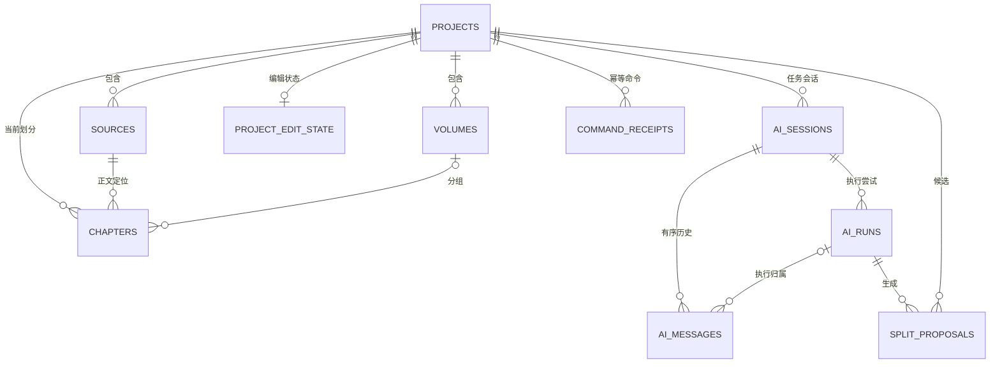
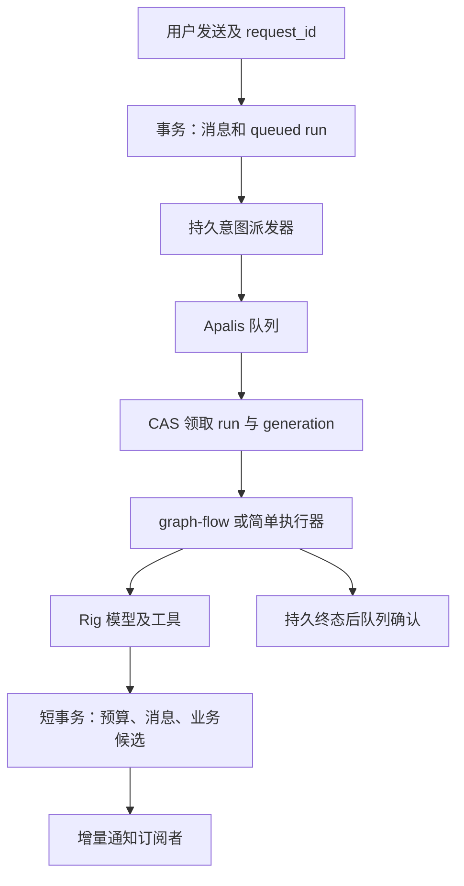

# Design

## Context

动机与范围见 [proposal.md](proposal.md)。重构前 `novel_import/store.rs` 用进程锁、文件锁和原子 JSON 替换保存完整 `Recovery`；`storage.rs` 已将不可变正文外置，但读记录仍重建正文。原 `DiagnosticTransport` 已做到卸载只 unsubscribe、显式停止才 cancel，Rust 命令也已独立 spawn；应保留这些正确语义。原 `DiagnosticStream` 从完整分章快照重新计算聊天差量。

原 `project/commands.rs` 已实现 v2 文件保存/打开；用户明确不考虑兼容性，本次移除这些入口和旧恢复存储，不构建旧文件导入器。分章变更尚未归档，本次不编辑历史提案；数据与恢复边界以本提案为后续实施依据，采用和来源约束保持不变。已有本机文件不自动清理。

## Goals / Non-Goals

**Goals:** 通过三张 AI 核心表支持任务隔离、历史查询、后台执行、重连和明确重试；用数据库事务替换恢复 JSON 的整体发布；验证两个独立会话可真实并行；前端接入通用协议而不再接收整个工程状态作为聊天流。

**Non-Goals:** 不实现章节分析算法、跨章角色合并、整书调度产品、AI 页面重设计、工程导出、托盘常驻服务；不迁移 TaleChime 音色库、模型缓存或已有音色后台任务；不新增模型请求和工具审计表，也不做永久 token 事件日志。

## Decisions

### 1. SeaORM 实体优先与新库初始化

采用 SeaORM 2.x + SQLite，业务实体是字段、关系、索引的定义入口；初始化使用 SchemaBuilder，开发数据库可使用 schema-sync。首期仅建立新库初始版本及结构版本检查，不实现历史数据升级链。SQLite 后加外键及数据变换超出自动同步边界，未来出现真实升级需求再增加显式版本迁移；不通过删库实现自动升级。只注册应用实体，不让自动同步接管或删除 Apalis 内部结构。

复用宿主异步 runtime，启用外键约束、WAL、有限 busy timeout；短事务内不进行 LLM 网络、正文解码、regex 扫描或文件对话框。schema 初始化完成后才启动 Worker。Entity、领域校验对象和 Specta IPC DTO 分离；私有模块采用具名文件，不为 ORM 单独增加工作区 crate。

替代方案：继续扩充 Recovery JSON 会重复实现局部更新与查询；将整个 Recovery 放入数据库单一 JSON 列无法解决更新范围问题；所有字段拆表则提前增加无查询收益的关系。

### 2. 表与关键约束

| 表 | 职责与主要字段 |
| --- | --- |
| `projects` | 稳定 id、title、description、revision、stage、时间；从创建开始就是本地工程 |
| `sources` | project_id、顺序、文件名、encoding、raw_sha256、raw_path、text_sha256、text_path、各自大小；新导入必须保留原始副本 |
| `volumes` | project_id、source_id、标题、来源行和人工标记 |
| `chapters` | project_id、source_id、volume_id 可空、标题、起止 UTF-8 字节、标题行、顺序、predecessor_ids JSON |
| `project_edit_state` | project_id 唯一、结构版本、规则/人工修正/异常和单步撤销 JSON；撤销只引用来源，不复制正文 |
| `ai_sessions` | project_id、task_kind、chapter_id 可空、标题、累计预算、配置绑定、历史修订和 next_sequence |
| `ai_messages` | session_id、run_id 可空、稳定 id、ordinal、role、version、parts JSON、完成/中断状态与用量摘要 |
| `ai_runs` | session_id、trigger_message_id、request_id、retry_of、状态、固定配置修订、基础工程修订/来源摘要、预算、检查点 JSON、派发重试时间、执行 generation、宿主实例 id、取消意图、错误与时间 |
| `split_proposals` | project_id、run_id、base_revision、来源摘要、版本化方案 JSON、采用/放弃状态；过期由当前修订计算 |
| `command_receipts` | command_id、操作类型、作用域、请求摘要和已提交结果引用；采用/小说导入去重，不保存 token |

另有数据库结构版本记录及 Apalis 自身队列表；这些不属于三张 AI 核心表。LLM 连接配置暂沿用 `llm-connections.json` 与系统凭据库，执行仅保存无密钥配置身份；不导入旧会话，不新建审计表。

约束：`(session_id, ordinal)`、`(session_id, request_id)` 唯一；每会话至多一个 queued/running/cancelling run 通过数据库约束或事务条件更新保证；消息与运行所属会话、章节与来源所属工程需显式校验。删除章节不能级联删除对话历史，失效引用保留在执行绑定中；历史章节替代关系不是要求旧 id 仍存在的外键。所有来源、UTF-8 范围、完整覆盖及人工修正仍走领域校验。

`parts` 使用受校验的带 tag Rust enum 和版本字段，工具 part 自带稳定 call_id、name、input、output、state、可选结果引用。工具事实只存一次，不再维护工具表或可信前端历史。工具引用统一为 kind/id/summary；业务面板通过类型注册查当前结果，未知 kind 显示摘要。不把任意模型 JSON 当渲染指令。

### 3. 文件边界与发布

新导入先冻结原始字节、解码并计算两套摘要，发布受控原文件及 UTF-8 正文后再提交 sources 和初始章节。所有路径由宿主生成和解析，数据库不信任外部路径字段；失败允许存在未引用 blob，但不能存在成功引用未发布 blob。清理只处理应用拥有、无活动租约且无已提交引用的文件。数据库不存 WAV、ZIP 或全文消息副本。

TaleChime VoiceLibrary 仍是音色权威，后续工程用稳定音色 id 引用；本轮不做音色元数据双写或通用资产大表。新生成音频持久化待具体章节工作流再建表。

### 4. Apalis 调度与应用执行状态

选择 Apalis 1.x + SQLite 后端管理队列，SeaORM 管应用表；实施锁定 SQLx/SQLite 链接兼容版本并记录 feature tree。主仓库 README 与官方 SQLite 后端当前未显示独立 SeaORM 扩展，不将未经核实的扩展当作架构前提。

采用 `ai_runs` 上的持久派发意图：一个 SeaORM 事务保存用户消息与 queued run。提交后派发器查询待派发 run，向队列仅投递 run_id；成功后记录派发信息，失败使用有界退避保留意图。宿主启动和周期对账恢复未派发/失联的 queued run。重复入队允许，但业务执行必须去重；无需额外 outbox 表，也不需要借用队列内部 SQL 或假定共享事务。即便以后提供同事务入队优化，也必须保留重复交付保护。

Worker 以事务 CAS 领取 queued run，产生 generation 与 owner_instance；之后每次写消息、工具结果、检查点、预算和终态均携带该执行身份，失效 Worker 不得提交。重复队列项读到已领取/终态 run 时直接结束。队列状态不作为业务成功依据；业务成功提交后即使队列 ack 丢失，重投递也只回读终态。

全局与连接并发可配置，首期保守默认全局 2、每连接 1；同会话 1，等待输入不占名额。连接配额在发起外部请求前获取，不能将全部 Worker 名额长期占在同一受限连接等待；必要时延迟重新调度尚未开始的 run。确定性 CPU/文件工作继续放 blocking worker。现有语音引擎非 Send 资源线程不进入 AI Worker。

替代方案：仅 Tokio spawn 无持久队列；自建所有租约/心跳/重试会复制基础设施；默认将整个 Agent 自动重试会重复费用和副作用。

### 5. 重试、取消、重启与 graph-flow

执行状态：queued → running → waiting_for_input / succeeded / failed；queued 或 running 可进入 cancelling → cancelled；上个宿主的 running/cancelling 启动时转 interrupted，并将消息/工具未闭合部分标记中断。尚未开始的 queued 可自动派发；上次已开始的 run 不因 Apalis orphan recovery 自动重新请求模型。当前宿主持续订阅失败不改变执行状态。

调度层默认不对已开始的 LLM run 做整个 handler 自动重试；仅安全派发/领取前故障退避。用户明确重试或继续创建 retry_of 指向旧执行的新 run，仍使用会话累计预算；从已校验步骤重新构造合法模型历史，不能合并两次不完整输出或重放正式采用。当前 8 次请求/轮、64 次请求/会话、24 次工具/会话及字节限制保持，以现有 budget.rs 为准，不因表拆分清零。

graph-flow 管当前诊断节点与私有检查点，Rig 管节点内部有界工具循环；Apalis 管调度。保留 prepare/diagnose/validate/review，等待输入保存后结束 Worker，下一次用户输入重新调度。图版本与应用数据版本分开；图 checkpoint、工具完成结果和候选在同一应用事务边界保存，checkpoint 不保证外部调用恰好一次。本轮不引入 apalis-workflow，后续并行 DAG 单独评估，不据此认定两个框架等价或必须互斥。

取消先持久化意图，再通知内存 CancellationToken，禁止新请求/工具并使晚到写失效；等待已启动 blocking 工具退出才发布 cancelled。不直接将 Apalis future drop 当作业务已取消。宿主真正退出会中断在途任务；窗口提示读取 queued/running/cancelling 的真实数量，不新增关闭到托盘。

### 6. 通用 IPC 与恢复流

通用命令承担 create/list/read_history/start/retry/cancel/subscribe/unsubscribe；任务启动输入只接收 user 文本、任务范围、模型选择与期望修订，宿主取历史。命令与 DTO 经 tauri-specta 导出，不泄露 Rig、SeaORM、Apalis 类型。

恢复返回分页消息、消息版本、会话 cursor 和活动 run；Channel 传版本化通用文本增量、工具更新、运行状态和 resync_required，均带 session_id/run_id/sequence。前端统一 transport 投影 AI SDK UIMessageChunk；分章候选查询与业务通知独立。维护每会话有界内存回放缓冲，原子注册订阅并核对 cursor；缓冲缺口、持久化后未发通知或宿主重启时要求重读消息快照，而不是重发启动命令。对恢复过程中已存在的助手消息按稳定 id 替换/接续，避免 useChat 再附加重复助手消息。

文本按约 100ms 或 4KiB 合并写入并发布，完成和工具边界强制 flush；未落盘尾部在崩溃时可能丢失，不承诺 token 级恢复。数据库提交成功后才发布对应序号；若发布失败，下一次读取仍得到记录。慢订阅者超过缓冲则 resync，不能反压模型消费者或全局任务。

### 7. 业务结果事务

test_rules/patch_boundaries 在事务外计算、事务内复核 base_revision/hash，再同时插入候选并完成工具 part。自然语言同意不等于采用；采用命令仍核对来源、修订、proposal_id 与人工约束，一次事务更新章节/卷/编辑状态、撤销、候选状态和回执。全工程 revision 暂保守使用，细粒度章修订留待实际分析业务，不为并行测试放宽冲突校验。

### 8. 模块划分与设计原则

本提案将“四大原则”具体解释为 KISS、DRY、YAGNI 与 SOLID 的职责/依赖约束；作为设计准则而不是声称存在唯一的四原则定义。

- **KISS**：一个 Rust host crate、一个应用数据库、三张 AI 核心表、一个共享前端 transport；简单查询直接使用 SeaORM，不套通用 repository/service/manager 多层转发。
- **DRY**：AI 消息、订阅、取消、预算及运行状态只有一套实现；分章模块不复制通用会话逻辑；工具结果只在 parts 保存一次。
- **YAGNI**：不做旧格式兼容、通用资产中心、全量事件溯源、模型审计平台、额外 Node 服务或数据库多后端抽象。
- **SOLID**：IPC 只做边界转换，handler 只调用应用用例；查询/事务写入按领域归属组织，领域规则不接收 WebView、WorkerContext 或 ORM ActiveModel。只有真实替换点如模型调用与流订阅边界使用窄接口，不为每张表造一个 trait。业务结果类型接入共享聊天组件，避免共享组件依赖分章实现。

依赖从装配层指向用例与适配器，基础模块不能反向导入 Tauri commands。跨模块事务由用例发起；领域 store 的查询/写入函数接受 `ConnectionTrait` 对应的连接或事务，不在每个 helper 内自行 commit。Entity 保持数据映射职责，业务行为不藏在泛型 ActiveModel hook 中。

实际目录如下；这是模块职责清单，只创建实际需要的文件，不强制机械拆出每个小文件。Rust 使用 `foo.rs` 入口而非官方示例的 `foo/mod.rs`。

| 目录/文件 | 职责 |
| --- | --- |
| `src-tauri/src/lib.rs` | Tauri 装配和命令注册，不承载业务事务 |
| `database.rs`、`database/entity.rs`、`database/entity/*.rs`、`database/schema.rs` | 连接、Entity 注册、初始 schema 与版本检查；一实体一具名模块 |
| `project.rs`、`project/{local,query,edits,store,document,assets,text,receipts}.rs` | 本地工程查询/写入、来源与章节不变量；替换原可移植文件职责 |
| `novel_import.rs`、`novel_import/encoding.rs`、`novel_import/detection.rs` | 原始小说导入、解码、本地分章；不再拥有通用 AI 会话存储 |
| `novel_import/splitting.rs` 与 `splitting/{graph,execution,tools,store}.rs` | 分章提示、受限工具、图与候选业务；通过共享会话运行接口保存结果 |
| `ai.rs`、`ai/commands.rs`、`ai/service.rs`、`ai/history.rs`、`ai/runs.rs` | 通用会话用例、消息和执行事务；service 只在真实跨表用例处组织操作 |
| `ai/messages.rs`、`ai/stream.rs` | parts 与合法历史投影、序号/有界缓冲/订阅；不含分章目录 |
| `jobs.rs`、`jobs/runtime.rs` | Apalis 装配、薄任务 handler、持久意图派发和停机；payload 只带 run_id |
| `llm/` | 沿用模型连接、凭据、Rig provider 与有界 HTTP 职责，不复制进 ai 或 jobs |
| `src/lib/ai/transport.ts`、`src/lib/ai/stream.ts` | Tauri ChatTransport、AI SDK chunk 适配及去重；替换分章专用 transport |
| `src/hooks/use-ai-session.ts` | 稳定 transport 实例、会话恢复、订阅释放；卸载不发取消命令 |
| `src/components/ai-elements/session-{messages,input}.tsx` | 共享消息、工具摘要与输入组件，只依赖通用消息和回调 |
| `src/components/projects/` | 分章方案/目录业务视图；按 kind/id 读取方案，采用明确命令 |

前端消息状态由 useChat 管理，业务结果通过宿主查询/通知管理；不再用多个 React state 维护第二套权威 messages。transport 与组件分离，稳定实例与 cleanup 可通过 StrictMode；只在任务 id 变化时切会话，不因每个增量重建 transport。复杂消息/长历史按稳定 id 更新并分页，工具 JSON 默认不作为产品内容铺开。继续沿用现有 Base UI、Lingui 和主题，不借后端重构重做全站目录。

官方参考的取舍：SeaORM Axum 示例的 entity/query/mutation 分离作为职责参考，不照搬 API server、独立 migration crate 或整套 workspace；Apalis 的 Backend/Worker/Middleware 内核目录不等于业务应用模板，仅采用小任务参数、普通 async handler、Data 依赖注入和集中 Worker 装配；AI SDK 的 custom transport 是 Tauri 桥接位置，不照搬 Next.js 路由或 Redis 服务。

## Risks / Trade-offs

- [Apalis 与 SeaORM 的驱动版本或 SQLite native link 冲突] → 首个实施任务编译兼容性验证并锁版本；不在此提案伪造通过结果。
- [持久派发允许重复队列项] → 执行领取 CAS、generation fence、命令唯一键与终态回读；以故障注入验证 ack 丢失和旧 Worker 回写。
- [单库写竞争] → 文本合并、短事务、有限连接与并发；测量长对话和多会话，不将每 token 永久落表。
- [自动同步不等于任意结构升级] → 验证空库初始化和同结构重启、外键与唯一约束；未知结构版本停止写入，未来升级按真实需求单独设计。
- [不兼容旧工作数据] → 明确不支持旧工程和恢复记录，移除旧入口与双写，不自动删除用户文件。
- [新旧分章文档冲突] → README、数据格式和验证文档随实施同步；主规格同步时以后继能力为准替代旧存储/另存为描述，不复活 legacy-main。

## 切换计划

1. 初始化全新应用数据库及受控来源目录，验证同结构重启幂等；未知结构版本报告错误，不自动删库。
2. 替换工程工作状态与诊断存储，移除 Recovery JSON、旧 DiagnosticSnapshot 协议及旧 `.castglean` 解析/保存入口；不保留兼容 facade、dual-write、旧数据迁移器。
3. 新界面只列新数据库工程；工程打开表示打开本地 id，导入入口只导入小说来源。清除另存为和基于未写工程文件的关闭提示，后台任务影响提示保留。
4. 用户已有旧文件保持原位，不自动扫描或清理；代码回退只影响程序版本，不承诺新旧数据互通。

## References

- [SeaORM 实体优先及 SQLite 限制](https://www.sea-ql.org/SeaORM/docs/generate-entity/entity-first/)
- [Apalis SQLite 后端源码与依赖](https://github.com/apalis-dev/apalis-sqlite)
- [Apalis 队列、Worker 与工作流架构](https://apalis.dev/docs/introduction/architecture)
- [AI SDK 历史与流恢复](https://ai-sdk.dev/docs/ai-sdk-ui/chatbot-resume-streams)
- [SeaORM 官方示例目录](https://github.com/SeaQL/sea-orm/tree/master/examples/axum_example)：参考 entity 与 query/mutation 职责划分；本项目保持单 crate。
- [SeaORM 分层架构](https://www.sea-ql.org/SeaORM/docs/internal-design/architecture/)
- [Apalis handler、Data 与 Worker 示例](https://github.com/apalis-dev/apalis/blob/main/apalis/README.md)
- [AI SDK Transport](https://ai-sdk.dev/docs/ai-sdk-ui/transport)

参考资料证明所提供能力，不代表本仓库已完成集成；实施须以锁定版本的源码和故障测试为准。
