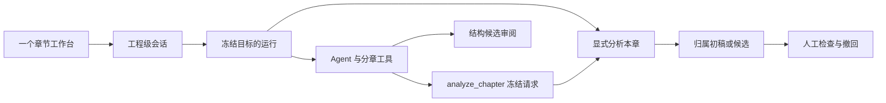

# Design

## Context

ProjectWorkspace 当前通过隐藏保挂载两套工作台，各自 useAiSession。会话按 taskKind/chapterId 组织；Apalis 按 session.taskKind 分派。分章已有 Rig 动态工具、graph-flow 校验与显式候选；归属已有可重试窗口、来源/人工依赖和事务发布。

## Goals / Non-Goals

Goals：真正共用单一阅读和会话；继续复用领域校验；运行上下文独立于视图。
Non-Goals：音频制作、无限并行批量分析、自动采用候选、自动合并旧历史。

## Decisions

1. 新会话使用 project_assistant、chapterId=null。StartRun 增加可空 workspaceContext（action auto/split/analyze、chapterId）；ai_runs 增加可空 JSON 列，SQLite v3 原子迁移。context 参与请求哈希；重试取原运行上下文，不从当前 UI 重新绑定。旧会话不改写。
2. auto/split 复用分章 Agent，auto 工具集增加只读 read_analysis 和 analyze_chapter；split 快捷命令仅暴露结构工具。该工具在受保护事务中冻结 analysis_input，最多一个章，返回已受理事实。graph 流程结束后由同一 Worker 执行归属流水线并发布真实结果，避免嵌套工具提前终结外层租约。受理分析后，Agent 保持原回复 streaming，分析阶段通过 Output::resume 复用同一回复 ID；只有最终发布才完成消息，不允许把 complete 消息重新打开。显式 analyze 快捷入口直接冻结并执行，省去路由模型请求。auto 普通讨论可用只读工具；提示明确用户未要求时不生成分析/结构候选，所有采用仍是独立宿主命令。
3. ImportedWorkspace 成为唯一章节正文，加入独立结构编辑/规则/分卷/跳行、逐行边界动作及结构候选。右侧默认助手，检查器按正文选择打开并提供返回；共享组件保持挂载和输入。统一待检查筛选显示结构/归属类型。
4. 运行中的章节和结果从宿主 context/result 查询，不能用当前 UI 章节猜测。HistoryPage 按页批量提供运行上下文，回复常驻标注上下文并可定位，实时更新/向前翻页保留该映射。结果点击先取得真实候选/版本目标再导航；旧历史只读，不在旧作用域新发请求。
5. 参考 Cursor 的单 Agent 工具、VS Code 的上下文与工具分离、Notion 的当前内容快捷动作，以及 shadcn Trace 表达真实执行。遵循现有 token、紧凑工具栏与浮层，不新增组件体系。

## Risks / Trade-offs

- 长会话成本增长 → 沿用有界历史分页及真实用量；用户可显式新建会话。
- 结构改变使归属失效 → 原宿主依赖检查保持；仅在结构修改/采用前提示，不常驻占据一行。
- 工具生成请求后模型失败 → 未开始分析不发布业务结果；显式重试才继续，禁止自动重放。
- 工具选择的语义准确性 → 提供确定快捷入口，使用可控协议测试与真实模型抽样分别记录，不声称普遍语义质量。

## Migration Plan

v1/v2 依次事务迁移至 v3，新增列可空且旧运行读取为无上下文。未知版本拒绝，不删除数据。旧路由 mode 参数仍可解析但统一显示同一工作台。以迁移、工具受理/重复/跨工程、后台切章、历史和 UI 矩阵验证交付。
