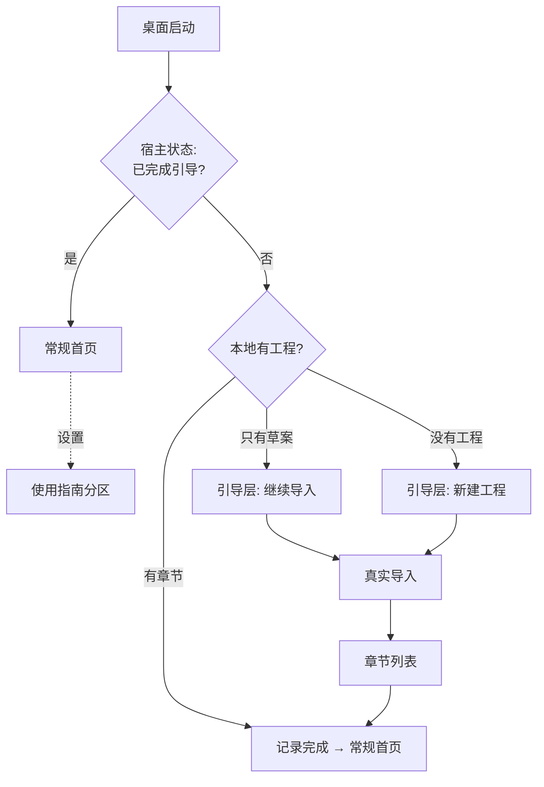

# Design

## Context

动机见 proposal.md。当前实现有三处相关事实：`src/components/onboarding/start-guide.tsx` 是唯一的首次使用说明页，靠「工程是否有章节」「模型是否 Ready」动态打勾并常驻侧栏；`src/routes/index.tsx` 的空态已经给出「导入原文 → 检查章节 → 绑定声音 → 生成音频」的流程提示与新建入口；`simplify-project-home` 正在把首页改成卡片网格，新建入口常驻第一格，未完成导入并入网格。

宿主侧目前没有通用键值存储：工程数据在 SQLite，应用配置类状态由 `llm/config.rs`、`engine/config.rs` 以 JSON 文件落在应用配置目录并用 `atomic_json.rs` 原子替换。首次使用完成标记属于应用级界面状态，遵循同样的持久化方式即可，不需要数据库 schema 迁移。

本设计只覆盖桌面首次使用。浏览器预览没有文件选择与模型能力，任何首启引导都会是假的，因此保持独立。

## Goals / Non-Goals

**Goals:** 让第一次使用的用户在一次会话内看到章节列表；引导结束或跳过后保持安静；主流程说明随时可查；不新增常驻导航目的地。

**Non-Goals:** 不做引导到模型下载、声音绑定或音频生成；不做可跳转的 tour 组件库；不做多步骤向导框架；不改工程数据格式与导入流程本身；不动浏览器预览的能力边界说明内容。

## Decisions

### D1：引导是首页浮层，不是新路由

首启引导是覆盖在工程首页内容列上方的一块面板，不新增路由、不锁导航、不遮蔽整个窗口。它与首页空态互斥：引导出现时不再渲染常规空态，避免同一区域出现两块说明。

备选方案是做一个 `/welcome` 全屏路由，问题是它会打断「导入失败回首页看工程」这类回路，也让侧栏多出一个只在第一天存在的目的地，因此不采用。

### D2：完成状态由宿主持久化

新增宿主模块 `app_state.rs`，用 `atomic_json::save` 把 `{ version, onboardingCompleted }` 写入应用配置目录的 `app-state.json`，暴露 `app_state_snapshot` 与 `app_state_complete_onboarding` 两个命令。文件缺失按未完成处理；文件损坏时按未完成处理并重新写回，不静默当作已完成。

前端只读该状态，不写 `localStorage`：项目分层规定前端只持临时 UI 状态，且浏览器预览与桌面共用同一份前端代码，判定依据必须只有一处。

### D3：触发与结束条件由真实工程状态决定

引导在「宿主未记录完成」且「本地不存在有章节的工程」时呈现。工程只有未完成导入的草案时，引导指向继续导入；出现章节即判定完成并写入完成状态，此后不再自动呈现。

这样既满足「以没有任何工程作为首启判定」——已有章节的老用户完全不会被打扰，也满足「引导只到章节列表」——导入完成的那一次回到首页会自动收尾。

### D4：使用指南留在设置里

设置面板新增「使用指南」分区，按导入原文、检查章节、绑定声音、生成与导出四步列出说明与入口按钮。说明文字保留原快速上手页的关键约束：模型可以稍后准备，导入原文不以模型准备为前提。

备选方案是保留一个可复看的独立路由，但它仍然是常驻说明书入口，与删除快速上手页的目的冲突，因此不采用。

### D5：删除页面而不是重定向

`/start` 路由与组件直接删除，侧栏不保留兼容入口。项目约定不为旧界面保留兼容层。

## Risks / Trade-offs

- 首启引导与常规空态在同一区域切换，用户跳过前后看到的文案不同，需要保证两者都成立：空态负责「还没有工程」，引导负责「第一次该怎么开始」。
- 宿主写入失败时引导不能反复弹回打扰用户：本次会话内按已完成处理，只在下次启动时重新出现。
- 合成 IPC 的浏览器回归不覆盖真实桌面首启行为，桌面真机仍需单独验收。
