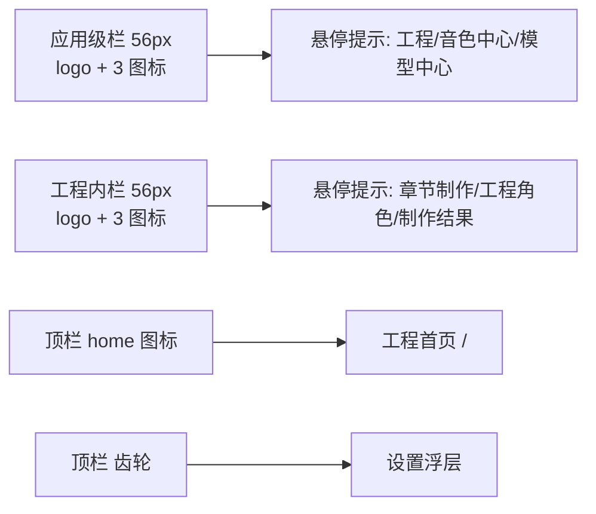

# Design

## Context

动机见 proposal.md。现状事实：`library-sidebar.tsx` 用 `w-52`（208px）固定宽，放 `buttonVariants({size:"row"})` 的图标+文字链接，底部另有一个「设置」按钮；`app-sidebar.tsx` 用 shadcn `Sidebar` + `SidebarProvider` 的 `--sidebar-width: 6rem`（96px），按钮用 `size="nav"`（图标在上、文字在下），同时已经写了 `Tooltip`（`side="right"`），只是文字同时常显。

两条导航栏的职责不同：应用级栏是**目的地切换**（工程 / 音色中心 / 模型中心），使用频率低、间隔长；工程内栏是**同一工程内的分区切换**（章节制作 / 工程角色 / 制作结果），使用频率高。两者的共同点是名称都是短名词、图标语义清晰，因此都适合纯图标 + 悬停提示。

## Goals / Non-Goals

**Goals:** 两处导航栏形态统一；应用级内容列在 1024×680 下多出约 150px；设置入口唯一；悬停提示与无障碍名称让图标可理解；键盘与读屏路径不退化。

**Non-Goals:** 不引入飞出面板或折叠状态；不改应用级导航的信息架构（仍只有三个目的地）；不新增/删除任何业务目的地；不动浏览器预览与设置浮层内部结构。

## Decisions

### D1：两处栏都是纯图标 + 悬停提示

应用级栏与工程内栏都收到 56px，图标居中，名称通过 tooltip（`side="right"`）呈现。

备选是「选中项常驻文字」（方案 B），保留可读性但让选中态与图标栅格不齐；另一个备选是悬停飞出面板（方案 C），信息更全但要处理焦点与避让。用户选择纯图标，理由是桌面生产工具的既有习惯（Codex 等）与本应用的短名词导航。

代价要明确：名称不再常显，依赖悬停或读屏获得。缓解手段是每个图标项都带 `aria-label`（读屏与键盘焦点都会读出），tooltip 只做视觉补充。AGENTS.md 里「导航直接显示名称、不依赖悬停才能发现」这条规则因此需要按本变更修订（见 D3）。

### D2：设置入口唯一

删除应用级侧栏底部的「设置」按钮，只保留顶栏齿轮。顶栏齿轮在所有页面常驻（含工程内界面），覆盖面更广；侧栏那条既重复、又与顶栏同名，读屏里出现两个「设置」。

### D3：logo 与首页入口分工

两处栏顶的 logo 退为纯品牌标记（不再链接到 `/`），「回工程首页」只由顶栏 home 图标承担。应用级栏里另有「工程」图标也指向 `/`，三者指向同一目的地时保留一个入口即可。

这条同时意味着 `AGENTS.md` 的「导航直接显示名称」需要改写为「导航目的地用图标 + 悬停提示与无障碍名称承载，名称不常显」——按仓库约定，规则变更先落到 OpenSpec 与知识库，再改 `AGENTS.md` 的短约束。

### D4：两处栏共用同一套控件

图标项统一用 `Button size="icon"`（36px）+ `Tooltip`；应用级栏沿用 `buttonVariants` 的 `selected` / `ghost` 变体与 `aria-current`，工程内栏沿用 shadcn `Sidebar` 的 `selected` / `ghost`。栏宽用同一个 token（56px），避免两处各自定义。

### D5：影响面

- 侧栏文字链接的 e2e 定位改为按 `aria-label` 找图标项；`navigation-links` 断言的是「链接仍可达」，语义不变。
- 应用级内容列变宽后，模型/音色页的表格与分页重新排布，需在 1024×680 核对无横向溢出。
- 顶栏 model chip 仍链到 `/models`：它是状态信息不是导航项，保留。

## Risks / Trade-offs

- **可发现性下降**：首次使用者看不到目的地名称。缓解：图标语义明确（书库、波形、CPU）、选中项有强调底、tooltip 即时出现；首启引导本身已说明「音色中心 / 模型中心」等入口。
- **Windows 高分屏与触屏**：本应用是桌面生产工具，无触屏目标；tooltip 在触屏不可用，但每个入口也有无障碍名称。

## Migration Plan

无数据迁移。UI 形态一次性切换，旧的文字侧栏不保留兼容层。

## Open Questions

- 是否后续把应用级目的地拆成「图标栏 + 第二列文字列表」（Codex 双列）？本次不做，等实际使用后再定。
