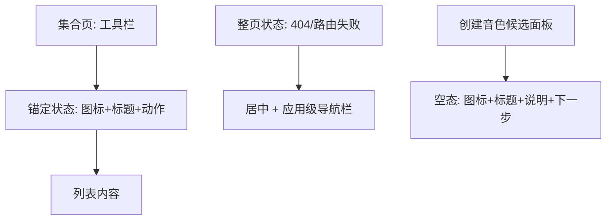

# Design

## Context

`src/components/app-state.tsx` 是应用里唯一的空状态组件，底层是 shadcn 的 `Empty` 基座：

```
"rounded-surface flex w-full min-w-0 flex-1 flex-col items-center justify-center gap-4 border-dashed p-6 text-center text-balance"
```

`flex-1 + justify-center` 让空状态在父级 flex 列里撑满剩余高度并垂直居中。这对**整页状态**（404、路由加载失败）是对的，但对**集合页状态**（搜索无结果、读取中）是错的：集合页上方有工具栏（搜索框、模型筛选、视图切换），用户刚操作完那里，状态却掉到屏幕中部，像是另一块不相干的内容。

集合页的状态容器分两类：

- 列表容器：`voice-library.tsx` 与 `model-center.tsx` 的 `div.flex.min-w-0.flex-col`（或同结构的列），父级是 `PageShell fill` 的 `div.flex.min-h-0.flex-1.flex-col`。
- 整页容器：`route-states.tsx` 的 `main`，父级是 `DesktopShell` 的内容区。

`AppState` 现有 `placement="list"` 已经是「嵌在列表末尾」的意图，但只做了 `min-h-0` 与 `border-b`，没有去掉 `flex-1`，所以仍然会被拉伸居中。

## Goals / Non-Goals

**Goals:** 集合页状态锚定在工具栏正下方；同类状态形态一致；路由级状态保留应用外壳；候选面板有明确空态。

**Non-Goals:** 不重写 `Empty` 基座；不改整页状态的居中形态；不引入新的状态组件或通用状态注册表；不动业务逻辑与数据。

## Decisions



### D1：给 `AppState` 增加「锚定」形态而不是改基座

新增 `anchored` 形态：内容高度自适应（不撑满），因此状态紧跟在上一个元素之后；水平居中、垂直贴顶。加在 `AppState` 上而不是直接改 `Empty`，是因为 `Empty` 还要服务卡片、设置面板等其它场景，`Empty` 基座的居中行为在那里是正确的。

备选是改 `Empty` 基座去掉 `flex-1`：会连带影响设置浮层里的分类空态、卡片网格等已在验收中的形态，回归面太大，不采用。

### D2：集合页的加载态、错误态、搜索无结果态统一锚定

模型中心的「正在读取模型目录…」「没有匹配的模型」「本构建没有编译进任何模型」，预置音色的「正在读取预置音色…」「预置音色读取失败」「没有匹配的音色」「没有可用的预置音色」，我的音色的「没有匹配的音色」都改为锚定形态。整页状态（404、路由加载、路由失败）保持居中。

### D3：同类状态形态一致

预置音色的「没有匹配的音色」原本用 `compact` 变体（没有图标），模型中心同款有放大镜图标。统一为都带图标 + 标题 + 清除动作；`compact` 只保留给设置面板内的局部空态。

### D4：路由级状态保留应用外壳

`route-states.tsx` 的三个状态改为与 `PageShell` 同样的结构：`LibrarySidebar` + `main`。不直接复用 `PageShell`：它会渲染带标题的粘性页头，404 再放一个「这个页面不存在」标题会重复；这里只要外壳与导航栏，标题由状态块本身承担。

### D5：候选面板空态

右侧「音色候选」在没有候选时用 `AppState` 的锚定形态（图标 + 标题 + 说明），说明里包含原有一句「候选会保留在当前应用会话中，确认保存后才能加入音色库」，并补一句下一步（在左侧用设计引擎生成候选）。原来的单行说明移除。

## Risks / Trade-offs

- **加载态从「居中」改成「贴顶」后更靠近工具栏**，视觉上比整页居中弱；但集合页的语义就是「工具栏 + 列表」，状态属于列表区域，贴顶更符合上下文。
- **404 补上导航栏后页面宽度变窄**：状态块仍居中，内容不受影响；窄窗口下导航栏与状态块同屏，1024×680 与更小窗口需要复核不横向溢出。

## Migration Plan

无数据迁移。界面形态一次性切换，不保留旧形态兼容层。

## Open Questions

- 是否后续把空状态文案统一到一份「状态词典」里维护（当前每处各自翻译）？本次不做。
