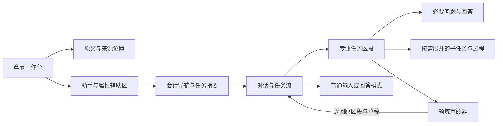

# Design

## Context

动机见 [proposal](proposal.md)。本方案基于 2026-11-17 当前代码与同日原生公开样例截图：`SessionMessages` 递归渲染消息/工具，`AgentInterrupts` 在输入栏前逐题插入表单，`ImportedWorkspace` 同时承担运行横幅、恢复、结果和检查器切换；用户等待回答时仍看到第二块大输入框。`useAiSession` 已接官方 runtime，`AgentPage` 已有消息、records、invocations、interrupts、冻结上下文与当前 run。这里是**待实施交互设计**，不是新界面验收记录。

依据：`PRODUCT.md`、`DESIGN.md`、[现行数据契约](../../../docs/data-format.md)、[审计问题 P1-03 / P2-16](../../../docs/ui-ux-audit/README.md)、[渐进展示规则](../../../docs/knowledge/decisions/layout-disclosure-patterns.md)。历史审计用于选择回归，不直接当作当前故障结论。界面为 Operate 模式，沿用静阅青、语义 token、共享表单及纯图标目的地导航。

## Goals / Non-Goals

**Goals:** 用户在助手中直接辨认“正在为谁做什么、卡在哪里、结果在哪里、下一步会不会重新调用模型”；任务流、必要回答和审阅往返围绕稳定目标组织，正文保持主要操作面。删除被替代交互，同时保留现行 AG-UI 会话及业务事实。

**Non-Goals:** 新目标/步骤数据库、自动跨步骤执行、任意生成式 UI、通用 JSON Schema 表单、协议重写或库命名修复、音频生成/播放卡、选声/说话人/采用专用决定、撤回/忽略领域能力、模型质量裁决、整应用视觉系统重做。已有音频播放器、角色中心和复杂差异审阅器仍由对应领域拥有。

## Decisions

### D1：原文为主工作面，助手有明确的任务入口

采用“会话导航 → 当前任务摘要 → 对话/任务流 → 输入区”。普通对话保留自然消息；专业调用在其发起位置形成任务区段，不给每条消息包卡片。当前运行摘要只显示目标、状态和“定位任务”入口；停止/重试由任务区段唯一承载。普通回复没有专业任务区段时，停止由输入区唯一承载，不再同时在正文顶部、助手横幅和输入区重复显示同一操作。

宽窗口允许正文与助手/属性并排；辅助区内明确切换“助手 / 属性”，不把属性称为助手。1024×680 无法容纳目录、正文和辅助区时允许临时折叠辅助区，但记录其模式、任务定位、草稿及触发器；关闭目录后恢复原辅助模式。保留工程三目的地及共享资源入口，不新增一套 agent 页面或脱离工程的任务中心。

选择任务区段而非保留通用工具聊天：用户关心专业任务与结果，工具调用只解释过程。也不采用全屏聊天替换正文，避免每次审阅都丢失来源位置。

### D2：专业任务按身份归组，子任务渐进展开

- 专业任务显示“检查全书分章”“分析《章名》”“生成工程选角建议”等用户目标，不以 agent 名、tool 名或 run id 为标题。
- `invocation.id/subagentRunId` 是调用身份；父工具/消息关联决定位置，`parentId` 决定嵌套。直接快捷入口没有父工具时，在触发消息之后显示独立任务区段。不得伪造一个父模型调用来满足布局。
- 分析与只读预审分别标为阶段/子任务，同名不同调用保持独立。同一任务回答后产生的新 run 作为继续尝试，沿用可关联分组；重试保留旧尝试及错误，不能覆盖为成功。
- 默认保留任务状态、结果摘要、待回答问题和主要动作。工具、reasoning、用量为次级信息；reasoning 默认折叠，不展示原始工具 JSON/传输字段。没有阶段/耗时/总量时明确未知或省略，不从工具次数编造进度。
- 已有业务结果链接只在任务结果区域出现一次；详情中的工具成功事实不能再复制出第二个主结果操作。普通查询工具可归为该回复的“查看过程”，不生成专业任务节点。

复用官方 runtime 的嵌套消息和 AG-UI 生命周期；应用只做按身份的展示索引和已注册领域结果映射，不再建立协议 reducer、解析器或事件兼容桥。

### D3：运行状态、通信状态、领域结果分开表达

| 权威事实 | 默认说明与主要动作 | 执行边界 |
| --- | --- | --- |
| 待受理/发送中 | 正在发送；可保留草稿并停止本次意图 | 不等于已接受或已运行 |
| 受理未确认 | 核对原请求 | 不提供普通再次发送；确认不存在后才重试原身份或停止恢复 |
| queued | 已排队；停止 | 不伪造模型已工作或用量 |
| running | 显示已知阶段；停止 | 停止操作只提交一次取消意图 |
| cancelling | 正在停止；查看已保存内容 | 本地工作退出前不显示已取消，不再给重复停止动作 |
| waiting_for_input | 需要回答；回答问题 | 挂起不占运行名额，不提供把回答丢弃的假取消按钮 |
| succeeded | 任务计算完成；查看结果/审阅 | 待采用候选另显示“待审阅”，不能显示已采用 |
| failed / interrupted / cancelled | 具体状态及保留内容；显式重试（宿主允许时） | 说明会新建尝试并可能产生调用；只读刷新不重执行 |
| 历史/状态读取失败 | 读取未完成；重试读取 | 保留最后已知内容并标为可能过时，不把失败读成空历史或任务失败 |
| 宿主不可用 / 无可用模型 | 说明缺失条件；到达对应设置入口 | 不显示可启动的假按钮；设置返回恢复原草稿和焦点 |

当前宿主取消和重试以 run 为单位：根任务操作影响本轮执行，嵌套预审只显示真实状态，不提供尚无宿主能力的独立停止/重试。成功执行与候选的 pending/applied/discarded/stale 独立呈现。状态由宿主事实及 runtime 更新；前端仅保存展开、选中与请求进行中等临时状态。状态切换适度播报，不能逐 token 朗读；错误有安全说明和对应动作，不显示底层异常。

### D4：问题属于任务，同一时刻只有一套主要作答界面

必要问题与回答表单位于所属任务区段，显示目标和宿主问题。等待期间普通 composer 收为“草稿已保留 / 返回回答”的紧凑入口，保留普通草稿；不再堆叠回答 textarea 和完整聊天 textarea。允许用户返回原文或稍后回答，但该操作仅改变视图，不创建“已跳过/已取消”的业务事实。返回任务可聚焦原回答位置。

本轮只实现宿主已有的文字回答控件；`responseSchema` 不驱动任意表单生成。遇到未注册的输入形式，显示安全问题摘要及暂不支持作答的原因，不擅自降级成无约束字符串。与类型库是否接受非法文档无关，不为此增加通用 schema 拦截。

回答草稿键为 project/thread/interrupt；提交记录使用当前中断集合。若同轮有多题，集中展示并一次提交该轮全部必要回答，避免逐题提交被 runtime 的完整性约束拒绝。提交失败保留输入；受理未知时使用当前原请求核对路径，禁止盲目再次调用。消费后清理该问题草稿，恢复普通 composer 及原草稿，不展示 resume 路由 JSON。普通发送和回答均保留 IME 组合保护、正确标签与错误说明。

### D5：审阅往返使用领域当前状态，执行目标不可随导航漂移

点击结果先用稳定引用读取领域现状，再打开已有分章候选、归属检查器或选角建议界面。读失败只给重读动作；过期、已采用、已放弃按当前事实标识。大范围比较留在领域审阅器，本轮不新增对话内采用决定卡或另一份候选状态。

返回恢复会话、任务锚点、阅读范围、草稿和触发器焦点。正在阅读乙章但运行目标为甲章时，摘要始终标甲章；“查看目标”明确切到甲章，不能偷偷将后续审阅应用到乙章。普通输入区单独表达下次发送的上下文，发送时继续由宿主冻结和校验。

### D6：展示模块边界与数据缺口

建议拆分 `AgentWorkspace`（区块布局）、`AgentTaskSection`（任务与尝试）、`AgentTaskDetails`（次级轨迹）、`AgentQuestionGroup`（回答）及结果动作分派；具体文件组织在实现时沿用仓库命名惯例。`ImportedWorkspace` 负责工程/正文/检查器协作，不继续堆全部 agent 状态分支；`chapter-diagnostics` 如仍有有效入口，共用相同展示组件。

数据来源如下：

| 展示项 | 当前权威来源 | 缺失时处理 |
| --- | --- | --- |
| 会话和当前运行、冻结模型/目标 | AgentPage.session/run/contexts | 显式未知/读取失败，不按当前章节反推 |
| 子任务归因和尝试 | invocations、retryOf、标准生命周期和消息归因 | 无父关联的快捷调用独立放置，不按同名猜测 |
| 文本、工具、reasoning | 官方 runtime 的消息/内容 | 未注册内容安全摘要，不展示协议 JSON |
| 必要问题与消费状态 | interrupts、标准 interrupt outcome、宿主受理查询 | 从权威恢复，不只维护本地已回答标记 |
| 结果、采用和过期 | records 引用 + 所属领域查询 | 不以消息中的旧状态代替当前领域状态 |
| 用量/阶段/耗时 | 已持久观察值 | 无值不填零、不推算费用或百分比 |

若专业任务名称、目标或引用跨页恢复需要额外信息，限定为查询现有记录得到的只读投影，并为新字段生成 bindings；不为 UI 摘要创建目标步骤表、新队列或第二份运行状态。长历史前置加载不抢滚动，流更新只更新相应区段，避免全部 Markdown 和正文重挂载。

### D7：与在途方案的所有权

| 工作项 | 本变更 | assistant-guided-production |
| --- | --- | --- |
| 现有运行/专业调用的摘要、状态与详情 | 实施并成为共享展示入口 | 复用；不得再另建同类区段 |
| 已有文字 AG-UI 中断、回答草稿与恢复 | 实施 | 在其上扩展领域交互 |
| 分章/分析/选角结果摘要与打开已有审阅器 | 实施 | 持有未来对话内专用决定语义 |
| 目标和步骤持久化、自动跨步骤推进 | 不纳入 | 负责 |
| 说话人分歧、音色选择、采用/拒绝/忽略专用卡及命令 | 不纳入 | 负责，并依赖对应领域能力 |
| 助手发起音频生成、产物恢复、内嵌播放与详情卡 | 不纳入 | 负责，复用音频域执行器 |
| 助手区域布局、草稿/焦点/滚动往返 | 现有能力的基础契约 | 新领域场景增量验证 |

`rewrite-agent-ag-ui` 的执行/传输/数据隔离及未完成验收由其继续拥有。新 UI 的停止按钮必须补原生证据；如发现底层问题，在所属协议变更修复并交叉链接，不将其遗漏或直接勾选旧任务。`migrate-ai-elements-shadcn` 的组件资产继续复用，替代的是旧编排，不保留旧 agent 交互路径。`redesign-production-experience` 的其他页面与设计系统仍独立规划。

## Risks / Trade-offs

- [任务摘要遮蔽模型解释] → 保留可达的原始回复与次级过程；不把已保存失败文字删成一行失败提示。
- [新任务索引变成第二套业务状态] → 仅按权威身份派生，刷新/重启可重建；采用状态按领域查询。
- [长历史分页导致同名合并或重复区段] → 以身份/尝试关联测试，覆盖无父工具、嵌套预审及分页边界。
- [只给停止图标但真实 WebView 无法操作] → 原生点击与状态回读均验；窗口 hidden/锁屏/脚本超时记为未验，不冒充通过。
- [英文、问题长文挤走原文和提交动作] → 单一作答界面、局部滚动与紧凑摘要，验证 1024×680；长问题不截掉必要内容。

## Migration Plan

1. 先实现可测试的只读任务展示索引和组件分层，基于当前 AG-UI 公共样例逐个覆盖状态，不运行另一套旧协议。
2. 替换助手流、状态/恢复、问题与输入交互，再接结果审阅和面板往返；每条已切换路径直接删除旧 JSX 分支和旧测试夹具，不新增版本开关。
3. 保留现行会话、工程及候选，沿用宿主恢复，不做数据转换；前端临时状态仅按新键隔离，不写用户数据库或来源。
4. 完成自动化与原生矩阵后同步 README、领域文档和验收报告。失败时修复或回退代码，不以清库、迁移旧 agent 或恢复兼容双栈作为回退手段。
