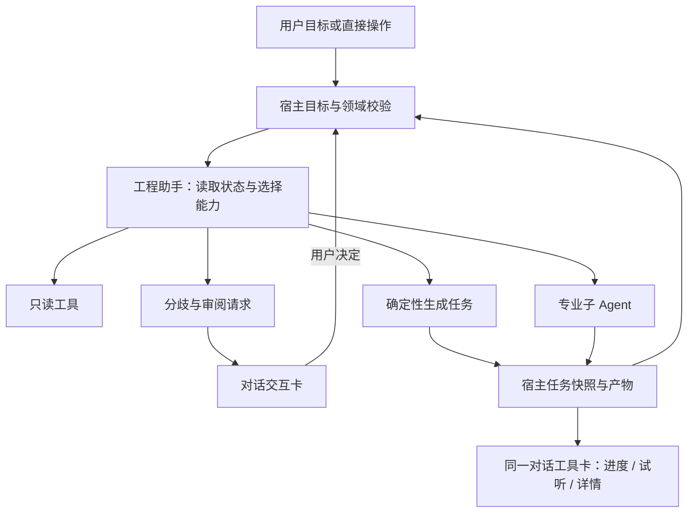

# Design

## Context

日期：2026-11-10。方案待实施，动机和交付范围见 [proposal.md](proposal.md)。同日用户调整优先级：先整章生成及单章基础闭环，再实施本方案。下述交互机制是后续设计，不是章节音频前置；原“短试听切片优先”已被[方向决定](../../../docs/knowledge/decisions/chapter-generation-first.md)替代。当前代码证据：

- `ai/tasks.rs` 以冻结输入执行分析、分章、选角；一个 run 只受理一种专业任务，受理后由宿主交接，不能直接改成主模型循环并行启动任意任务。
- `ai/messages.rs` 已保存文本、工具事实和业务引用；`SessionMessages` 主要显示轨迹与结果跳转。业务当前状态本就独立于历史工具输出。
- `voices/studio.rs` 使用内存 `Tasks`，`StudioJob` 有序号和阶段；`use-voice-studio.ts` 合并事件。已有设计/试声、候选、受控媒体和共享播放器，但未保存候选不承诺跨重启恢复。
- `start_voice_job` 已校验短文本 1..500 字及元数据，不是章节合成入口。制作结果仍为占位状态。
- `character-voice-binding` 的撤回/忽略缺口由活动角色中心变更跟踪，不因增加卡片获得现成语义。

## Goals / Non-Goals

**Goals:**

- 面向用户只有一个制作助手；把分歧、任务进度、可试听结果放到当前对话，正文及资源直接操作保留。
- 稳定定义工具契约、交互状态和跨步骤推进，让用户决定、领域提交和生成产物可恢复、可追溯。
- 本方案实施时复用已经落地的章节任务及产物，再接状态、审阅、分析/选角、设计和短试听卡片；设计结果可显式入库/绑定。

**Non-Goals:**

- 本变更不重新实现章节音频域的合成单元、候选采用或拼接导出；通过已有用例及任务引用接入。整书批量和情绪规划仍后置，尚未交付的能力显式阻塞。
- 不建设通用插件平台、任意 UI/代码执行器、第二套任务队列或多个面向用户的 Agent。

## Decisions

### 1. 工具化业务能力，按执行性质分工

| 能力种类 | 首批建议工具/操作名 | 执行方及结果 |
| --- | --- | --- |
| 状态查询 | `read_production_state`、现有目录/正文/归属查询 | 宿主只读，返回有界状态、缺失前置与引用 |
| 用户交互 | `request_decision`、`open_review` | 宿主创建交互或定位引用；前端渲染已注册卡片并采集输入 |
| 领域提交 | `submit_decision`（用户动作 IPC）、已有采用/绑定用例 | 宿主核对用户选择、修订及目标后提交；不作为助手任意采用工具 |
| 确定性耗时任务 | `generate_chapter_audio`、`generate_voice_preview`、`design_voice` | 复用已交付章节/短试听用例，宿主受理并返回任务引用，沿既有引擎线程执行，不需要子 Agent |
| 专业模型任务 | 现有 `check_splitting`、`analyze_chapter`、`cast_voices` | 独立上下文/工具集，领域校验及发布保持原职责 |
| 本地展示动作 | 播放/暂停、展开生成信息、定位原文 | 前端通过受控媒体与导航 API 执行，不增加模型回合 |

这些名称是实施建议，语义以规格为准。工具 Schema 从宿主 DTO 生成，前端卡片是按类型注册的受控组件；模型不能下发 JSX、HTML、脚本、文件路径或任意命令。新增工具需对应具体用例，不把每个 IPC 机械暴露给模型。复用现有库，首期不引入新 Agent 框架。

考虑过把所有动作做成子 Agent，但下载、生成、播放和提交不需要模型推理；额外调用会增加耗时和不确定性。能力可组合来自统一用例和类型化引用，不来自 Agent 数量。

### 2. 制作目标跨步骤，run 保持单项执行

新增宿主目标记录与步骤记录，关联工程、固定章节/来源、用户要求、授权范围、当前步骤、阻塞、依赖修订、执行尝试及产物。步骤由已注册能力组成，状态为待执行/运行/待决定/阻塞/完成/取消；计划摘要可解释，不保存或显示模型内部思维链。

每一步仍使用现有 `jobs`、运行租约和单专业任务准入。领域任务完成后，目标推进器读取真实结果与最新依赖，确定下一步；需要模型判断时创建关联同一目标的新 run，只注入有界目标与已完成事实。一个目标同一时刻最多推进一个步骤；`(goal_id, step_id, attempt)` 与领域回执协调去重。不在原单任务 run 内偷偷追加第二个专业任务，也不重走已受理委派。

明确目标授权覆盖其必要且已说明的分析/选角/短试听步骤，无需每步询问。人工候选采用、归属分歧、超出授权的资源准备和配置变化仍通过既有业务规则交互。若用户只要求短试听，不能自动升级为整章或整书生成。无进展、同一阻塞反复出现或无法继续时停止推进并给出原因，不循环改写计划。

普通讨论不创建可执行目标。完成后的新动作、新选择或重试新建可追溯尝试；切章不改变目标。新目标与当前目标冲突时呈现继续/取消后切换的明确选择，不并发改写同一制作状态。

### 3. 用户交互是持久化业务对象

交互记录包含 `interaction_id`、工程/目标/步骤/消息引用、固定章与范围、问题类型、有效选项、证据、期望领域修订、状态及用户回执。状态为 `pending / answered / dismissed / stale / cancelled`。无选项默认提交；“稍后处理”不等于选择推荐项，也不等于已实现选角忽略。

`request_decision` 成功时工具调用以 `interaction_required` 和业务引用正常结束，该目标转为待决定，释放 Worker、模型租约和数据库锁。恢复模型历史使用合法的调用/结果配对；不维持跨用户等待的悬空供应商工具调用。用户提交由宿主校验后形成类型化用户决定事实，必要时新 run 继续目标，不由客户端拼造工具结果。

提交校验问题状态、目标归属、候选及来源依赖，用命令回执和条件更新保证双击/多窗口只生效一次。正文范围、绑定或候选已变化时标为 stale 并重新展示差异；不得把用户对旧内容的确认套用到新内容。仅无关修订变化时可通过领域依赖校验，不强迫重新确认整本书。

没有对应显式命令的“撤回”不渲染成可用按钮；补齐角色中心 6.1/6.2 后，卡片和角色中心共用该用例，包含后续人工修改保护。

### 4. 工具卡引用真实任务，不把流式文本当进度

卡片稳定引用工具调用、目标步骤、持久化任务和产物 ID。历史的“受理成功”保持原事实，卡片另查任务当前状态，显示“已受理、排队、加载模型、生成、写入、完成”等实际阶段；没有总量就显示阶段和耗时，不编造百分比。更新在原卡片内合并，不为每次进度追加消息。

优先复用先行章节音频域建立的任务/产物持久记录，不为助手创建第二套生成作业。对于仍仅有 Studio 内存状态的设计/短试听，补充最小持久化适配并复用其校验与执行核心。将语义请求、实际配置、状态、阶段、产物引用、用户授权及失败/取消事实落到 SQLite；音频发布为完整文件后才提交可播放引用。既有内存任务序号作为进程事件序号，不充当跨重启身份。首批助手任务产物提升为可恢复的宿主管理产物；既有无关联临时候选的恢复承诺保持原范围。

事件是提示，快照是权威；重连按序号补齐或刷新，旧事件不能覆盖新终态。重启将没有完成发布的执行显示中断，用户显式重试产生新尝试；不承诺恢复引擎内部在途推理、不自动再次收费生成。生成结果与消息引用之间使用同数据库事务；文件与数据库用完整文件发布和可核验清单衔接，检测孤立或缺失文件，不假设跨存储原子事务。

### 5. 卡片内试听与详情，直接操作不经模型

完成卡默认只呈现目标、结果、播放和下一步。展开详情再看实际文本/来源范围、音色、后端/模型、设备、有效配置、时间、采样率、声道、时长、尝试历史及真实用量；缺失值显示未知，本地 TTS 不伪造 token 或货币成本。复用共享播放器及播放租约，多个卡片不同时发声；播放/暂停和打开详情不重新生成。

音色设计产物提供保存、绑定和查看音色入口；短文本试听产物只表示该文本的音频，不出现“整章已完成”。采用、入库、绑定各有独立状态和命令。产物缺失/已清理时卡片保留生成事实，禁用播放并解释；重新生成是显式新尝试。公开卡片不暴露凭据、原始供应商错误或内部磁盘路径。

### 6. 以渐进展示降低界面复杂度

章节工作台默认突出正文、当前制作目标及一个主要下一步；助手可收起为状态条，待决定时显示数量和可展开入口，不强制弹窗或抢焦点。用户展开对话查看交互卡，正文证据可定位；大型差异比较保留检查器并返回原会话。角色/音色/模型入口继续可发现，不要求用户通过对话才能访问。

三种关键卡片：

| 卡片 | 默认信息 | 直接操作 |
| --- | --- | --- |
| 归属分歧 | 原文引用、候选角色、待决定原因 | 选角色、保留未知、定位、稍后 |
| 生成中 | 目标文本、真实阶段、已用时间 | 取消、展开信息 |
| 已生成 | 音频时长、目标/音色、结果状态 | 播放、生成信息；设计产物另有入库/绑定 |

不把每个只读工具调用都变成大卡片，过程轨迹默认折叠。桌面宽窗口正文与助手并排；1024×680 时按需展开助手/检查器，避免正文、角色列表、详情、对话四栏同时争宽。保持中英、亮暗、键盘操作和滚动位置。

## Risks / Trade-offs

- [目标推进导致反复询问或无限调用] → 宿主记录已授权范围和已回答问题，按依赖变化复核；无进展停止，不为总结增加固定模型回合。
- [聊天卡与角色中心出现两套写入规则] → 只暴露同一领域命令，卡片提交携带用户回执；UI 不拥有采用权限。
- [Studio 现有内存任务被误当成可靠作业] → 首先补齐稳定身份、持久记录和文件发布恢复，再接对话卡；不把前端事件缓存当证据。
- [序列化步骤降低吞吐] → 首期以单章正确性和人工保护优先；整书并发另立规格，不放宽单 run 一专业任务守卫。
- [工具过多导致模型选择混乱] → 按阶段提供最小能力集合，复用业务契约；确定性下一步由宿主直接推进。
- [工具卡开发推迟真实音频交付] → 先按独立章节音频规格完成生成/播放与单章基础闭环，再接本方案；工具卡验证实际章节任务，短试听只补充回归。

## Migration Plan

1. 先核对已交付章节音频契约与任务/产物记录，复用其稳定身份及发布恢复语义；再增量增加目标、步骤、交互及必要的 Studio 关联适配；对现有 SQLite 做增量迁移，保留旧会话和工程。旧历史没有交互引用就按原记录只读展示，不伪造关联或重新执行。
2. 拆出可供 IPC 与助手复用的 Studio 用例，保持引擎专用线程和受控媒体；先验证持久化与崩溃边界。
3. 接类型化工具与交互回执，再接卡片和目标推进；没有实现的能力显示为阻塞，不登记可用工具。
4. 完成真实切片验收后删除被替代的重复入口编排，保留稳定页面导航。回退时暂停新目标推进并保留新表与产物，不降级写入或删除用户数据。
