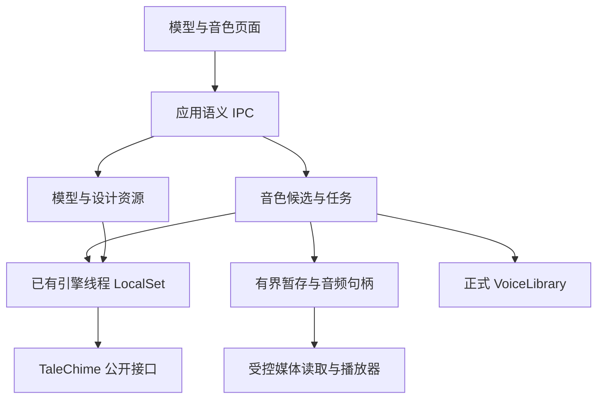

# Design

## Context

动机见 proposal.md。当前 `engine/catalog.rs` 从 Registry 合成目录映射应用 DTO，`text_design` 固定为 false；宿主仅启用 `moss-nano-candle` 与 `kokoro`。`engine/resources.rs` 已建立专用线程、LocalSet、下载任务和频道请求。`voices` 域使用应用数据目录 `voices-v2/`，独立完成批量搬运，不需要 Registry。音色创建页已有草稿和本地 WAV 预览，但正式资产重命名、删除、真实预置目录和合成试听没有接线。

TaleChime 的设计目录已包含四类适配；Qwen 的 Design17 明确不在合成 Registry 中，MOSS 专用设计要求可用 GPU。`VoiceStudio::design_with_channel` 会准备资源并在生成后直接 `library.create`，不能直接实现先听后存。`Engine::prepare` 当前自行新建 Registry，不能假定自动继承宿主镜像配置。已有设计测试可注入引擎，合成测试可注入后端，适合无权重的生命周期验证。

本设计跨模块且涉及依赖 API、暂存和任务退出，满足创建 design.md 的条件。既有资源与传输变更仍拥有自身验收记录；本变更只扩展能力，不代勾历史任务。

## Goals / Non-Goals

**Goals:** 保持模型无关音色资产、线程受限引擎和应用 IPC 的边界；生成候选、可播放结果和正式资产各有明确发布点；用户可在持续推理时浏览、比较和修改草稿。

**Non-Goals:** 不创建通用工作流引擎、公共插件协议或新服务；不把一次短试听变为章节候选系统；不引入 ASR、麦克风采集或旧包迁移；不承诺所有设备组合真实可用。

## Decisions

### D1：完整编译覆盖与本机能力分开

在宿主 manifest 中显式启用七类后端的 CPU 能力，以及 macOS 目标的 Metal feature；不得全平台无条件打开 Metal/CUDA。重复保留 TaleChime candle fork patch。MOSS nano、MOSS 其他已实现合成变体、Qwen 固定/克隆、VoxCPM 量化/原精度等变体均从 Registry 枚举，不在 UI 写第二份型号列表。仅设计资源来自 designers 目录。

应用目录增加 compiled devices、available devices、不可用原因以及资源准备类别；资源就绪不等于设备可用。Kokoro、IndexTTS、CosyVoice3 等转换型入口展示基础库实际要求和诊断，在未有完整转换产物时阻止加载。本轮提供明确准备指引和重盘点，不新增任意外部命令执行器。

备选方案是开启所有 feature 后隐藏失败条目，会掩盖设备与转换问题，因此不采用。macOS 为首轮实测目标；Windows/Linux 保持条件编译边界，CUDA 不进入本轮通过声明。

### D2：设计资源与合成资源共用配置及下载执行

设计目录单独提供应用级 `DesignEngineEntry`，包含稳定身份、限制、设备、缺失字节及复用关系。扩展资源请求为明确的合成目标或设计目标，沿用现有下载前确认、共享缓存、镜像、凭据、进度和持久化下载记录；按用户“不考虑兼容性”的新要求，使用类型化 ResourceKey 和独立 `resource-downloads.json` v2；旧日志原样保留，不读取或迁移，已有权重仍按真实盘点复用。新日志验证重启暂停与缓存作用域。

TaleChime 需要公开设计资源状态/准备入口，以及接受调用方 Registry/DownloadConfig 的 Engine 装配入口（最终命名由依赖项目确定）。正常推理只消费已确认准备的资源；资源在执行前消失则报告需要重新准备，不由 `design`/`Engine::prepare` 偷跑未确认下载。下载和设计共同依赖的资源须按规范化资源身份协调，不能两个任务竞争发布。

备选方案是在每个创建调用中使用默认 Registry，会绕过镜像和下载确认，因此不采用。基础库新增接口先在 TaleChime 工程交付；本变更产物不授权跨仓写入。

### D3：基础库生成候选，宿主管理确认保存

扩展 VoiceStudio，提供不写正式库的设计结果：经输入校验后返回 WAV、准确朗读文字、描述和实际来源引擎；现有直接设计入库 API 可组合新路径，保持现有调用语义。候选结构封装在基础库，不将 backend 私有结构导出到 bindings。取消必须等待底层设计线程退出，不能只 drop 外层 future 就宣告模型已释放。

宿主 `voices` 的具名私有模块分别拥有候选存储、任务与音频句柄；推理通过已有 engine 线程通信，不把 Rc 放入 Mutex 或 blocking 池。参考文件由原生选择器打开并立即受限校验/冻结，复用库的 WAV 与元数据校验，不信任前端 RIFF 头检查。

候选存于应用缓存的专用目录，与正式 `voices-v2` 和可切换模型缓存分离。默认最多 8 个候选、单 WAV 25 MiB、总暂存音频 200 MiB；达到预算时拒绝新生成并提示清理，不能自动删除仍被选中的旧候选。设计任务与合成试听输入文字首版全局上限 500 字，另取引擎限制的更小值；描述、名称、转写继续受当前资产格式和引擎限制约束。

每个候选拥有宿主身份、冻结元数据、内容摘要和预分配正式 VoiceId；状态为可用、保存中、已保存、已放弃。保存复用 VoiceLibrary 原子创建，并在同候选重复调用时返回已有 VoiceId；发布后响应丢失也要按预分配身份和内容核对实际结果。失败保留候选。保存候选不复制成第二份候选，用户可继续预览正式资产。原格式不改变，来源继续使用 Imported 或 Designed(engine-id)。

备选方案是在正式库生成后再删除不满意结果，会使未确认声音进入导出与资产观察，因此不采用。

### D4：一种任务生命周期，两类音频身份

应用语义任务区分设计与合成试听，状态为 queued、running、cancelling、cancelled、failed、succeeded；阶段包括校验、资源检查、加载、生成、写入。首版同一时刻仅允许一个推理任务，排队上限 4，下载继续受自身资源协调约束；资源切换或缓存目录变更在相关活动任务存在时返回忙状态。请求携带会话内幂等键，事件带任务 ID 与递增序号，重连返回快照与有界终态记录（最多 32 条，不淘汰仍关联候选的结果）。

同一引擎线程创建、使用、关闭 Engine/VoiceStudio，复用宿主运行时；任务等待底层退出再释放推理槽。合成可用 `synthesize_pcm_with_options` 收集短音频，硬限制为 30 秒及 16 MiB，超过限制取消并丢弃新结果。首版生成结束后播放完整 WAV，暂不实现边生成边播，减少流式回压与媒体状态复杂度；旧完整结果在新任务失败时保留。

声音选择使用两个互斥身份：模型预置声音（backend/model/voice-id）与库资产（VoiceId）。未保存候选若要换模型试听，使用冻结参考的临时适配路径，不先写正式库；必要的模型缓存可再生，不能改变正式资产。兼容性以能力初筛加实际参考校验表达，失败不替换预置声音兜底。

### D5：受控本地媒体与清理

音频发布先写私有暂存、校验 WAV 后原子完成，再生成不透明 AudioId。使用限定音频命名空间的本地协议/资源处理器，处理 Range、MIME 和读取租约；前端仅得到媒体 URL 与元数据，不接收路径或 WAV JSON，不开放整个应用目录。未知、释放或越界身份拒绝读取。

播放器首版复用 HTMLAudioElement，提供播放、暂停、停止和 seek；一个中心播放器控制当前音源，切换停止旧播放。引用计数/租约保护播放中的文件；释放候选先停止/释放媒体，再删除无租约暂存。页面草稿属于瞬态 UI，任务和媒体目录属于宿主。应用重启不自动续跑推理；候选不承诺跨重启恢复，启动仅清理自己命名空间内的遗留暂存，不扫描用户文件或模型目录。

备选方案是通用文件路径加宽权限或 base64 传 WAV，会扩大文件访问面并增加内存复制，因此不采用。

### D6：真实管理与传输并发

重命名直接调用无模型 VoiceLibrary；保留 VoiceId、参考与转写，刷新列表并由新导出获取新名称。已冻结导出继续使用开始时快照。宿主统一登记资产读取/写入占用，删除遇到活动试听、播放、保存或传输占用时返回 Busy；导入预览也作为占用登记，直至释放或提交结束。删除需要 UI 显式确认，使用库原有原子删除语义；不新增工程引用统计的假数据。

预置声音从 Registry 真实目录读取，删除现有示例预置来源；我的音色继续使用真实库。创建页改为先选方法，再分别选择设计引擎或录音，不强制为参考录音选一个模型。详情分开显示“原始参考”和“模型试听”，合成结果显示实际模型和设备；模型详细诊断按需展开。

## Risks / Trade-offs

- [完整 feature 增加编译体积和系统依赖] → 按目标条件编译，记录构建体积与原生依赖，不能以裁掉某个后端并声称完整覆盖收尾。
- [MOSS 等 GPU 路径出现数值错误或设备不支持] → 提供类型化失败、逐组合真实烟测和失败记录；目录存在不等于推理验收通过。
- [共享资源准备绕过镜像或隐式下载] → 所有准备使用显式配置，测试设计与合成两条调用链，无权重测试使用本地假端点。
- [原生线程无法即时中断] → 显示取消中并等待资源释放，不提前启动下一项；退出应用遵循活动任务提示。
- [暂存预算与监听大音频导致压力] → 短输入、PCM/WAV 双上限、租约和有限任务记录；首版只播放完整短音频。
- [跨仓接口未交付] → 先在依赖项目交付公开契约和测试，再消费已验证源码；仅完成宿主 mock 不计真实集成完成。

## Migration Plan

1. 在 TaleChime 自身范围交付无提交设计结果、设计资源管理、显式配置合成与未保存参考适配的依赖契约及测试。
2. CastGlean 扩展完整编译目录和设计资源，接入候选/任务/音频，再接前端与真实管理入口；保留原有传输测试。
3. 正式音色与包沿用 v2，不迁移或删除旧资产。新增短期任务和候选不进入工程格式；必要的下载任务版本演进独立验证。
4. 完成无权重自动验证和 macOS 真实矩阵，记录每个模型/设备/设计引擎的通过或阻塞。旧 B1 三项验收仍在原变更单独结项。
5. 回退源码时保留正式资产和权重，仅清理本功能无活动租约的暂存；不自动降级重写数据，不发布库或应用版本。
