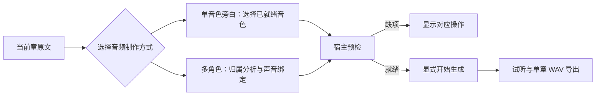

# Design

## Context

目前 `chapter_audio_check` 与 `chapter_audio_start` 共用宿主计划器。计划器读取真实章范围和来源文本，随后要求存在有效分析版本再装配角色、音色和合成单元。运行投影、续跑判断及停顿有效性都依赖该分析版本；状态查询目前只取本章最近任务。前端已有 `ChapterAudioBar`、`ChapterAudioTrack`、`ChapterPlaybackBar` 与应用级 `ChapterPlaybackProvider`。最后一项已经让播放会话跨章和跨页，适合用作唯一播放状态来源。

## Goals / Non-Goals

- 明确制作方式、生成预检、续跑身份和本章播放的可验证边界。
- 在现有章节路由内完成改造，以 FigCraft 确认稿为界面依据。整书管理和音频候选编辑另行设计。
- 两条生产路径继续使用当前已支持的预置音色和宿主合成执行能力。TTS 引擎调度、支持的模型组合与授权边界沿用现有实现。

## Decisions

### 宿主接收明确的制作方式

用带类型的制作方式描述两种输入。单音色旁白带用户选择的合格预置音色；多角色由宿主读取本章采用的分析版本及实际绑定。音色可从现有选择器选取，工程旁白绑定可作为显式可选项。本章旁白选择作为工作台草稿，提交后按任务冻结，不随工程绑定更新。选择方式或音色只刷新就绪状态，执行由独立动作发起。切章、切模式及重开的预检请求按目标隔离，晚到响应不能覆盖当前视图。

单音色旁白从本章受校验的不可变 UTF-8 来源范围构建覆盖单元，沿用现有分割和后端文本规则。使用稳定的来源映射以支持正文跟读、失败定位与停顿，保留空白单元标记。多角色继续对采用的分析验证来源、完整覆盖及有效角色，再从绑定构建同一类执行计划。宿主在启动时重新核对条件，预检或用户界面的状态不能替代启动校验。共用顺序执行、写入、媒体协议和失败码。

### 当前章的制作操作与弹窗

底栏固定一个当前章制作主操作，由方式、宿主预检与本章任务状态决定。单旁白可直接选声，多角色可直接发起本章分析。其他章和助手的任务提供独立的状态和返回入口。生成条件分组显示在居中的弹窗内，音色确认留在清单内并触发重新检查。定位或修正归属时关闭弹窗并回到对应原文，底栏保留重开入口。条件满足后仍由用户发起生成。底栏耳机按钮打开本章音频设置弹窗。右侧只在助手与片段属性间切换，普通选段保留已打开的助手，显式编辑或定位修正进入属性。

### 任务和编排按制作方式读取

任务数据明确存储方式。多角色冻结原有分析身份；旁白的分析关联为空，冻结章字节范围、来源、实际音色、模型和文本语义。以工程、章节和方式查询最近任务及适用的完整产物，沿用 run id 读取媒体、断点、停顿和导出。一个方式启动失败或生成新结果不会覆盖另一方式的数据。结果可用性以实际媒体为准；新的任务有缺口时，选择试听完整旧产物应有明确来源和身份提示。历史产物管理保持在单章范围内。

继续操作应指向原任务并核对冻结计划，输入改变时由明确的重新生成动作建立新任务。现有全局活动任务互斥保留。旁白的当前有效性以该来源与章范围及冻结计划判断，之后取得分析不会作废既有旁白。如果切换为不同音色的生成草稿，与旧结果采用的音色分别展示。多角色继续执行已有来源、分析版本与当前角色绑定保护。导出仍走已验证的完整性与编排修订约束。

### 保留一个播放器和一个可见工具栏

播放栏固定在真实章节工作台的正文和右侧面板下方，目录独立延伸到底。正文与助手对话各自滚动，助手输入框在播放栏上方保留完整空间。没有音频时显示可执行的下一步；片段轨道默认收起，由用户展开。使用共享播放会话，工作台内有完整的播放工具栏，离开章节制作后已有播放由应用外壳的紧凑播放控件承接。同一章情况直接复用会话；跨章节时显示播放目标并提供返回位置。切换当前章的制作方式只改变这章的生成、轨道和导出投影，旧播放会话继续使用已冻结来源。避免对后台播放章的控制被误用为当前章的导出。

完成态左侧显示时间，沿正文中线排列章首、上一片段、播放／暂停、下一片段、章末，右边是带提示和无障碍名称的单章导出、轨道收放。生成与失败共用底栏的状态和就近操作。展开使用现有轨道虚拟化、真实波形缓存和双向正文映射，胶囊不改变单元的时间、范围和完成状态。折叠时暂停轨道渲染和滚动副作用，保留用户视图状态及播放位置。手动滚动后保留浏览位置，正文定位仍可滚到对应片段。拖动或展开不能把阅读锚点移到其他正文位置。

2026-11-19 层级调整：模型入口随分析操作展示，播放底栏仅显示当前可区分的目标身份，片段次要动作使用带提示的图标。成功导出在导出图标处短暂确认，失败仍保留就近提示。[项目视觉层级规则](../../../docs/knowledge/decisions/workbench-visual-hierarchy.md)

2026-11-20 底栏调整：常驻播放栏左侧承载生成状态。进度环内留空，旁边单行显示阶段和已完成计数。同位置换成继续、重试或需要时生成新版本。轨道使用固定紧凑高度，以时间刻度、底色和胶囊状态区分层级，计时范围只覆盖连续的已知时长。直接点胶囊定位，双击或 Shift+Enter 从此处播放。停顿从片段边界编辑，撤销放在停顿编辑器内。

胶囊按可用宽度自动布局，短章在最小点击宽度允许时适配窗口，长章用紧凑密度并在轨道内横向滚动。生成过程中沿用固定占位尺寸，待整章就绪后重新布局并保留浏览锚点。等比轨道用秒刻度，非等比轨道仅标注已知的片段起点。显示宽度不参与播放、编排或导出计算。

### 组件选型

本地已有 shadcn Base UI 的 `RadioGroup`、`Collapsible`、`Button`、`Tooltip`、`Progress`、`Slider` 和 `Separator`。制作方式用互斥单选，选声沿用现有 `Combobox` 和音色选择面板。右侧图标组用现有 `Button` 与 `Tooltip` 组合，轨道折叠复用 `Collapsible` 的展开语义和隐藏内容焦点管理。视觉继续用 Base Nova 与 Neutral 的语义变量，参照 FigCraft 排布；播放或失败指示同时有文字或状态语义。

对照 shadcn 官方 [Radio Group](https://ui.shadcn.com/docs/components/base/radio-group) 与 [Toggle Group](https://ui.shadcn.com/docs/components/base/toggle-group)，现有单选组适合始终选择一种请求模式。Toggle Group 可以表示可开关的命令状态，本变更无需增装。媒体时间映射、虚拟片段、真实波形和停顿拖动是领域行为，继续使用工作台现有实现。实施若发现确实缺失通用组件，先比对本地组件和官方 Base UI 目录，再记录选择和需要保留的键盘行为。

## Risks / Trade-offs

- **两个方式之间串用回复、产物或续跑状态**。查询和异步响应按工程、章和方式筛选，媒体按 run id 绑定；两条路径使用同一来源但独立的计划身份。
- **折叠导致暂停、正文跳位或丢停顿草稿**。播放归共享会话，收放仅改变轨道呈现。进入收放动作前沿用停顿草稿保护，根据源字节和轨道单元保持浏览锚点。
- **窄窗播放时横向溢出**。工具栏在支持的最小尺寸容纳必要操作，轨道自身滚动；验收包括 1024×680 下由宽变窄及活动播放时的布局。
- **分支功能重叠**。旧变更的生成、停顿、导出和平台验证继续按其契约核对，档案同步先归入基线要求，再应用本变更的两条新路径和常驻工具栏约束。

## Migration Plan

数据库接受空库与当前结构。任一任务必须有来源身份，多角色记录分析版本；旁白的分析关联为空。旧库原样保留，宿主拒绝打开版本不匹配的库。

### 正文归属标记与就近操作

已分析和未分析正文沿用原文行与同一排版。有效归属作为原文范围的装饰层，阅读时只显示待确认标记。显示角色标记时在角色切换处用稳定色点和可读的名称标识。片段浮条悬停或聚焦出现，点击可固定，支持 Esc 关闭；片段试听、编辑和待确认修正沿用原工作台行为。用户选中文本时，选区浮条接管引用及基于选区首行的结构入口。行号菜单提供同一行的分章或合并确认，章节标题菜单保留章节和工程级操作。标记、正文和播放装饰分别表达，复制、虚拟化锚点和宿主坐标沿用原文数据。
