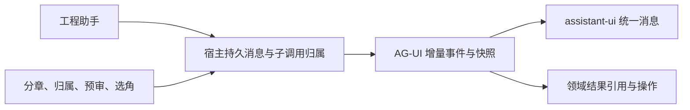

## Context

宿主已持久化 AG-UI 消息身份、父工具及子调用归属。分章已有流式执行，归属与选角的执行器当前丢弃可见文本。

## Decisions

- 使用现有 Rig 流式路径输出可展示的文本及思考，复用 AG-UI 的消息与子调用归属。模型多输出文本时，领域任务仍按原有完成校验退出。
- 子任务文字使用普通回复的正文排版和专业角色名称。调用参数和工具输出可展开，结果引用和领域操作继续由宿主数据驱动。
- 主辅消息共享行内思考状态。活动时显示圆点和已观测时间，提供实际收到的摘要。无摘要时展示可观测阶段。
- 快捷入口和委派入口共用渲染，完成回执在当前子调用中只显示一次。派发、取消、审批和续跑继续依赖宿主记录。

## 组件来源

行内运行状态取自 assistant-ui Base Nova 的 `elements-thinking-indicator` 和其使用的共享样式。主助手与子任务使用同一 `ThreadAssistantMessage`，委派消息来自 AG-UI 的工具嵌套，快捷任务与预审按持久调用归属投影到 assistant-ui 的 `ReadonlyThreadProvider`。

